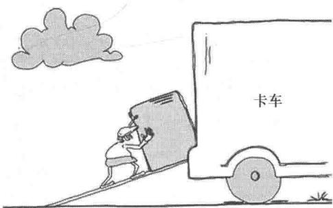
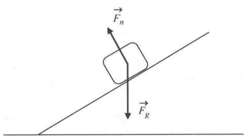
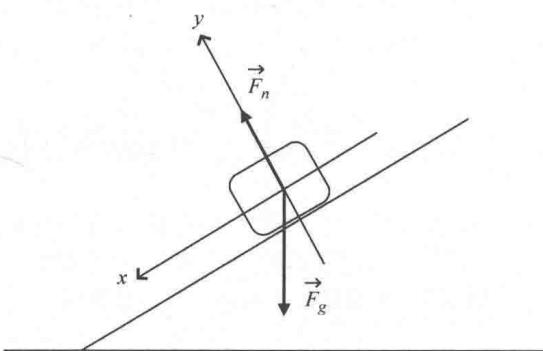
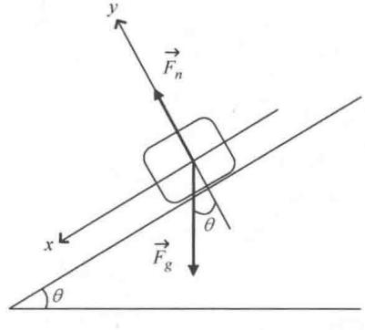
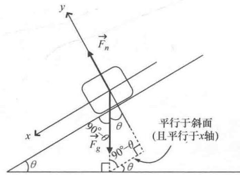
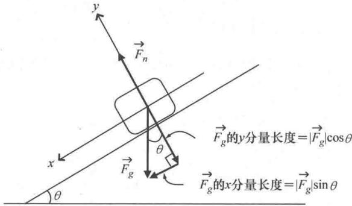
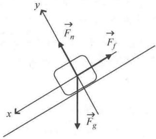

import Guide from '@/components/Guide.astro';
import Knowledge from '@/components/Knowledge.astro';
import Example from '@/components/Example.astro';
import Analysis from '@/components/Analysis.astro';
import Solution from '@/components/Solution.astro';
import Variant from '@/components/Variant.astro';
import Note from '@/components/Note.astro';
import Block from '@/components/Block.astro';
import Method from '@/components/Method.astro';
import Exercise from '@/components/Exercise.astro';

## 3.1 斜面上的物体

如图 3.1 所示，女送货员正在将一个很重的箱子沿斜面推到她的货运卡车上。显然有多个力作用在这个箱子上，因此要想确定箱子如何移动，就要知道如何处理矢量。具体来说，要解决这类问题首先用矢量加法求出作用在箱子上的合力，然后运用牛顿第二定律通过合力求出箱子移动的加速度。

  
图 3.1 货运卡车问题

为什么可以这么做？想象送货员从斜面一边离开，只留下箱子在重力的作用下从斜面上自由滑落。首先假设斜面足够光滑，箱子和斜面表面的摩擦力可以忽略不计（因此摩擦系数实际上等于零）。箱子滑到斜面底部时移动的速度有多快？这个速度取决于什么？后者可能是我们更关注的。

遇到这类问题时，首先要画图并且把作用在箱子上的力画出来。"受力分析图"可以帮助我们确定作用在物体上的合力，这样运用牛顿第二定律（ $\vec{a} = \sum \vec{F / m}$ ）很容易就可以求出物体的加速度。只要知道加速度，速度就很容易求了。图3.2就是这种情况下（无摩擦）的受力分析图。

  
图 3.2 光滑斜面上物体的受力分析图

该问题中女送货员已经离开并且也没有摩擦力，则作用在箱子上的力只剩下重力 $\vec{F}_g$ 和斜面的正压力 $\vec{F}_n$ 。其中，重力方向竖直向下，正压力垂直（"正交"）于斜面。这些力的产生很容易理解。地球的质量产生了重力；箱子放在斜面上产生压力作用，同时斜面对箱子就会产生反作用力，也就是正压力（如果没有斜面对箱子斜向上的支撑作用，箱子就会在重力的作用下直接掉下来）。

这两个力会如图3.3所示一样作用在箱子里的某个点上吗？显然不是，因为箱子的每个质点都会被重力向下牵引，并且箱子整个底面都受到斜面对箱子的作用力。但是要求箱子的加速度，不必考虑力的实际作用点，而是把箱子看作某个位置上的质点就可以了。并不是所有的问题都可以这样处理，例如涉及扭矩和角加速度，力的作用点就非常关键。但是本例中箱子沿斜面滑动向下，而不是滚动向下，因此完全可以把这个箱子看作一个质点，受力分析图中认为所有的力作用在同一个点，这样力的方向也不容易画错，如图3.2所示。根据质心（CM）的概念可以将质量为 $m$ 的刚体看作一个点并且有 $\vec{a}_{CM} = \vec{F}_{CM} / m$ ，这也说明了这样做的合理性。

  
图 3.3 建立坐标系的受力分析图

要想运用矢量加法求出作用在箱子上力的合力，首先要在受力分析图上建立坐标系，画出坐标轴，如图3.3所示．理论上坐标轴的方向可以任意选取，但是本例中讨论的物体落在斜面上，不妨选择 $x$ 轴方向平行于斜面向下， $y$ 轴方向垂直于斜面向上，这样选取坐标轴方向会带来极大的便利．因为正压力完全沿着 $y$ 的正半轴，物体沿斜面向下的移动完全沿着 $x$ 的正半轴（只要箱子仍然在斜面上）．但是重力 $\vec{F}_g$ 方向竖直向下，既不与斜向下的平面一致（ $x$ 轴方向），也不与垂直于平面轴（ $y$ 轴）的方向一致，因此要运用一些几何方法找出重

力的 x 分量和 y 分量. ①

要想求出重力 $\vec{F}_g$ 的 $x$ 分量 $\vec{F}_{g,x}$ 和 $y$ 分量 $\vec{F}_{g,y}$ ，关键是要先求出斜面与水平面的夹角 $\theta$ ，并且这个夹角和 $\vec{F}_g$ 与 $y$ 轴负方向的夹角相等，如图3.4a所示。

  
a)

  
b)  
图3.4 $\vec{F}_{g}$ 角度的几何分解

如果不能理解图 3.4a 中给出的两个角 $\theta$ 为什么相等，参考图 3.4b. 将图中两个三角形补充完整，如图 3.4b 所示，就很容易看出 $\vec{F}_{g}$ 与 y 轴负方向的夹角确实为 $\theta$ （本例中如果 $\theta = 0^{\circ}$ 或 $\theta = 90^{\circ}$ 结果同样成立）.

知道 $\vec{F}_g$ 与 $y$ 轴负方向的夹角为 $\theta$ ，就能直接求出重力矢量 $\vec{F}_g$ 的 $x$ 分量 $\vec{F}_{g,x}$ 和 $y$ 分量 $\vec{F}_{g,y}$ 。如图3.5所示， $\vec{F}_g$ 的分量为

$$
\begin{array}{l} \overrightarrow {F} _ {g, x} = | \overrightarrow {F} _ {g} | \sin \theta (\hat {i}), \\ \overrightarrow {F} _ {g, y} = | \overrightarrow {F} _ {g} | \cos \theta (- \hat {j}). \end{array}\tag{3.1}
$$

其中， $\hat{j}$ 前面的负号说明这个分量指向 y 轴负方向.

  
图3.5 $\vec{F}_{g}$ 的 $x$ 分量和 $y$ 分量

如第1章所述，式3.1通常记为

$$
\begin{array}{c}{{F _ {g, x} = | \stackrel {\rightarrow} {F} _ {g} | \sin \theta ,}}\\{{F _ {g, y} = - | \stackrel {\rightarrow} {F} _ {g} | \cos \theta .}}\end{array}\tag{3.2}
$$

即，写成标量的形式，而不是矢量。这是因为由矢量分量的下标就可以知道矢量分量的方向： $x$ 分量的方向就是 $\hat{i}$ 的方向（如果 $x$ 分量为负，则为 $-\hat{i}$ 的方向）， $y$ 分量的方向就是 $\hat{j}$ 的方向（如果 $y$ 分量为负，则为 $-\hat{j}$ 的方向）。所以矢量的分量既可以写成标量也可以写成矢量，但是每个分量都指向一个特定的方向，即使 $x$ 分量和 $y$ 分量用标量表示也不能简单地把它们用代数方法相加，而是作为矢量相加。

无论分量是用矢量表示还是标量表示，知道了 $F_{g}$ 的x分量和y分量以及作用在箱子底面的正压力沿y的正半轴，接下来要做的就是利用矢量加法求出作用在箱子上的合力。x方向合力的大小是：

$$
\left| \sum \vec {F} _ {x} \right| = | \vec {F} _ {g} | \sin \theta ,\tag{3.3}
$$

并且 $y$ 方向合力的大小是：

$$
\left| \sum \vec {F} _ {y} \right| = (\mid \vec {F} _ {n} \mid - \mid \vec {F} _ {g} \mid \cos \theta),\tag{3.4}
$$

也可以换一种表示方法，将合力 $x$ 分量和 $y$ 分量这两个方程合并起来，用一个矢量方程表示：

$$
\sum \vec {F} = (\mid \vec {F} _ {g} \mid \sin \theta) \hat {i} + (\mid \vec {F} _ {n} \mid - \mid \vec {F} _ {g} \mid \cos \theta) \hat {j}\tag{3.5}
$$

这与式 3.3 和式 3.4 是等价的.

由作用在箱子上的合力很容易就能求出箱子的加速度，根据牛顿第二定律，加速度的 $x$ 分量和 $y$ 分量分别为

$$
a _ {x} = \left| \sum \vec {F} _ {x} \right| / m = | \vec {F} _ {g} | \sin \theta / m,\tag{3.6}
$$

$$
a _ {y} = \mid \sum \vec {F} _ {y} \mid / m = (\mid \vec {F} _ {n} \mid - \mid \vec {F} _ {g} \mid \cos \theta) / m,\tag{3.7}
$$

或者全矢量形式：

$$
\vec {a} = \sum \vec {F} / m = (\mid \vec {F} _ {g} \mid \sin \theta / m) \hat {i} + [ (\mid \vec {F} _ {n} \mid - \mid \vec {F} _ {g} \mid \cos \theta) / m ] \hat {j}.\tag{3.8}
$$

不知大家是否意识到，有两个常识可以把上述方程大大简化。第一个是质量为 $m$ 的物体受到的重力大小 $\left|\vec{F}_g\right|$ 等于 $mg$ ，其中，" $g$ "为重力加速度的大小（地球表面上为 $9.8\mathrm{m / s^2}$ ）。因此，只要遇到 $\left|\vec{F}_g\right|$ ，就可以用 $mg$ 来替代。

第二个是只要箱子在斜面上而没有离开飞向空中或者冲破障碍落在地上，加速度的 $y$ 分量（ $a_y$ ）始终等于零（注意， $y$ 轴与斜面垂直）。结合 $\left|\vec{F}_g\right| = mg$ 以及 $a_y = 0$ ，式（3.6）和式（3.7）可以写成：

$$
a _ {x} = m g \sin \theta / m = g \sin \theta ,\tag{3.9}
$$

$$
a _ {y} = (\mid \vec {F} _ {n} \mid - m g \mathrm{cos} \theta) / m = 0.\tag{3.10}
$$

当求解物理问题时，暂时不要考虑计算，而是先去观察中间结果是否包含一些重要信息，以上方程的简化就是这样做带来的好处。从式（3.9）可以得出一个重要结论：没有女送货员向上推箱子并且没有摩擦力的情况下，箱子会加速沿斜面向下滑（即，沿 $x$ 轴正方向），其中加速度取决于两点：货运卡车停在哪个星球上（即， $g$ 的值）以及斜面与水平面形成的夹角（ $\theta$ ）。就像物体做自由落体一样，箱子的加速度与质量无关。

坡度角的正弦不可能大于1，所以由式（3.9）可知物体加速度的大小（ $g\sin\theta$ ）不可能大于重力加速度g。如果 $\sin\theta=1$ ， $g\sin\theta$ 等于g，说明 $\theta$ 一定是 $90^{\circ}$ （因为 $\sin90^{\circ}=1$ ），也就是斜面会垂直于地面，因此不存在物体沿斜面下滑，而是物体靠墙掉下来。

式（3.10）中含有一个重要信息，但是需要先思考一下才能发现。根据方程，箱子加速度的 $y$ 分量等于正压力（ $|\vec{F}_n|$ ）大小与重力 $y$ 分量（ $mg\cos \theta$ ）的差再除以箱子质量 $m$ 。本例中箱子始终在斜面上，所以加速度 $y$ 分量等于零，因此由方程（3.10）可以确定正压力的大小。因为

$$
a _ {y} = (\mid \vec {F} _ {n} \mid - m g \mathrm{cos} \theta) / m = 0,
$$

则

$$
\mid \vec {F} _ {n} \mid = m g \mathrm{cos} \theta .\tag{3.11}
$$

由式（3.11）可知，正压力取决于物体的重量（mg）以及坡度角（ $\theta$ ）的余弦，明白这一点可以有效避免学生常犯的一个错误。即，因为正压力是斜面对物体反作用力，继而错误的认为正压力一定等于物体重量（mg）。这种推理只适用于水平面，因为对于任何倾斜面，只有物体重量在垂直于倾斜面方向的分量才会产生反作用力，也就是我们所说的正压力。物体重量的垂直分量如图3.5所示，为 $mg\cos\theta$ ，范围从mg（当 $\theta=0^{\circ}$ ，表示斜面是水平的，承受了物体的全部重量）到0（当 $\theta=90^{\circ}$ ，表示斜面是垂直于水平面的，不承受物体的重量）。这两种特殊情况以外，正压力的大小都将介于0到mg之间。

如果只关心加速度的 $x$ 分量，是否还要考虑 $\left|\vec{F}_n\right|$ 呢？当然还要考虑，如果在无摩擦力的情形下不必考虑 $|\vec{F}_n|$ （除非担心斜面会不会塌掉），但是如果斜面与箱子底部有摩擦力，则一定会用到 $|\vec{F}_n|$ .

已知加速度沿斜面向下的分量大小 $(a_{x})$ ，就可以求出箱子在斜面底端的速度．如果已知箱子到达斜面底端所需的时间或者（更可能实现）箱子从起点到斜面底端的距离，由加速度求出速度就很简单了，尤其加速度是恒定不变的情况（本例中就是如此）．另外还要知道初始速度（通常由初始条件可得），本例中初始速度取为零．根据动力学原理，已知物体沿 $x$ 方向移动，初始速度为 $v_{x,\mathrm{initial}}$ ，恒定加速度为 $a_{x}$ ，经过一段时间 $t$ ，则物体的最终速度为

$$
v _ {x, \text { final }} = v _ {x, \text { initial }} + a _ {x} t.\tag{3.12}
$$

或者已知沿 $x$ 正方向加速的距离 $d$ ，则有：

$$
\left(v _ {x, \text { final }}\right) ^ {2} = \left(v _ {x, \text { initial }}\right) ^ {2} + 2 a _ {x} d.\tag{3.13}
$$

代入式（3.9）中加速度的表达式，有：

$$
(v _ {x, \mathrm{final}}) ^ {2} = (0) ^ {2} + 2 (g \sin \theta) d,
$$

或者

$$
v _ {x, \text { final }} = \sqrt {2 (g \sin \theta) d}.\tag{3.14}
$$

例如，箱子沿长 2m，坡度角为 $30^{\circ}$ 的斜面向地面滑行，箱子到斜面底端的速度是：

$$
v _ {x, \text { final }} = \sqrt {2 ((9 . 8 \mathrm{m} / \mathrm{s} ^ {2}) \sin 3 0 ^ {\circ}) 2 \mathrm{m}} = 4. 4 \mathrm{m} / \mathrm{s}.\tag{3.15}
$$

如果想要知道箱子沿斜面向下滑行 2m 经过了多长时间，将式（3.15）求出来的值代入到式（3.12）中并解出 t 即可，本例的结果为 0.9s.

学习问题基本知识的时候，通常不考虑摩擦力等因素的影响，这是一个很好的方法，但遇到物理教材以外这类的问题，大多数是要考虑摩擦力的。但是，只要掌握了如何运用矢量，考虑摩擦力影响的"斜面上的箱子"问题解决起来也会非常简单，只需要在合力中加入另外一个力再来求加速度。

摩擦有两种形式："静"摩擦决定了要用多大的力才能推动一个静止物体使其移动，但是一旦物体移动，摩擦力就转换成了阻碍运动

的"动"摩擦。因此，尽管这两种摩擦都在阻碍物体运动，但静摩擦力的大小取决于施加的力（推得越用力，静摩擦这个反作用力就越强，直到物体"打破静止"并将要移动），而动摩擦力的大小只取决于正压力和物体与接触面之间的动摩擦系数 ① 。为了确定动摩擦对箱子在斜面底端速度的影响，只要在受力分析图中把摩擦力 $(\vec{F}_{f})$ 考虑在内即可，如图3.6所示。

  
图 3.6 有摩擦下的斜面物体受力分析图

请注意，摩擦力是在阻碍运动，要依据这个事实来确定摩擦力的方向。因为本例中箱子沿斜面向下滑动，所以动摩擦力指向斜面向上的方向（x 轴负方向）。

要想确定摩擦力会对箱子下滑的加速度产生什么影响，只要在 x 方向的合力方程式（3.3）中加入摩擦力 $\left(\vec{F}_{f}\right)$ ，得到：

$$
\left| \sum \vec {F} _ {x} \right| = | \vec {F} _ {g} | \sin \theta - | \vec {F} _ {f} |,\tag{3.16}
$$

加速度为

$$
a _ {x} = \sum \vec {F} _ {x} / m = (\mid \vec {F} _ {g} \mid \sin \theta - \mid \vec {F} _ {f} \mid) / m.\tag{3.17}
$$

很显然，要想确定加速度（ $a_{x}$ ）的大小，就要知道力的大小，式（3.9）给出了 $\left|\vec{F}_{g,x}\right|$ 的表达式 $mg\sin\theta$ ，还要知道 $\left|\vec{F}_{f}\right|$ 表达式。动摩擦力的大小就等于正压力大小（ $\left|\vec{F}_{n}\right|$ ）与动摩擦系数（ $\mu_{k}$ ）的乘积：

$$
\mid \vec {F} _ {f} \mid = \mu_ {k} \mid \vec {F} _ {n} \mid ,\tag{3.18}
$$

又，由式（3.11）可知 $|\vec{F}_n| = mg\cos \theta$ ，因此

$$
\begin{array}{r l} a _ {x} & = (m g \sin \theta - \mu_ {k} m g \cos \theta) / m \\ & = g \sin \theta - \mu_ {k} g \cos \theta . \end{array}\tag{3.19}
$$

将该加速度表达式与无摩擦情形下箱子的加速度（式（3.9））进行比较，会发现重力的项（ $g\sin \theta$ ）完全相同，只要从重力项中减去摩擦力的项（ $\mu_{k}g\cos \theta$ ）即可。这就是说摩擦力会导致箱子的加速度减小。仍然考虑箱子沿长 $2\mathrm{m}$ ，坡度角为 $30^{\circ}$ 的斜面向地面滑行，如果箱子和斜面之间的动摩擦系数为0.4，那么箱子滑到斜面底端时的速度减小为

$$
\begin{array}{r l} v _ {x, \text {final}} & = \sqrt {2 ((9 . 8 \mathrm{m} / \mathrm{s} ^ {2}) \sin 3 0 ^ {\circ} - (0 . 4) (9 . 8 \mathrm{m} / \mathrm{s} ^ {2}) \cos 3 0 ^ {\circ}) 2 \mathrm{m}} \\ & = 2. 5 \mathrm{m} / \mathrm{s}. \end{array}         \tag{3.20}
$$

如果式（3.19）中第二项大于第一项会怎么样呢？因为 $0^{\circ}$ 到 $45^{\circ}$ 之间任意角的余弦都大于其正弦，如果动摩擦系数 $(\mu_{k})$ 足够大，则由该方程得出：加速度方向为 $x$ 轴负方向。这说明，即使没有人推动，箱子也会沿斜面上加速。正如物理学家喜欢说的那样，"这不是物理"，意思是这样的结论与其他公认的物理定律相矛盾（本例中要注意能量守恒）。是不是哪里分析错了呢？分析没有错，但是没有仔细考虑初始条件。我们这样分析的条件之一是箱子沿着斜面向下滑动，因此所受摩擦力方向沿斜面向上，如受力分析图（3.6）所示。但是如果斜面不是很陡且箱子和斜面之间的摩擦系数足够大，那么重力沿斜面向下的分量就不足以克服摩擦力，箱子也不会沿斜面下滑。所以式（3.19）没有任何问题，但它只适用于箱子受重力作用正在沿斜面下滑的情形，此时动摩擦力方向沿斜面向上。

这一节内容主要包括用矢量表示重力和摩擦力，以及如何找到矢量分量并运用矢量加法求出各种情形下箱子的加速度和速度。箱子沿斜面下滑的问题比较简单，下面还会介绍矢量的三个应用，体会矢量

以及矢量运算在弯曲路径上的运动以及电场和磁场中的运用.
