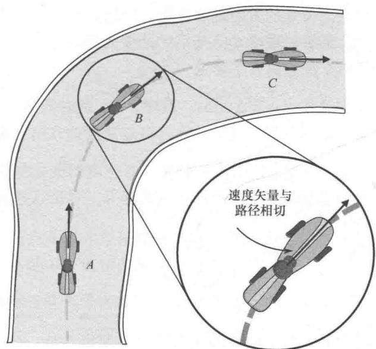
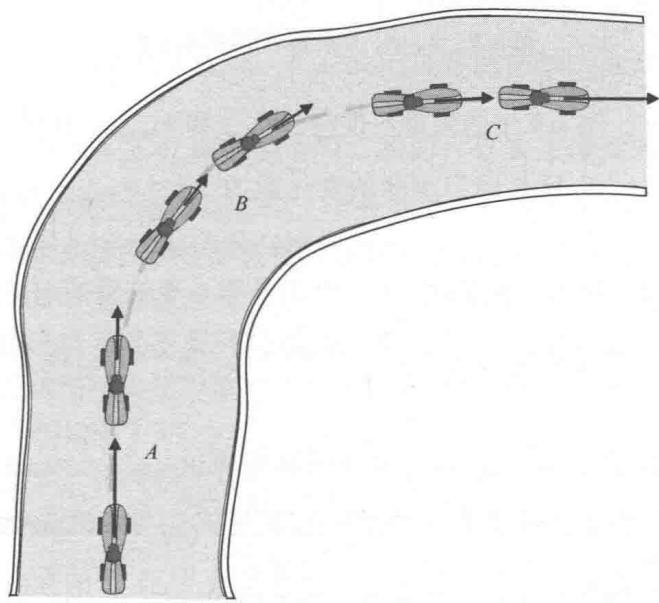
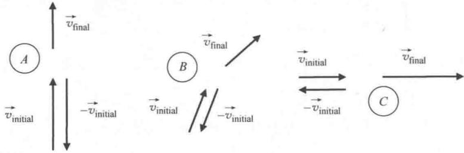
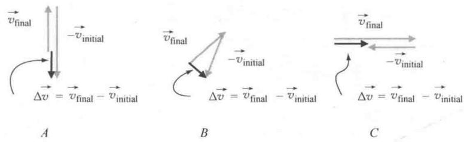
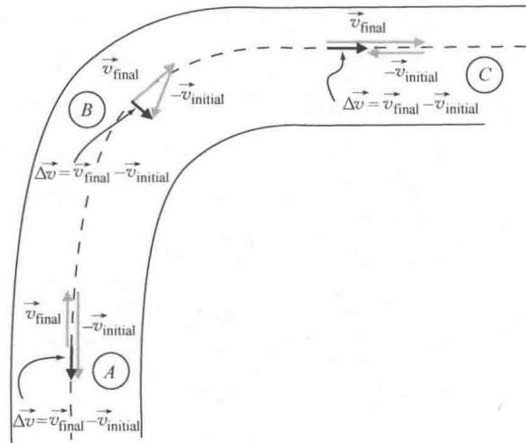
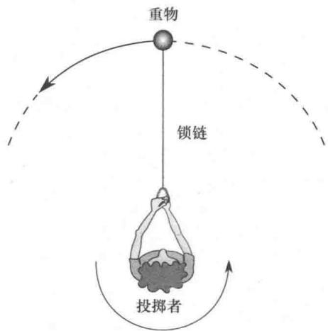
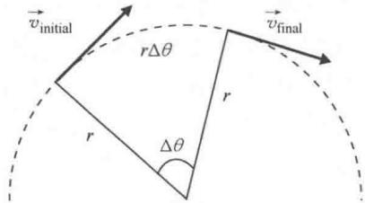
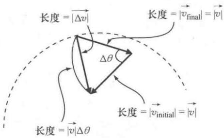
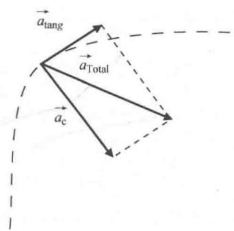

import Guide from '@/components/Guide.astro';
import Knowledge from '@/components/Knowledge.astro';
import Example from '@/components/Example.astro';
import Analysis from '@/components/Analysis.astro';
import Solution from '@/components/Solution.astro';
import Variant from '@/components/Variant.astro';
import Note from '@/components/Note.astro';
import Block from '@/components/Block.astro';
import Method from '@/components/Method.astro';
import Exercise from '@/components/Exercise.astro';

## 3.2 曲线运动

日常用语中，"加速度"就是"提高速度"的代名词。因此，汽车中的"加速器"通常是指油门。但是在物理学和工程领域中，加速度定义为速度的任意变化，其中速度是一个既有大小又有方向的矢量。因此，改变速度的方向也是一种加速形式，也就是说大多数汽车都有三种加速装置：油门、刹车和方向盘。"踩油门"产生的加速度与速度矢量方向相同（引起速度增加），"踩刹车"产生的加速度与速度矢量方向正好相反（引起速度降低），"转动方向盘"产生的加速度垂直于速度矢量（引起汽车行进方向改变，但是不影响速率）。 ① 方向平行于速度矢量（或反平行）的加速度称为"切向的"，方向垂直于速度的加速度称为"径向的"。当物体有径向加速度时，它不会沿直线移动，其运动被称为是"曲线的"。图3.7中的汽车沿着曲线行驶，这就是曲线运动的一个例子。

请注意，任意时刻的速度矢量的方向都是与行进路径的方向一致的。如果路径是曲线的，这就是指瞬时速度矢量与路径相切，我们可以观察图3.7中汽车行驶到B点的速度。如果想要求出汽车在路径上A，B，C点的加速度，只知道速度是不够的，还需要知道这些点处速度随时间的变化。

为了更直观的体现出车辆的加速度，不妨先画出车辆位于 A, B, C 点前后的瞬时速度矢量。图 3.8 给出了三种加速度的三种情况：由于车辆接近转弯，在 A 位置减速；在 B 处转弯，速率恒定不变；然后在 C 处离开弯道，加速行驶。

下面观察速度矢量在每个点处的变化来体会加速度．比较 A 点前后的速度矢量，从图中可以看出矢量的方向没有变化，但是长度变小了．这就是说汽车的速度降低但是没有转弯．然后比较 B 点前后的速

  
图 3.7 汽车沿曲线路径行驶的速度矢量

  
图 3.8 汽车的速度矢量在 A, B, C 处前后的变化

度矢量，可以看出矢量的方向发生变化，但是长度不变，说明汽车以恒定速率转弯。最后，观察 C 点前后的速度矢量，可以看出矢量长度在增加，说明汽车加速离开了弯道。

已知平均加速度为 $\vec{a} = \Delta \vec{v} / \Delta t$ ，其中， $\Delta \vec{v}$ 是时间 $\Delta t$ 上速度的变化量。根据这个方程很容易就可以确定出加速度的方向。速度的变化量可以写成 $\vec{v}_{\mathrm{final}} - \vec{v}_{\mathrm{initial}}$ ，图3.8中每个点速度的变化量用点后面的速度减去前面的速度就可以求出来。直观起见，只把这些速度矢量提取出来，如图3.9所示。

  
图3.9 $A, B, C$ 点前后的速度矢量

请注意，图3.9中的矢量不仅包含 $\vec{v}_{\mathrm{final}}$ 和 $\vec{v}_{\mathrm{initial}}$ ，也包含 $\vec{v}_{\mathrm{initial}}$ 的负矢量- $\vec{v}_{\mathrm{initial}}$ .这是因为速度的变化量为 $\Delta v = \vec{v}_{\mathrm{final}} - \vec{v}_{\mathrm{initial}}$ ，也就是 $\vec{\Delta v} = \vec{v}_{\mathrm{final}} + (-\vec{v}_{\mathrm{initial}})$ .运用图形计算矢量加法时只需将一个矢量尾部移动到另一个矢量的头部，然后从第一个矢量的起点指向第二个矢量终点的矢量就是合矢量．矢量 $\vec{v}_{\mathrm{final}}$ 与- $\vec{v}_{\mathrm{initial}}$ 的合矢量如图3.10所示.

图3.10中，如果将 $A$ ， $C$ 处的速度矢量 $\vec{v}_{\mathrm{final}}$ 与 $-\vec{v}_{\mathrm{initial}}$ 画成首尾相接会产生重叠，所以 $A$ ， $C$ 处的速度矢量 $\vec{v}_{\mathrm{final}}$ 与 $-\vec{v}_{\mathrm{initial}}$ 会画得稍有偏移．下面来观察每个点处速度矢量变化量（ $\Delta v$ ）的方向．可以看出，当汽车在 $A$ 处减速时，速度变化量的方向与这一点速度方向相反．又因为加速度（ $\vec{a}$ ）定义为速度变化矢量（ $\Delta v$ ）除以发生变化的时间间隔标量（ $\Delta t$ ）， $a$ 的方向与 $\Delta v$ 的方向相同，因此和大家预想的一样，当汽车在 $A$ 处减速时，该点处加速度的方向与速度矢量的方向相反。这是一个负切向加速度的例子。

  
图 3.10 A, B, C 处速度矢量的变化量

下面考虑速度矢量在 B 点处变化量 $\Delta v$ 的方向，汽车在该点处以恒定速率转弯。在这种情形下，由 $\vec{v}_{final}$ 减去 $\vec{v}_{initial}$ 得到的矢量 $\Delta v$ 垂直于速度矢量。这说明如果物体沿曲线移动并且速率恒定不变，它的加速度指向曲率中心（为了更直观地看到这个方向，图 3.11 画出了汽车行驶路径上的矢量 $\Delta v$ ）。B 点处的加速度是径向加速度的一个例子。

最后，当汽车在 $C$ 点处加速时，我们可以看出速度矢量变化量 $\vec{\Delta v}$ 的方向与速度矢量方向相同，也就是说这种情形下加速度与速度相互平行。因此， $C$ 点处加速度为正切向加速度的一个例子。

仔细分析 B 点处速度矢量变化量的长度就可以得出，径向加速度的大小取决于速率的平方以及路径的曲率半径。在进一步说明之前，我们要先明确曲线运动中描述力和加速度的常用术语。指向曲率中心的加速度（例如图 3.11 中 B 点处的加速度）称为"向心"（搜索中心）加速度，产生向心加速度的力称为向心力。有一点要明白，向心力不是某种新的力，它与机械力、电力、磁力或其他力有所不同。"向心"这一词直接给出了力的方向，但是力本身与我们平时见到的各种力没什么不同。对于沿曲线路径行驶的汽车，向心力就是轮胎与地面的摩擦力。如果在绳子上栓一块石头并绕圈旋转，作用在石头上的向心力来自于绳子的张力。如果在桶里装满水并把它甩过头顶，作用在桶上的向心力（通过桶作用于水）来自于手臂的肌肉。因此，只要可以产生向心加速度使得物体沿曲线经路移动的力就是向心力。

  
图 3.11 A, B, C 处的加速度矢量

正如前面的脚注所述，通常径向加速度 $(a_{r})$ 的正方向为从曲率中心指向外，而向心加速度 $(a_{c})$ 的正方向为指向曲率中心。方程 $\vec{a}_{r} = -\vec{a}_{c}$ 直接阐明了径向加速度与向心加速度大小相等，方向相反。

我们可以发现，无论是沿曲线路径行驶的汽车，还是拴在绳子上绕圈旋转的石头或者是甩过头顶的一桶水，这些例子中向心加速度（以及相应的向心力）都是指向曲率中心的，并没有加速度（也没有力）的方向沿径向向外。但是汽车上的人会感受到朝着曲线向外（比如汽车向右转，但朝向左侧门）的"离心"力，这是为什么？当汽车加速向右转弯时，车上的人遵循牛顿第一定律继续做匀速直线运动，因此他们会感受到指向左侧车门的作用力。所以离心力是观察者在旋转的参考系中所感受到的惯性力（物理学家把这样的加速参考系称为"非惯性系"）。因此，如果汽车正在右转，你坐在汽车中就会滑过座位靠在左侧门上。此时，在你的（旋转）参考系中，你正在向左加速，这就导致你认为有一个这个方向的力（从曲率中心指向外）。但是对于没乘车的人，他们不会感受到任何这样的力，只是观察到汽车轮胎与路面的摩擦力提供了向心力（向右）并产生了向心加速度。

为了理解向心力和离心力的概念，下面再举一个例子。想象奥运会链球运动员旋转链索末端的重物，如图3.12所示。对投掷者来说，感觉物体受到了一个向外的拉力（远离她）。在体育场非旋转参考系中，这只是因为物体试图遵循牛顿第一定律继续沿直线运动。因此，从观察台的角度看到的是链球运动员必须制造向心力（径向向内），使物体沿着弯曲路径运动。

  
图 3.12 链球运动员俯视图

链球运动员的判断是错误的吗？当然不是。运动员自己的参考系是随重物旋转的参考系，在这个参考系中，她认为存在沿径向向外的力（离心力）的结论是完全正确的。她知道必须对链索施加一个大的向内的力，才能使重物与她保持相同的距离（因为在她的参考系中，投掷之前物体的加速度为零）。因此，链球运动员的结论是正确的，在她的参考系中一定有一个力径向向外并与她向内的拉力相平衡。有人会说离心力是"虚构的"，它们通常指的离心力是观察者在旋转

(非惯性) 参考系中的惯性力.

了解了向心加速度和向心力的概念，自然想知道要使得物体沿指定路径运动，向心力的大小是多少？如果已知物体的质量并可以求出向心加速度，就可以运用牛顿第二定律（ $\vec{F} = m\vec{a}$ ）求出向心力。可以证明向心加速度只取决于物体的速率和路径的曲率半径，见图3.13和图3.14。

  
图 3.13 速度方向的变化

  
图3.14 $\Delta v$ 的长度的几何表示

图3.13给出了做匀速圆周运动（也就是在考虑的时间间隔内，物体的速率和运动路径的曲率均为常数）的物体在两个点的速度。请注意，这两个点与曲率中心连线的夹角为 $\Delta \theta$ ，对应弧长为 $r\Delta \theta$ ，其中， $r$ 为曲率半径， $\Delta \theta$ 是弧度。因为物体在这段路程上的速度的大小是恒定的，所以 $|\vec{v}_{\mathrm{initial}}|$ 与 $|\vec{v}_{\mathrm{final}}|$ 一定相等（也就是说速度矢量的方向改变，大小不变）。因此，令 $|\vec{v}_{\mathrm{initial}}| = |\vec{v}_{\mathrm{final}}| = |\vec{v} |$ 其中， $|\vec{v} |$ 是物体在这两个点处的速率。因为物体运动的平均速率等于走过的路程除以走过这段路程所用的时间，所以有：

$$
| \stackrel {\rightarrow} {v} | = \frac {r \Delta \theta}{\Delta t},\tag{3.21}
$$

也就有：

$$
\Delta \theta = \frac {| \vec {v} | \Delta t}{r},\tag{3.22}
$$

$\Delta \theta$ 的表达式（式3.22）非常重要，因为这个角的变化与速度的矢量变化量大小直接相关，同时也是求向心加速度的必要条件。首先通过 $\vec{v}_{\mathrm{final}}$ 与 $-\vec{v}_{\mathrm{initial}}$ 的和得到 $\Delta \vec{v}$ ，如图3.14所示。请注意，矢量 $\vec{v}_{\mathrm{final}}$ 与 $-\vec{v}_{\mathrm{initial}}$ 的夹角等于 $\Delta \theta$ （将图3.13中的矢量 $\vec{v}_{\mathrm{final}}$ 与 $-\vec{v}_{\mathrm{initial}}$ 延长相交就可以看出）。另外，矢量 $\vec{\Delta v}$ 是在 $\vec{v}_{\mathrm{initial}}$ 的始端和 $\vec{v}_{\mathrm{final}}$ 的始端中间绘制的，因为这正是向心加速度的位置。最后要注意的是，图中的 $\vec{v}_{\mathrm{final}}$ 与 $-\vec{v}_{\mathrm{initial}}$ 的长度都等于 $|\vec{v}|$ ，因此图中相应的弧长等于 $|\vec{v}| \Delta \theta$ 。

如果夹角 $\Delta \theta$ 趋近于0，会有什么现象？随着角度减小，弧长 $|\vec{v} | \Delta \theta$ 越来越趋近于 $\Delta \vec{v}$ 的长度．因此，当夹角很小的时候，将式(3.22）中 $\Delta \theta$ 的值代入，有

$$
\mid \stackrel {\rightarrow} {\Delta v} \mid \approx \mid \stackrel {\rightarrow} {v} \mid \Delta \theta = \mid \stackrel {\rightarrow} {v} \mid \frac {\mid \stackrel {\rightarrow} {v} \mid \Delta t}{r} = \frac {\mid \stackrel {\rightarrow} {v} \mid^ {2} \Delta t}{r}.\tag{3.23}
$$

瞬时向心加速度的大小为

$$
\mid \stackrel {\rightarrow} {a _ {c}} \mid = \frac {\mid \stackrel {\rightarrow} {\Delta v} \mid}{\Delta t} = \frac {\mid \stackrel {\rightarrow} {v} \mid^ {2} \Delta t}{r \Delta t} = \frac {\mid \stackrel {\rightarrow} {v} \mid^ {2}}{r}.\tag{3.24}
$$

由此可得，任意一点的向心加速度都可以用速率的平方除以路径在该点处的曲率半径直接计算。因此，如果速度加快为原来的两倍，则向心加速度加大为原来的四倍，向心力也增大为原来的四倍。

式（3.24）不仅适用于匀速圆周运动，只要 $\Delta\theta$ 任意小，就可以认为相应时间段内的速率和曲率半径都没有改变，同样可以运用式

(3.24) 求运动物体的向心加速度.

由式（3.24）还可以求出使得物体沿着指定曲线路径运动所需的力是多少。仍以图3.12中链球运动员为例，假设运动员想要将链长 $1.2\mathrm{m}$ 重 $4\mathrm{kg}$ 铁球以 $20\mathrm{m / s}$ 的速度抛掷出去。假设她在松开链锁之前达到了最大速度，此刻的向心加速度为

$$
\mid \stackrel {\rightarrow} {a _ {c}} \mid = \frac {\mid \stackrel {\rightarrow} {v} \mid^ {2}}{r} = \frac {(2 0 \mathrm{m/s}) ^ {2}}{1 . 2 \mathrm{m}} = 3 3 3. 3 \mathrm{m/s} ^ {2}.
$$

运动员必须提供的向心力为

$$
\mid \overrightarrow {F _ {c}} \mid = m \mid \overrightarrow {a _ {c}} \mid = 4 \mathrm{kg} (3 3 3. 3 \mathrm {m/ s^ {2}}) = 1 3 3 3. 3 \mathrm{N}.
$$

这大约是300磅的力（不包含链锁的重量）.

式（3.24）给出了向心加速度的大小，又因为切向加速度为速率在相应时间段内的变化率 $(\vec{a}_{\mathrm{tang}} = \vec{\Delta v} / \Delta t)$ ，运用矢量加法就可以得到总加速度，如图3.15所示。因此总加速度的大小就是

$$
\begin{array}{r l}\left| \stackrel {\rightarrow} {a} _ {\text {Total}} \right|&= \sqrt {\left(\left| \stackrel {\rightarrow} {a} _ {c} \right|\right) ^ {2} + \left(\left| \stackrel {\rightarrow} {a} _ {\text {tang}} \right|\right) ^ {2}}\\&= \sqrt {\left(\frac {v ^ {2}}{r}\right) ^ {2} + \left(\frac {\left| \Delta v \right|}{\Delta t}\right) ^ {2}}.\end{array}\tag{3.25}
$$

  
图 3.15 向心加速度与切向加速度的总加速度
