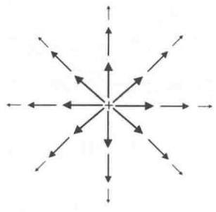
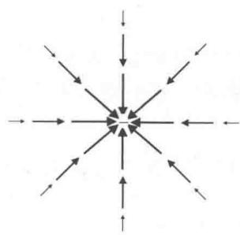
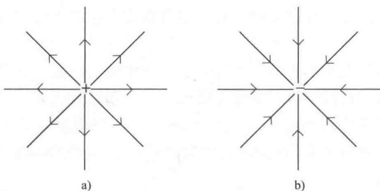
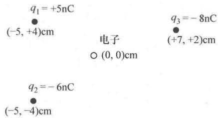
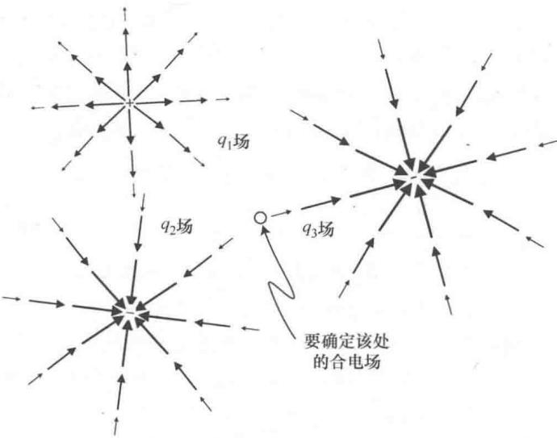

import Guide from '@/components/Guide.astro';
import Knowledge from '@/components/Knowledge.astro';
import Example from '@/components/Example.astro';
import Analysis from '@/components/Analysis.astro';
import Solution from '@/components/Solution.astro';
import Variant from '@/components/Variant.astro';
import Note from '@/components/Note.astro';
import Block from '@/components/Block.astro';
import Method from '@/components/Method.astro';
import Exercise from '@/components/Exercise.astro';

## 3.3 电场

前两节的内容体现了矢量在力学问题中的重要作用，接下来的两节内容将帮助我们体会矢量在电场和磁场及其对带电粒子的影响这类问题中的重要性。另外，我们还将看到散度、旋度、梯度和拉普拉斯算子这些矢量运算在静电学中是如何使用的。即使从未修过机电（E&M）课程（也不希望修该课程的），这两节的例子也足以说明矢量以及矢量运算在机电工程中如何应用。

要想讨论电场和磁场，自然先要给出简单而准确的定义说明什么是电场，什么是磁场。但目前还没有标准的定义。迈克尔·法拉第（Michael Faraday）最开始用"力场"来描述电荷周围的区域，但是将近两个世纪后，仍然没有一个标准的说法来说明这个场是什么。《牛津英语大辞典》中"场"的定义包括某个因素影响下的"区域或者空间"，施加力时的"状态或者情况"以及力的"作用"。根据詹姆斯·克拉克·麦克斯韦（James Clerk Maxwell）的说法，"电场是带电体周围空间的一部分"。哈里德、雷斯尼克、沃克（Halliday, Resnick, Walker）通过在某个点放置一个小的正检验电荷 $q_{0}$ 并测量该电荷所受的电场力 $\vec{F}_{E}$ 来定义电场 $^{\ominus}$ ，电场 $\vec{E}$ 定义为 $\vec{E} = \vec{F}_{E} / q_{0}$ 。格里菲斯（Griffiths）在《电动力学导论》中指出"…在物理上， $\vec{E}(P)$ 表示将会作用在 $P$ 点处单位检验电荷上的电场力。该定义中的"将会"一词很重要，因为场的存在与检验电荷是否存在没有关系。

贯穿这些定义的主线都是：场和力是密切相关的。因此，我们用下面这个式子来定义电场 $\vec{E}$ ：

$$
\vec {E} \equiv \frac {\vec {F} _ {E}}{q _ {0}}.\tag{3.26}
$$

其中， $\vec{E}$ 是电场矢量， $q_0$ 是一个小的检验电荷， $\vec{F}_E$ 是电场对检验电荷产生的电场力。根据这个方程，可以看出 $\vec{E}$ 是一个矢量，大小与电场力的大小成比例并且方向与作用在正检验电荷的电场力方向相同（如果 $q_0$ 是负电荷，那么在方程的右边就会有一个负号，此时矢量 $\vec{E}$ 与矢量 $\vec{F}_E$ 的方向相反）。

由该定义也可以看出，E 的量纲为电场力除以电量，国际标准单位（SI）是牛顿每库仑（N/C）。因为伏特的量纲是力乘以距离除以电量（单位是牛顿·米/库仑），所以电场的单位等价于伏特每米（V/m）。有些文献中电场单位是 N/C，有些文献中是 V/m，它们的含义完全相同。

但是，在电场矢量的单位中要强调：长度的量纲（在本例中以米为单位）出现在电场量纲的分母中。这说明电场矢量与位置矢量（量纲为长度）、速度矢量（量纲为长度除以时间）或加速度矢量（量纲为长度除以时间的平方）等有根本区别。第4章将会讲到，这是因为当坐标系变换时，量纲分子中含有长度的矢量变成量纲分母中含有长度的矢量。有些读者不太理解这些，也不打算学习这本书张量部分的内容，依然可以运用第1章和第2章中的概念和运算来解决涉及这种矢量的问题，本节余下的内容就可以看到。但是，如果遇到被称为"one-forms"或"余矢量"的矢量（电场就是一个例子），要想了解这与我们所说的矢量有什么不同，那么就先从量纲分母中的长度开始（第4章会解决剩余的部分）。

如果已知某个点的电场为 $\vec{E}$ ，在这个点处放置任意电荷 $q$ ，则该电荷受到的电场力 $\vec{F}_E$ 为

$$
\vec {F} _ {E} = q \vec {E}.\tag{3.27}
$$

式（3.26）运用作用在正检验电荷的电场力定义了电场。若已知一点的电场，通过式（3.27）就可以求作用在该点处任意电荷上的电场力.

定义电场很重要，但是电场是如何产生的呢？每一点质量都可以形成重力场，同样每一点电荷都可以产生电场，因此我们可以把一些电荷集中起来产生所需的电场。另外还可以利用磁场的变化产生电场。由静止电荷产生的电场为"静电场"，本节要讨论的就是静电场中的矢量应用。

要理解电场中矢量的应用，不妨将带电体周围的电场形象的表示出来。最常见的方法是用箭头或"场线"表示电场，箭头或"场线"指向电场的方向。如果用箭头的方法，箭头的长度表示电场的强度；如果用场线的方法，场线的密度表示电场的强度，场线越密集表示场强越强。请注意，当用场线或者箭头表示电场时，线与线之间也存在电场。

图 3.16 用箭头表示了正负点电荷产生的电场，图 3.17 用场线表示了正负点电荷产生的电场。当用这样的电场线表示电场时，要注意电场中的箭头和线的方向与电场中正检验电荷所受到的电场力方向一致，同时静电场线的起点是正电荷，终点是负电荷。场线表示出了任意给定点处电场的方向并且电场的方向是唯一的，因此两条场线不可能相交，否则在交叉点处电场不只有一个方向（如果在给定点处有两个电场叠加，只要将两个电场矢量相加作为该点处的合电场即可，合电场的方向是唯一的）。

  
图 3.16 用箭头表示正负点电荷产生的电场

a)

  
图 3.17 用场线表示正负点电荷产生的电场

由此可知电场可以由电荷产生，同时对电场中的其他电荷产生力的作用。因此，解决问题时首先要确定某个位置处电荷产生的合电场，然后再求合电场对另外的电荷（不是产生电场的电荷）产生的作用。但是被作用的电荷（我们称之为"受力电荷"）是否也会产生自己的电场呢？当然会，但只要受力电荷产生的电场比较弱，不会引起其他电荷的移动，就可以先求出所有其他电荷产生的合电场，然后用合电场来确定作用在受力电荷上的力，从而解决问题。这种方法非常类似于先求空间某个点上地球的重力场，然后利用求出来的重力场计算出在该位置质量已知物体的重力，而不考虑物体质量对地球的影响。

如果电场是由一个或者多个离散的点电荷产生，问题就会简单很多。因为，点电荷 q 的电场 $\vec{E}$ 可以写成：

$$
\vec {E} = k _ {e} \frac {q}{r ^ {2}} \hat {r}.\tag{3.28}
$$

其中， $k_{e}$ 为库仑常数（ $8.99 \times 109 ~N \cdot m2/C2$ ），r 是从场源点电荷到所求场点的距离，单位为 m， $\hat{r}$ 为从场源点电荷沿径向向外指向场点的单位矢量.

因此单个质子（电量为 $1.6 \times 10^{-19}$ C）在距离 1m 处产生的电场为

$$
\begin{array}{r l} \overrightarrow {E} & = (8. 9 9 \times 1 0 ^ {9} \mathrm{N} \cdot \mathrm{m} ^ {2} / \mathrm{C} ^ {2}) \left(\frac {1 . 6 \times 1 0 ^ {- 1 9} C}{(1 \mathrm{m}) ^ {2}}\right) \hat {r} \\ & = 1. 4 5 \times 1 0 ^ {- 9} (\mathrm{N/C}) \hat {r}. \end{array}
$$

请注意，因为单位矢量 $\hat{r}$ 的方向为从质子指向场点，所以该电场的方向从质子处沿径向向外。电子带负电荷，产生的电场与质子产生的电场大小相同，但是电子产生电场的方向从场点沿径向向内指向电子。这是因为当我们将负电荷 $q$ 带入式（3.28）时，有

$$
\begin{array}{r l} \vec {E} & = (8. 9 9 \times 1 0 ^ {9} \mathrm{N} \cdot \mathrm{m} ^ {2} / \mathrm{C} ^ {2}) \left(\frac {- 1 . 6 \times 1 0 ^ {- 1 9} C}{(1 \mathrm{m}) ^ {2}}\right) \hat {r} \\ & = - 1. 4 5 \times 1 0 ^ {- 9} (\mathrm{N/C}) \hat {r} = 1. 4 5 \times 1 0 ^ {- 9} (\mathrm{N/C}) (- \hat {r}). \end{array}
$$

其中，负号表示电子产生电场的方向与 $\hat{r}$ 的方向相反，指向场源电荷（因为 $\hat{r}$ 的方向通常是场源电荷沿径向向外指向场点，则负 $\hat{r}$ 的方向径向向内）。这恰恰与电场线从正电荷开始到负电荷结束是一致的。

下面考虑电场矢量如何相加，以图3.18所示情形为例。其中， $q_{1}$ 是正电荷，因此它的电场方向从 $q_{1}$ 所在位置径向向外， $q_{2}$ 和 $q_{3}$ 是负电荷，因此它们的电场方向一定是指向电荷所在位置径向向内。要想求出电子所在位置处的合电场，不妨画出 $q_{1}, q_{2}$ 和 $q_{3}$ 的电场，如图3.19所示。

  
图 3.18 电子周围的电荷

本节前面介绍电场线的时候已经强调了电场不仅存在于场线上，也存在于场线与场线之间。但是为了直观的表示出每个电荷产生电场的方向并使它们与所求合电场的位置（本例中为原点）在一条直线上，图3.19中画出的电场线是倾斜的。另外要注意，图中的电场线看起来越来越小不代表电场趋近于0。因此由 $q_{1}$ 产生的电场指向电子所在位置的右下方， $q_{2}$ 产生的电场指向左下方， $q_{3}$ 产生的电场指向右上方。将这三个矢量场加在一起就可以确定原点处的合电场。

根据式（3.28），由三个点电荷 $q_{1}$ ， $q_{2}$ 和 $q_{3}$ 产生的电场分别是：

  
图3.19 电荷 $q_{1}$ ， $q_{2}$ 和 $q_{3}$ 产生的电场

$$
\vec {E} _ {1} = k _ {e} \frac {q _ {1}}{r _ {1} ^ {2}} \hat {r} _ {1},
$$

$$
\vec {E} _ {2} = k _ {e} \frac {q _ {2}}{r _ {2} ^ {2}} \hat {r} _ {2},\tag{3.29}
$$

$$
\vec {E} _ {3} = k _ {e} \frac {q _ {3}}{r _ {3} ^ {2}} \hat {r} _ {3}.
$$

由图3.19可以看出，三个电场的方向并不相同。这是因为单位矢量 $\hat{r}_1$ 的方向为从点电荷 $q_{1}$ 的位置径向向外，而 $\hat{r}_2$ 和 $\hat{r}_3$ 的方向分别从点电荷 $q_{2}$ 和 $q_{3}$ 的位置径向向外。显然，要想求出原点处的合电场，不能直接将三个电场按代数相加，而是必须运用矢量加法。本章的习题中有电场矢量加法的题目并有线上解答。

静电学中不仅会用到矢量加法和数乘这样的简单矢量运算。如果读者已经读过第2章中的散度运算，可能就会联想到点电荷产生静电场的散度究竟是什么（见图3.16和图3.17）。实际上，电场的高斯定律是静电学的基本定律之一，其微分形式是：

$$
\vec {\nabla} \cdot \vec {E} = \rho / \varepsilon_ {0}.\tag{3.30}
$$

其中， $\rho$ 表示电荷体密度（库仑每立方米）， $\varepsilon_{0}$ 表示自由空间的真空电容率（ $8.85 \times 10^{-12} ~Nm2/C2$ ）

电场的高斯定律说明，电场线从任意正电荷所在位置（正 $\rho$ ）向外发散，并会聚在负电荷所在的位置（负 $\rho$ ）。这就是为什么将静电场线的"流动"与液体流动进行类比。在这个类比中，正电荷就是静电场线的"源"，正如水龙头是水流的源一样，负电荷就是静电场线的"汇"，就像排水管一样。

点电荷的电场散度（在球面坐标系下计算最方便）为

$$
\begin{array}{r l} \vec {\nabla} \cdot \vec {E} & = \frac {1}{r ^ {2}} \frac {\partial}{\partial r} (r ^ {2} E _ {r}) = \frac {1}{r ^ {2}} \frac {\partial}{\partial r} (r ^ {2} k _ {e} \frac {q}{r ^ {2}}) \\ & = \frac {1}{r ^ {2}} \frac {\partial}{\partial r} (k _ {e} q) = 0. \end{array}
$$

由上面的计算可知点电荷的电场散度为0，而第2章的例子中证明过大小为 $1 / r^2$ 的径向矢量场的散度为0，这两个结论是一致的。注意，除了场源 $r = 0$ 以外，所有的点处散度都为零。因此，由电场的高斯定律可知静电场线只在正电荷处发散，并且只在负电荷处收敛。

通过点电荷 E 的旋度，可以进一步了解静电场的性质．考虑球面坐标系下， $E_{\theta}$ 和 $E_{\varphi}$ 均为零，则电场的旋度为

$$
\begin{array}{r l} \vec {\nabla} \times \vec {E} & = \frac {1}{r} \frac {1}{\sin \theta} \frac {\partial E _ {r}}{\partial \varphi} \hat {\theta} + \frac {1}{r} \left(- \frac {\partial E _ {r}}{\partial \theta}\right) \hat {\varphi} \\ & = \frac {1}{r} \frac {1}{\sin \theta} \frac {\partial}{\partial \varphi} \left(\frac {k _ {e} q}{r}\right) \hat {\theta} + \frac {1}{r} \left[ - \frac {\partial}{\partial \theta} \left(\frac {k _ {e} q}{r}\right) \right] \hat {\varphi} \\ & = 0. \end{array}
$$

由于点电荷静电场的径向性质，才能得出这样的结论.

根据第2章的内容，旋度为零的矢量场称为无旋场。因为梯度的旋度等于零，所以常常把无旋矢量场写成一个标量场的梯度。

如果是静电场，电场可以写成标量电位（常记为 $\phi$ 或者 V）的梯度．习惯上，电场写成标量电位梯度的负值，因此电场也常常写成这样的等式关系：

$$
\vec {E} = - \vec {\nabla} V.\tag{3.31}
$$

其中，V 是标量电位，单位为 Nm/C（相当于焦耳每库仑或者伏特）.

因为电场是电位随距离变化的负值，沿电场线方向移动的意思是朝着电位降低的区域移动。同样，向相反的方向移动（与场的方向相反）就是朝电位升高的区域移动，向垂直于场线的方向移动不会引起电位的变化。因此，"等电位面"总是垂直于电场线。

静电学中另一个常用的微分矢量运算就是拉普拉斯算子（ $\nabla2$ ）.

拉普拉斯算子涉及二阶空间导数，表示梯度的散度。由于静电场 $\vec{E}$ 可写成标量电位 V 梯度的负值，因此电场的散度为

$$
\vec {\nabla} \cdot \vec {E} = \vec {\nabla} \cdot (- \vec {\nabla} V) = - \vec {\nabla} ^ {2} V.\tag{3.32}
$$

根据电场的高斯定律，电场的散度是 $\rho / \varepsilon_0$ ，也就是

$$
\nabla^ {2} E = - \rho / \varepsilon_ {0}.\tag{3.33}
$$

这就是著名的泊松方程。因为拉普拉斯算子可以求出函数的峰和谷（函数值不同于周围平均值的点），所以由泊松方程可知电位只能在电荷处达到局部最大值或局部最小值（当 $\rho \neq 0$ 时）。我们知道，拉普拉斯算子在峰处取负值并且谷处取正值，此处也就是正电荷产生电位的峰，负电荷产生电位的谷。这也就是为什么电场是电位梯度负值的原因之一。

电荷密度（ $\rho$ ）为零的区域中，泊松方程就变成了拉普拉斯方程：

$$
\nabla^ {2} E = 0.\tag{3.34}
$$

因此，电荷密度为零的地方电位没有极大值或者是极小值.
