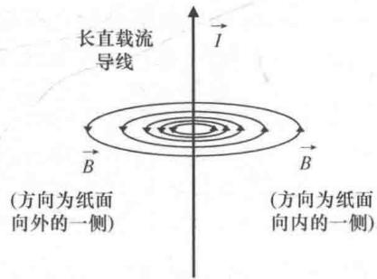
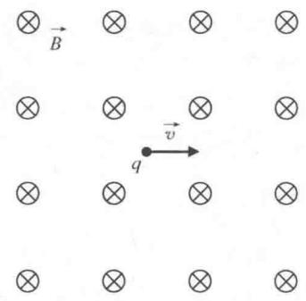
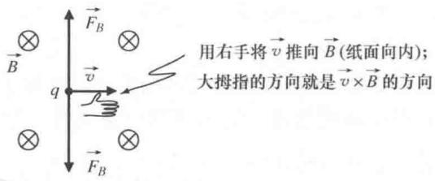
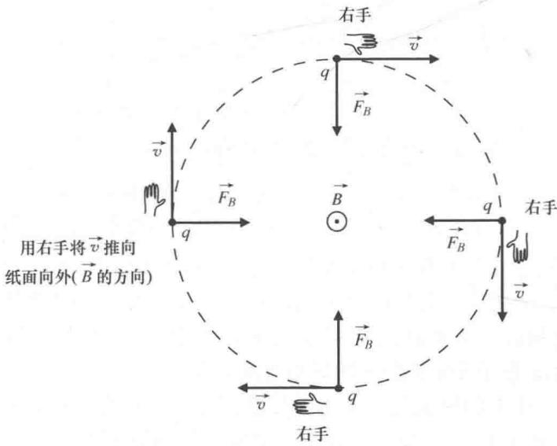

import Guide from '@/components/Guide.astro';
import Knowledge from '@/components/Knowledge.astro';
import Example from '@/components/Example.astro';
import Analysis from '@/components/Analysis.astro';
import Solution from '@/components/Solution.astro';
import Variant from '@/components/Variant.astro';
import Note from '@/components/Note.astro';
import Block from '@/components/Block.astro';
import Method from '@/components/Method.astro';
import Exercise from '@/components/Exercise.astro';

## 3.4 磁场

本节的主要内容包括磁场（B）的性质、运动带电粒子受到的磁力以及矢量运算在静磁场中的应用—静磁场的散度和旋度.

我们知道电场线在正电荷处发散并且在负电荷处会聚，磁感线则不同。电流（流动的电荷）在周围产生磁场，磁感线围绕电流形成环状。就像固定的源电荷产生静电场，固定的电流（电荷流是恒定的）产生的磁场被称为"静磁场"，如图3.20所示。静磁场场线的方向由右手法则确定：如果右手大拇指指向电流的方向，弯曲另外四根手指（就像握住电流一样），那么磁场的方向就是手指弯曲的方向。因此，如果反转电流的方向，磁感线仍然在电流周围形成环状，但是磁感线方向相反（只要大拇指指向相反的方向，观察四指弯曲的方向就可以验证）。

由图 3.20 中场线的间距可以告诉我们：距离电流越远，磁感应强度越弱。假设无限长的细直导线载流为 I，则磁感应强度的矢量方程为

$$
\vec {B} = \frac {\mu_ {0} I}{2 \pi r} \hat {\varphi}.\tag{3.35}
$$

其中， $\mu_0$ 是一个常数，称为真空磁导率， $r$ 表示从场点到导线的距图 3.20 长直导线的磁场

离， $\hat{\varphi}$ 表示柱面坐标的横向单位矢量，指向绕导线旋转的方向。磁感应强度的国际标准单位（SI）为特斯拉（T）。

将电流周围的磁感线与第2章讨论各种矢量场的散度和旋度对比，我们应该就能猜到磁场属于"低散度，高旋度"这种类型。电场线源于正电荷止于负电荷，并且只有在这些电荷所在点处的静电场散度是非零的。而磁感线闭合的，不会从某个点发散，也不会聚到某个点，因此认为磁场的散度值很小是合理的。实际上，根据磁场的高斯定律，有：

$$
\vec {\nabla} \cdot \vec {B} = 0.\tag{3.36}
$$

即，磁场（B）的散度为零．下面证明长直导线磁场式（3.35）的散度为零：

$$
\begin{array}{r l} \vec {\nabla} \cdot \vec {B} & = \frac {1}{r \sin \theta} \frac {\partial B _ {\varphi}}{\partial \varphi} = \frac {1}{r \sin \theta} \frac {\partial}{\partial \varphi} \left(\frac {\mu_ {0} I}{2 \pi r}\right) \\ & = 0. \end{array}
$$

根据第2章中旋度的讨论可以得出，载流导线周围的磁场旋度为零：

$$
\begin{array}{r l} \vec {\nabla} \times \vec {B} & = \left(- \frac {\partial B _ {\varphi}}{\partial z}\right) \hat {r} + \frac {1}{r} \left(\frac {\partial (r B _ {\varphi})}{\partial r}\right) \hat {z} \\ & = \left[ - \frac {\partial}{\partial z} \left(\frac {\mu_ {0} I}{2 \pi r}\right) \right] \hat {r} + \frac {1}{r} \left[ \frac {\partial}{\partial r} \left(r \frac {\mu_ {0} I}{2 \pi r}\right) \right] \hat {z} \\ & = 0. \end{array}
$$

如同电场的散度只在电荷所在点处具有非零值一样，磁场的旋度只在电流存在的位置（即，奇点 r=0 处）具有非零值.

要求磁场（ $\vec{B}$ ）作用在运动电荷（ $q$ ）上的力（ $\vec{F}_B$ ）时就要用到矢量以及矢量运算。这个作用力的矢量方程为

$$
\vec {F} _ {B} = q \vec {v} \times \vec {B}.\tag{3.37}
$$

其中， $\vec{v}$ 表示带电粒子在磁场中的速度。由矢量叉积的大小（ $|\vec{A} \times \vec{B}| = |\vec{A}| |\vec{B}| \sin \theta$ ）就可以求出力的大小：

$$
\mid \vec {F} _ {B} \mid = q \mid \vec {v} \mid \mid \vec {B} \mid \sin \theta .\tag{3.38}
$$

其中， $\theta$ 表示矢量 $\vec{v}$ 与矢量 $\vec{B}$ 的夹角.

仔细分析式（3.37）和式（3.38），将作用于带电粒子的磁力和电场力 $\vec{F}_{E}=q\vec{E}$ （式（3.27））对比，就可以发现二者的相同和不同之处：

\- 共性：均直接与带电量（ $q$ ）成正比；

\- 共性：均直接与场强（ $\vec{E}$ 或者 $\vec{B}$ ）成正比；

\- 特性：磁力依赖于粒子的速度 $(\vec{v})$ ；

\- 特性：磁力依赖于速度和磁场之间的夹角；

\- 特性：磁力既垂直于速度也垂直于磁场.

二者的共性很显然：电场力和磁力随着场强的增大而增强，随着带电量的增加而增强。同时，符号相反的电荷受到力的方向也是相反的。由第一个不同之处（磁力依赖于粒子的速度）可以得出很有意思的结论：磁场中静止的带电粒子（ $\vec{v} = 0$ ）感受不到来自磁场的任何力的作用；磁场中运动的粒子，速度越快，受到的磁力就会越强.

根据磁力方程中的矢量叉积还可以得出几个重要的结论。其一，运动方向平行于或者反平行于磁场的带电粒子不受磁力的作用。这是因为无论平行（ $\theta = 0^{\circ}$ ）还是反平行（ $\theta = 180^{\circ}$ ）的情况下，式（3.38）中的正弦项都为零。因此，矢量 $\vec{v}$ 与矢量 $\vec{B}$ 的夹角 $\theta$ 越接近 $90^{\circ}$ ，磁力越强。其二，由式（3.37）中矢量叉积可知磁力（ $\vec{F}_B$ ）永远不能指向磁场的方向。这是因为根据定义，叉积的结果是矢量且垂直于构成该叉积的两个矢量（在本例中为 $\vec{v}$ 和 $\vec{B}$ ）。同样，因为磁力垂直于粒子的速度矢量，磁力的方向永远不能指向速度矢量的方向。因此，假设速度矢量和磁场构成一个平面，那么磁力（如果存在的话）一定垂直于这个平面。

根据本文第3.2节中讨论的径向加速度和切向加速度可知，磁场中的带电粒子具有径向加速度，但没有切向加速度。要想有切向加速度，就要有与速度矢量平行或反平行方向上力的分量。又因为 $\vec{v} \times \vec{B}$ 的方向总是垂直于速度矢量 $\vec{v}$ ，所以磁场只能提供径向加速度。因此磁场可以改变带电粒子的运动方向，但不会改变其运动速率。

图 3.21 所示为磁力涉及的几何结构。图中，磁场方向为纸面向内，用圆圈内画一个叉表示 ① ，带电粒子向右运动。

本例中，矢量叉积 $v \times B$ 中运用右手法则就能确定磁力的方向，如图3.22所示。要切记（但很容易忘记），如果确定了 $\vec{v} \times \vec{B}$ 的方向，当电荷 $q$ 是负的，那么必须反转 $\vec{v} \times \vec{B}$ 的方向（根据式（3.37）有 $\vec{F}_B = q\vec{v} \times \vec{B}$ ，因此如果 $q$ 是负的，磁力与 $\vec{v} \times \vec{B}$ 的方向相反）。这就是为什么图3.22中磁力 $\vec{F}_B$ 有两个方向： $q$ 为正时向上， $q$ 为负时大学生理工专题导读——矢量与张量分析

  
图 3.21 带电粒子向右运动，磁场方为纸面向内

$q$ 是正的，磁力与 $\vec{v} \times \vec{B}$ 的方向相同

  
$q$ 是负的，磁力与 $\vec{v} \times \vec{B}$ 的方向相反

图 3.22 作用于正负电荷的磁力

向下.

我们可能会常常看到或听到关于带电粒子"绕磁感线旋转"或"沿磁场螺旋运动"的说法。要理解这样的说法，先要理解磁力方向与带电粒子速度方向的关系。以带正电的粒子 $q$ 为例，如图3.23所示。假设图中最左边的点为粒子的初始位置并且粒子以速度 $\vec{v}$ 竖直向上移动，磁场 $\vec{B}$ 的方向垂直纸面向外，则磁力 $q\vec{v} \times \vec{B}$ 的初始方向向右（由右手法则确定）。在该力的作用下，粒子沿虚线路径移动到图中的最顶端位置。同样，由于 $q$ 是带正电的，顶端位置处磁力方向与 $\vec{v} \times \vec{B}$ 相同，所以磁力 $\vec{F}_B$ 方向竖直向下。在竖直向下力的作用下，粒子移动到最右边的位置，此时速度的方向竖直向下且磁力 $\vec{F}_B$ 的方向指向左边．向左力的作用下，粒子移动到图3.23中最底部的位置，此时速度的方向向左且磁力 $\vec{F}_B$ 的方向竖直向上．在这个力的作用下，粒子移动回到起始点（最左边）的位置，然后再重复整个循环．所以如果磁场方向垂直纸面向外，那么带正电的粒子在磁场中做顺时针的圆周运动.

  
图 3.23 作用于正电荷的磁力

同理，如果磁场方向垂直纸面向外，带负电荷的粒子在磁场中做逆时针圆周运动。如果反转磁场方向，使得 $\vec{B}$ 不是垂直向外而是向内，那么粒子的旋转方向将被反转（此时，带正电的粒子将逆时针旋转，带负电的粒子将顺时针旋转）。

这些例子中的粒子都是沿着同一条路径一遍又一遍的运动，那么什么时候粒子"绕着"磁感线螺旋运动呢？简单来说：粒子的速度必须有一个与磁场方向平行（或反平行）的分量才能有螺旋运动。请注意，图3.23所示的粒子只在纸面平面内运动并且磁场垂直于纸面。因此，粒子的速度矢量没有沿着磁场方向的分量（纸面向内或者向外）。如果存在磁场方向的速度分量，粒子绕磁场进行圆周运动的同时也会沿着磁感线方向有一个运动分量，图3.23所示的圆周路径也会随时间朝纸面内或者外运动，环线就变成了螺旋线。磁场对平行或者反平行于磁场方向的速度分量（ $v_{\parallel}$ ）没有任何影响（因为这样的方向上没有磁力），因此只要没有其他外力的作用，粒子沿磁感线方向的速率就是一个常数。
