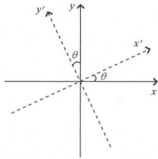
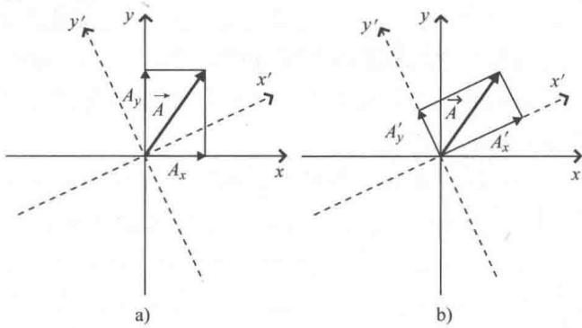
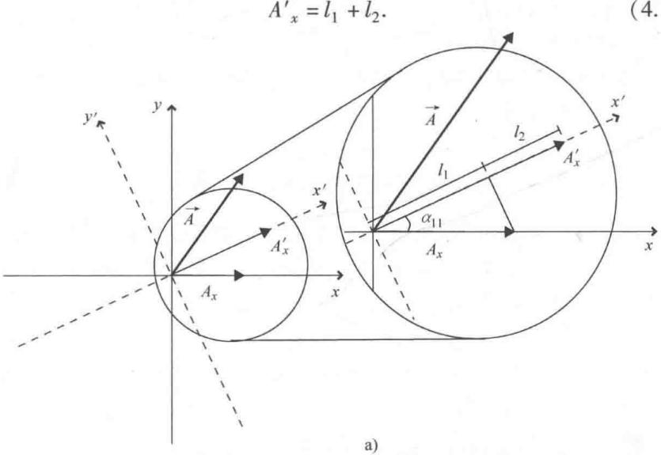
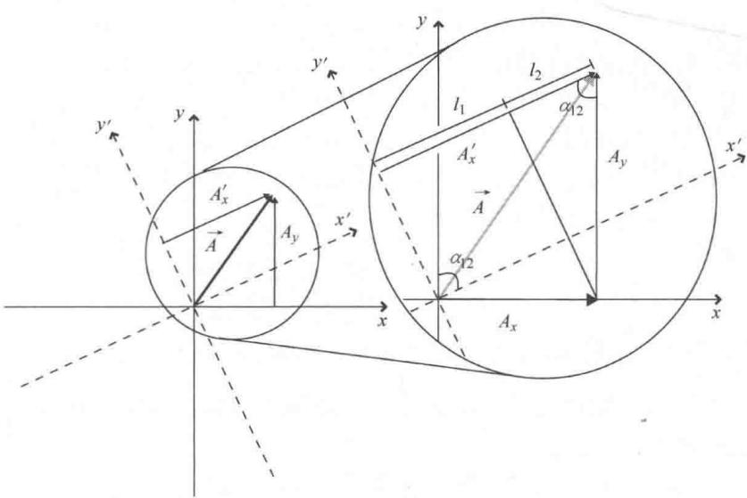
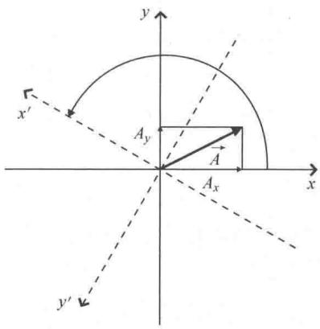
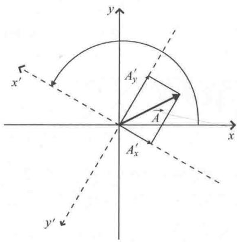
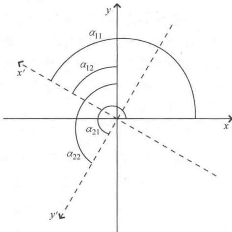
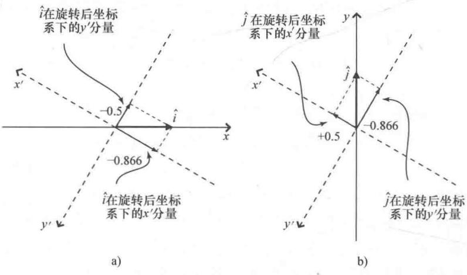

import Guide from '@/components/Guide.astro';
import Knowledge from '@/components/Knowledge.astro';
import Example from '@/components/Example.astro';
import Analysis from '@/components/Analysis.astro';
import Solution from '@/components/Solution.astro';
import Variant from '@/components/Variant.astro';
import Note from '@/components/Note.astro';
import Block from '@/components/Block.astro';
import Method from '@/components/Method.astro';
import Exercise from '@/components/Exercise.astro';

## 4.1 坐标系变换

为了更好地从矢量过渡到张量，先考虑这样一个问题："如果改变表示矢量的坐标系，矢量会发生怎样的变化？"简单地说就是矢量本身不会发生任何变化，但是在新坐标系下矢量的分量会有所不同。本节的目的就是帮助大家理解这些分量会发生怎样的变化。

在此之前，先来思考为什么改变坐标系的情况下矢量本身不会发生变化。如果是标量，这种说法很好理解，因为无论用摄氏度还是华氏度来衡量房间的温度，我们的感受是一样的，既不会感受到更热，也不会感受到更冷。请注意，矢量是物理实体的数学表示，改变实体所在的坐标系不会引起实体本身发生变化。思考：当把头歪向一边，房间的大小会改变吗？当然不会。但是如果歪着头定义上和下，所指的房间最高点和最低点可能就会发生变化，同时也改变了房间的"高"和"宽"。重要的是坐标系变化了，房间本身没有改变（房间"保持不变"）。如果将头部的中心定义为坐标系的原点，那么朝一面墙走，房间就会产生"位移"（也就是说，房间内位置的 $x, y, z$ 值可能会更改），但再次强调房间本身保持不变。同样，以英寸而不是米为量纲表示房间的尺寸只能在房地产广告中增加更多的数字，但房间依然不能容纳更大的沙发。

因此，坐标系进行旋转、平移或者缩放等变换时，物理量本身并不发生变化，但是坐标变换会对矢量产生什么影响呢？为了便于理解，不妨以二维笛卡儿坐标系的旋转变换为例，如图4.1所示。旋转变换下，坐标原点的位置没有变化，但是 $x$ 轴和 $y$ 轴均逆时针旋转了 $\theta$ 角，旋转后的坐标轴记为 $x^{\prime}, y^{\prime}$ ，为了与原坐标轴区分开，图中用虚线表示。

  
图 4.1 2-D 坐标系的旋转

旋转变换对这个空间中的矢量有什么影响？观察图4.2a和图4.2b中的矢量 $\vec{A}$ 及其分量。请注意，旋转变换下矢量 $\vec{A}$ 的长度和方向没有任何变化（虽然看上去图4.2a和图4.2b中的 $\vec{A}$ 有一点儿不同，但是用直尺和量角器就可以验证矢量本身是完全相同的）。很明显，旋转变换会引起 $\vec{A}$ 的分量发生改变： $A'_{x}$ （ $\vec{A}$ 在旋转坐标系中的 $x'$ 分量）比 $A_{x}$ 要长， $A'_{y}$ 比 $A_{y}$ 要短。如果继续按原来的方向旋转坐标轴，

最终会有一个角度，使得坐标系转过这个角度时 $\vec{A}$ 完全落在 $x'$ 轴上，此时 $\vec{A}$ 就没有了 $y'$ 分量（即， $A'_{y} = 0$ ）并且 $x'$ 分量等于 $\vec{A}$ 的长度 $(A'_{x} = |\vec{A}|)$ .

  
图 4.2 坐标系旋转下矢量分量的变化

要想求出坐标轴变化引起的矢量分量的变化，有两种方法：一是运用几何法通过画图求解，二是运用数学解析法通过点积来求解。本节主要介绍的是几何法，在本章末给出了一个关于解析法的习题。

要想求出图4.2中 $A_{x}$ ， $A_{y}$ 的变化，首先要明确旋转后坐标系下的矢量分量 $A^{\prime}_{x}$ 不完全取决于原坐标系下的分量 $A_{x}$ 。这是因为 $A_{x}$ 只包含了矢量 $\vec{A}$ 的部分而不是全部信息，其余信息包含在 $A_{y}$ 中。而且当坐标轴旋转时，原来指向 $x$ 方向的坐标轴现在指向偏（原） $y$ 方向。自然， $\vec{A}$ 先前指向原 $y$ 方向的部分（也就是只对 $A_{y}$ 做贡献）现在偏 $x^{\prime}$ 方向，因此 $\vec{A}$ 先前指向原 $y$ 方向的部分既对 $x^{\prime}$ 分量做贡献也对 $y^\prime$ 做贡献。

具体如图 4.3 所示. 图 4.3a 给出了原（未旋转的）坐标系下的矢量分量 $A_{x}$ 对旋转后坐标系下分量 $A'_{x}$ 的贡献，图 4.3b 给出了原坐标系下的矢量分量 $A_{y}$ 对旋转后坐标系下的分量 $A'_{x}$ 的贡献.

正如图中所看到的， $A_{x}^{\prime}$ 可以认为是由两个部分组成，记为 $l_{1}$ ， $l_{2}$ 。因此有：

(4.1)

  
b)  
图4.3 $A_{x}^{\prime}$ 对 $A_{x}, A_{y}$ 的依赖关系

为了确定 $l_{1}$ ， $l_{2}$ 与 $A_{x}$ ， $A_{y}$ 的关系，观察图 4.3 中右侧的直角三角形.

从图4.3a中可以看出，从 $A_{x}$ 的终点向 $x^{\prime}$ 轴作垂线， $A_{x}$ 就是这个直角三角形的斜边。 $x$ 轴与 $x^{\prime}$ 轴的夹角记为 $\alpha_{11}$ （此处用双下标是为了便于用矩阵表示旋转变换），则 $l_{1}$ 的长度（ $A_{x}$ 在 $x^{\prime}$ 轴上的投影）为 $A_{x}\cos (\alpha_{11})$ ，因此

$$
l _ {1} = A _ {x} \cos (\alpha_ {1 1}).\tag{4.2}
$$

通过图 4.3b 中的直角三角形可以求出 $l_{2}$ 的长度。将 $A'_{x}$ 沿着 $y'$ 轴平行向上移动，直到 $A'_{x}$ 的终点与 $\overrightarrow{A}$ 的终点重合，然后过 $A'_{x}$ 的终点向 x 轴作垂线，过 $A_{x}$ 的终点向 $A'_{x}$ 作垂线，形成直角三角形。在这个直角三角形中，我们可以看到：

$$
l _ {2} = A _ {y} \cos (\alpha_ {1 2}).\tag{4.3}
$$

其中， $\alpha_{12}$ 为 $A'_{x}$ 与 $A_{y}$ 终点端二者的夹角（同时也是 $x'$ 轴与 y 轴的夹角，从图 4.3b 中的平行四边形就可以看出）.

将 $l_{1}$ ， $l_{2}$ 的表达式加起来，可以得到：

$$
A _ {x} ^ {\prime} = A _ {x} \cos (\alpha_ {1 1}) + A _ {y} \cos (\alpha_ {1 2}).\tag{4.4}
$$

其中， $A_{x}$ ， $A_{y}$ 是原坐标系下矢量 A 的分量， $\alpha_{11}$ 为 $x'$ 轴与 x 轴的夹角， $\alpha_{12}$ 为 $x'$ 轴与 y 轴的夹角。请注意，新的分量 $(A'_{x})$ 是原分量 $(A_{x}, A_{y})$ 的加权线性组合。"加权"是因为余弦因子决定了每一个原分量对新分量的贡献。"线性"是因为关系式中的原分量是一次幂。"组合"是因为 $A_{x}$ ， $A_{y}$ 都对 $A'_{x}$ 有贡献。

同理，旋转后坐标系下矢量 A 的 y 分量 $A'_{y}$ 为

$$
A _ {y} ^ {\prime} = A _ {x} \cos (\alpha_ {2 1}) + A _ {y} \cos (\alpha_ {2 2}).\tag{4.5}
$$

其中， $\alpha_{21}$ 为 $y'$ 轴与 x 轴的夹角， $\alpha_{22}$ 为 $y'$ 轴与 y 轴的夹角.

矢量 A 在旋转和未旋转坐标系中分量之间的关系用矢量/矩阵表示法 ① 更简单：

$$
\binom {A _ {x} ^ {\prime}} {A _ {y} ^ {\prime}} = \left( \begin{array}{c c} \cos (\alpha_ {1 1}) & \cos (\alpha_ {1 2}) \\ \cos (\alpha_ {2 1}) & \cos (\alpha_ {2 2}) \end{array} \right) \binom {A _ {x}} {A _ {y}}.\tag{4.6}
$$

我们把式（4.6）称为矢量 A 的分量 "变换方程"，其中两列的这个矩阵称为"变换矩阵"。变换矩阵中的元素称为"方向余弦"。如果坐标轴刚性旋转，转过的角度为 $\theta$ ，则 $\alpha_{11}$ 和 $\alpha_{22}$ 都等于 $\theta$ ，并且 $\alpha_{12} = 90^{\circ} - \theta$ ， $\alpha_{21} = 90^{\circ} + \theta$ 。这种情况下，变换矩阵为

$$
\left( \begin{array}{c c} \cos (\theta) & \cos (9 0 ^ {\circ} - \theta) \\ \cos (9 0 ^ {\circ} + \theta) & \cos (\theta) \end{array} \right) = \left( \begin{array}{c c} \cos (\theta) & \sin (\theta) \\ - \sin (\theta) & \cos (\theta) \end{array} \right).\tag{4.7}
$$

其中， $\cos(90^{\circ}-\theta)=\sin(\theta)$ ， $\cos(90^{\circ}+\theta)=-\sin(\theta)$ 。

下面举一个具体的例子. 假设 $A$ 为二维笛卡儿坐标系下的矢量:

$$
\vec {A} = 5 \hat {i} + 3 \hat {j},\tag{4.8}
$$

坐标系中的 x 轴和 y 轴逆时针旋转 $150^{\circ}$ ，如图 4.4 所示.

b)  
a)  

  
图 4.4 2-D 笛卡儿坐标轴旋转 $150^{\circ}$

运用方程求旋转后坐标系下的矢量分量 $A^{\prime}_{x}$ ， $A^{\prime}_{y}$ 之前，我们先从图形中估计一下旋转对矢量分量的影响。从图4.4b很容易看出分量 $A^{\prime}_{x}$ ， $A^{\prime}_{y}$ 为负，并且 $A^{\prime}_{y}$ 分量比 $A^{\prime}_{x}$ 分量大。

对结果有了一个基本的估计之后，再将相关的值代入到式（4.6）中进行计算．已知 $A_{x}=5,\ A_{y}=3$ ，坐标轴的夹角如图4.5所示，所以 $\alpha_{11}=150^{\circ},\ \alpha_{12}=60^{\circ},\ \alpha_{21}=240^{\circ},\ \alpha_{22}=150^{\circ}$ .

代入式（4.6）有：

$$
\binom {A _ {x} ^ {\prime}} {A _ {y} ^ {\prime}} = \left( \begin{array}{c c} \cos (1 5 0 ^ {\circ}) & \cos (6 0 ^ {\circ}) \\ \cos (2 4 0 ^ {\circ}) & \cos (1 5 0 ^ {\circ}) \end{array} \right) \binom {A _ {x}} {A _ {y}},\tag{4.9}
$$

  
图 4.5 原坐标轴和旋转坐标轴的夹角

或者

$$
A _ {x} ^ {\prime} = 5 \cos (1 5 0 ^ {\circ}) + 3 \cos (6 0 ^ {\circ}) = - 2. 8,\tag{4.10}
$$

以及

$$
A _ {y} ^ {\prime} = 5 \cos (2 4 0 ^ {\circ}) + 3 \cos (1 5 0 ^ {\circ}) = - 5. 1.\tag{4.11}
$$

正如从图形中分析的一样，矢量 A 在旋转后坐标系下的两个坐标分量均为负数，并且 $y'$ 分量要比 $x'$ 分量大.

再次强调，变换方程式（4.6）并不会使得矢量 A 发生旋转或者其他的变化，该方程是用来确定矢量 $\vec{A}$ 在新坐标系下分量的值。当运用方程求解 $\hat{i}(1,0)$ ， $\hat{j}(0,1)$ 这样的基矢量在新坐标系下的分量时，特别要注意这一点。如果坐标轴逆时针旋转 $150^{\circ}$ ， $\hat{i}$ 在新坐标系下的分量为

$$
\left( \begin{array}{l l} \cos (1 5 0 ^ {\circ}) & \cos (6 0 ^ {\circ}) \\ \cos (2 4 0 ^ {\circ}) & \cos (1 5 0 ^ {\circ}) \end{array} \right) \left( \begin{array}{l} 1 \\ 0 \end{array} \right) = \left( \begin{array}{l} 1 \cos (1 5 0 ^ {\circ}) + 0 \cos (6 0 ^ {\circ}) \\ 1 \cos (2 4 0 ^ {\circ}) + 0 \cos (1 5 0 ^ {\circ}) \end{array} \right) = \left( \begin{array}{l} - 0. 8 6 6 \\ - 0. 5 \end{array} \right).\tag{4.12}
$$

$\hat{j}$ 在新坐标系下的分量为

$$
\left( \begin{array}{l l} \cos (1 5 0 ^ {\circ}) & \cos (6 0 ^ {\circ}) \\ \cos (2 4 0 ^ {\circ}) & \cos (1 5 0 ^ {\circ}) \end{array} \right) \binom {0} {1} = \binom {0 \cos (1 5 0 ^ {\circ}) + 1 \cos (6 0 ^ {\circ})} {0 \cos (2 4 0 ^ {\circ}) + 1 \cos (1 5 0 ^ {\circ})} = \binom {- 0. 5} {- 0. 8 6 6}\tag{4.13}
$$

这样做没有任何问题，但是要知道这个结果是什么意思：它们是原单位矢量 $\hat{i},\hat{j}$ （即，未旋转坐标系中的单位矢量）在旋转后坐标轴下的表示，如图4.6所示，但不是指向 $x^{\prime}$ 轴和 $y^\prime$ 轴方向的单位矢量 $\hat{i}^{\prime},\hat{j}^{\prime}$ （注意：变换后的坐标系下，指向旋转后坐标轴的单位矢量 $\hat{i}^{\prime},\hat{j}^{\prime}$ 的分量一定分别是（1，0），（0，1).

  
图 4.6 基矢量 $\hat{i}$ ， $\hat{j}$ 在旋转后坐标系下的分量

很多坐标系变换都可以改变矢量分量，笛卡儿坐标轴的刚性旋转变换只是其中一种。但是，只要新的分量可以写为原始分量的加权和，该变换就是线性的并且可以表示成矩阵方程。本章第4.3节会讲到，这类矢量分量的变换称为"逆变换"或者"被动变换"，这种变换的矩阵方程如下所示：

$$
\left( \begin{array}{l} {\text {同一个矢量}} \\ {\text {在新坐标系}} \\ {\text {下的分量}} \end{array} \right) = (\text {逆变矩阵}) \binom {\text {矢量在原坐标}} {\text {系下的分量}}\tag{4.14}
$$

此时，您可能会问如何将原（未旋转）坐标系的单位矢量（即， $\hat{i}, \hat{j}$ ）转换为变换（旋转）坐标系的单位矢量（ $\hat{i}', \hat{j}'$ ）。这与"已知一个矢量在原坐标系下的分量，如何找到同一个矢量在另一个坐标系下的分量"不是同一个问题。您要问的是"如何将已知矢量（在本例中为原坐标系中的单位矢量）变为另一个矢量（另一个坐标系中的单位矢量）？"下一节我们就来讨论这个问题.
