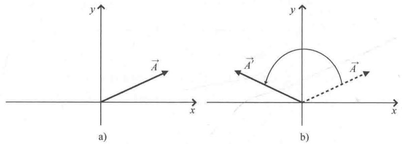
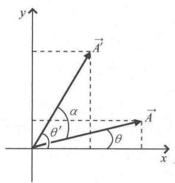
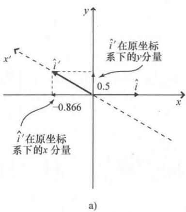
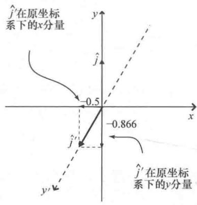

import Guide from '@/components/Guide.astro';
import Knowledge from '@/components/Knowledge.astro';
import Example from '@/components/Example.astro';
import Analysis from '@/components/Analysis.astro';
import Solution from '@/components/Solution.astro';
import Variant from '@/components/Variant.astro';
import Note from '@/components/Note.astro';
import Block from '@/components/Block.astro';
import Method from '@/components/Method.astro';
import Exercise from '@/components/Exercise.astro';

## 4.2 基矢量变换

上一节的内容阐明了二维笛卡儿坐标轴旋转时矢量分量发生的变化，结果不出意料：参照新（旋转）坐标轴的矢量分量与参照原（未旋转）坐标轴的矢量分量并不相同。具体地说，新的分量是原分量的加权线性组合。

这里强调一点：要想通过矢量过渡到张量，就一定会讨论到矢量的"协变"和"逆变"分量 ① ．讨论中可能会遇到这样的说法：协变分量与基矢量变换的方式一样（"co"≈"with"），逆变分量与基矢量变换的方式相反（"cotra"≈"against"）．从本章后面的内容会看到，这种说法固然包括很多真实的信息，但也设下一个很深的陷阱．这是因为基矢量的"变换"通常是指从原（未旋转）坐标系下基矢量到新（旋转）坐标系下不同基矢量（沿坐标轴方向）的变换，而矢量分量的"变换"则是指同一个矢量相对两组不同的坐标轴分量的变化．这里非常容易产生混淆，因此舒茨（Bernard F. Schutz）在1983年写到"放弃'co'和'contra'的原因是为了避免将两个完全不同的概念混淆到一起" ② ．无论好坏，"协变/逆变"这两个术语仍然在使用，本书也会将这两个词语与更现代的术语一同使用．

为什么先提到"协变/逆变"？这可能是因为将一个矢量变换为另一个矢量的过程与将一个矢量的分量从一个坐标系变换为另一个坐标系的过程有很多共同之处。下面就来介绍如何通过旋转生成新矢量（特别是如何旋转基矢量）。

以图4.7a中的矢量 $\vec{A}$ 为例说明如何旋转矢量．旋转矢量 $\vec{A}$ 使其指向不同的方向，图4.7b所示，这意味着旋转后的矢量不再是原来的矢量，因此把它记为 $A'$ 。从几何图形中，很容易看出原（未旋转）矢量与新（旋转）矢量的分量之间的关系，如图4.8所示。

  
图4.7 矢量的旋转

  
图 4.8 含角度的矢量旋转

如果该例中的旋转角度是 $\alpha$ ，则矢量 $A$ ， $A^{\prime}$ 的 $x$ 分量和 $y$ 分量分别为

$$
A _ {x} = \left| \overrightarrow {A} \right| \cos (\theta), A _ {x} ^ {\prime} = \left| \overrightarrow {A ^ {\prime}} \right| \cos (\theta^ {\prime}),
$$

$$
A _ {y} = \left| \overrightarrow {A} \right| \sin (\theta), A _ {y} ^ {\prime} = \left| \overrightarrow {A ^ {\prime}} \right| \sin (\theta^ {\prime}).
$$

其中， $\theta^{\prime}=\alpha+\theta$ ，因此分量 $A_{x}^{\prime}$ ， $A_{y}^{\prime}$ 为

$$
A _ {x} ^ {\prime} = \left| \overrightarrow {A} ^ {\prime} \right| \cos (\alpha + \theta) = \left| \overrightarrow {A} ^ {\prime} \right| [ \cos (\alpha) \cos (\theta) - \sin (\alpha) \sin (\theta) ],
$$

$$
A _ {y} ^ {\prime} = \left| \vec {A} ^ {\prime} \right| \sin (\alpha + \theta) = \left| \vec {A} ^ {\prime} \right| [ \sin (\alpha) \cos (\theta) + \cos (\alpha) \sin (\theta) ].
$$

因为矢量 $\vec{A}$ 与矢量 $\vec{A}'$ 的长度相同（旋转矢量并不会改变矢量的长度），即 $|\vec{A}|=|\vec{A}'|$ ，所以：

$$
\begin{array}{r l} A _ {x} ^ {\prime} & = | \vec {A} ^ {\prime} | [ \cos (\alpha) \cos (\theta) - \sin (\alpha) \sin (\theta) ] \\ & = | \vec {A} | \cos (\alpha) \cos (\theta) - | \vec {A} | \sin (\alpha) \sin (\theta), \\ A _ {y} ^ {\prime} & = | \vec {A} ^ {\prime} | [ \sin (\alpha) \cos (\theta) + \cos (\alpha) \sin (\theta) ] \\ & = | \vec {A} | \sin (\alpha) \cos (\alpha) + | \vec {A} | \cos (\alpha) \sin (\theta). \end{array}
$$

又因为 $|\vec{A}|\cos (\theta) = A_x$ ， $|\vec{A}|\sin (\theta) = A_y$ ，所以：

$$
\begin{array}{l} A _ {x} ^ {\prime} = A _ {x} \cos (\alpha) - A _ {y} \sin (\alpha), \\ A _ {y} ^ {\prime} = A _ {x} \sin (\alpha) + A _ {y} \cos (\alpha). \end{array}
$$

或者写成矩阵方程：

$$
\binom {A _ {x} ^ {\prime}} {A _ {y} ^ {\prime}} = \left( \begin{array}{c c} \cos (\alpha) & - \sin (\alpha) \\ \sin (\alpha) & \cos (\alpha) \end{array} \right) \binom {A _ {x}} {A _ {y}}.\tag{4.15}
$$

也就是通过式（4.15）可以求出新矢量（ $\vec{A}'$ ）在同一坐标系下的分量 $A_{x}^{\prime}, A_{y}^{\prime}$ .

下面举一个例子，考虑图4.7中矢量的旋转，已知原矢量为 $\vec{A} = A_{x}\hat{i} +A_{y}\hat{j} = 5\hat{i} +3\hat{j}$ ，若矢量旋转的角度为 $\alpha = 150^{\circ}$ ，则：

$$
\binom {A _ {x} ^ {\prime}} {A _ {y} ^ {\prime}} = \left( \begin{array}{c c} \cos (1 5 0 ^ {\circ}) & - \sin (1 5 0 ^ {\circ}) \\ \sin (1 5 0 ^ {\circ}) & \cos (1 5 0 ^ {\circ}) \end{array} \right) \binom {5} {3} = \binom {- 5. 8 3} {- 0. 1 0}.\tag{4.16}
$$

因此，新矢量为 $\vec{A}' = -5.83\hat{i} - 0.10\hat{j}$ 。可以看出，将矢量 $\vec{A}$ 旋转 $150^{\circ}$ 后得到的新矢量几乎完全落在 $x$ 的负半轴上（因为新矢量的 $x$ 分量是负值并且要比其 $y$ 分量长得多）。请注意，这是新矢量在同一个基 $(\hat{i}, \hat{j})$ 下的表达式，而不是同一个矢量在新基下的表达式（因为这里旋转的是矢量，而不是坐标系）。

同理，也可以旋转基矢量 $\hat{i}, \hat{j}$ . 如果遇到的问题中涉及旋转后坐标系，并且想要用原（未旋转）坐标系中的基矢量表示指向旋转后坐标系下坐标轴方向的基矢量，这就要用到基矢量旋转. 例如，将单位矢量 $\hat{i}$ 逆时针旋转 $150^{\circ}$ ，有：

$$
\binom {\hat {i} _ {x} ^ {\prime}} {\hat {i} _ {y} ^ {\prime}} = \left( \begin{array}{c c} \cos (1 5 0 ^ {\circ}) & - \sin (1 5 0 ^ {\circ}) \\ \sin (1 5 0 ^ {\circ}) & \cos (1 5 0 ^ {\circ}) \end{array} \right) \binom {1} {0} = \binom {- 0. 8 6 6} {0. 5},\tag{4.17}
$$

其中， $\hat{i}_x'$ 表示矢量 $\hat{i}$ 旋转了 $150^{\circ}$ 后的 $x$ 分量， $\hat{i}_y'$ 表示矢量 $\hat{i}$ 旋转了 $150^{\circ}$ 后的 $y$ 分量，如图4.9a所示。同样，将单位矢量 $\hat{j}$ 逆时针旋转相同的角度，有：

$$
\binom {\hat {j} _ {x} ^ {\prime}} {\hat {j} _ {y} ^ {\prime}} = \left( \begin{array}{c c} \cos (1 5 0 ^ {\circ}) & - \sin (1 5 0 ^ {\circ}) \\ \sin (1 5 0 ^ {\circ}) & \cos (1 5 0 ^ {\circ}) \end{array} \right) \binom {0} {1} = \binom {- 0. 5} {- 0. 8 6 6}.\tag{4.18}
$$

其中， $\hat{j}_x'$ 表示矢量 $\hat{j}$ 旋转了 $150^{\circ}$ 后的 $x$ 分量， $\hat{j}_y'$ 表示矢量 $\hat{j}$ 旋转了 $150^{\circ}$ 后的 $y$ 分量，如图4.9b所示.

  
b)  
图 4.9 $\hat{i}'$ , $\hat{j}'$ 在原（未旋转）坐标系下的分量

同式（4.15）一致，新基矢量 $\hat{i}^{\prime},\hat{j}^{\prime}$ 的分量与原基矢量 $\hat{i},\hat{j}$ 的分量都是在原坐标系下表示的．但是， $\hat{i}^{\prime},\hat{j}^{\prime}$ 在旋转坐标系下的分量一定是（1，0），（0，1），见上一节内容.

因此，要想将一组基矢量变换为新的基矢量（指向不同的坐标轴），就要运用"直接"或"主"变换矩阵，矩阵方程如下：

$$
(\text {新的基矢量}) = \binom {\text {直接}} {\text {变换矩阵}} (\text {原基矢量})\tag{4.19}
$$

比较式（4.14）与式（4.19）就能知道变换矩阵可以用于两种不同但是相关的运算：一是可以求出同一个矢量在新坐标系下的分量，二是可以求出不同矢量（例如新的基矢量）在原坐标系下的分量. 下一节内容就来比较这两种不同类型的变换矩阵.
