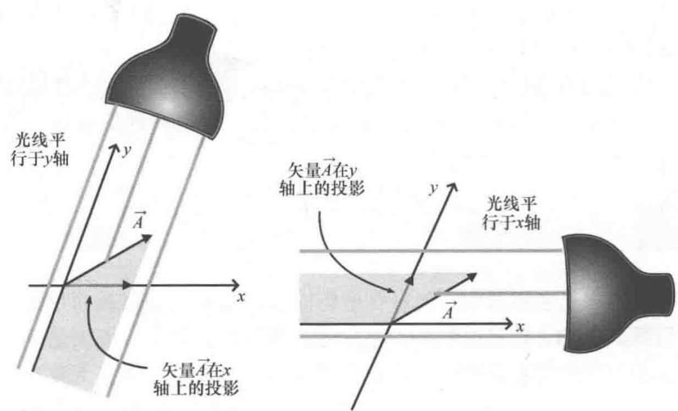
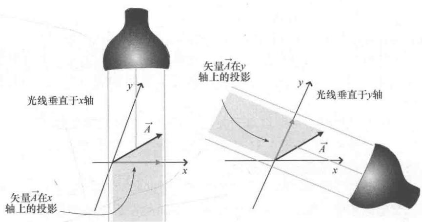
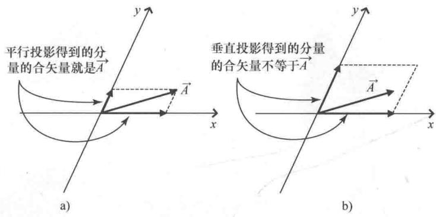

import Guide from '@/components/Guide.astro';
import Knowledge from '@/components/Knowledge.astro';
import Example from '@/components/Example.astro';
import Analysis from '@/components/Analysis.astro';
import Solution from '@/components/Solution.astro';
import Variant from '@/components/Variant.astro';
import Note from '@/components/Note.astro';
import Block from '@/components/Block.astro';
import Method from '@/components/Method.astro';
import Exercise from '@/components/Exercise.astro';

## 4.4 非正交坐标系

在笛卡儿坐标系中，矢量在坐标轴上"投影"的过程很简单。只要用第1章的光源和投影法，想象光源照射在矢量上，该矢量在一个坐标轴上产生阴影就能得到投影，如图1.6所示。二维笛卡儿坐标系中，有两种等价的方法指定光的方向：一是平行于其中一个坐标轴（实际上光是照回到原点的，也就是反平行于坐标轴）；二是垂直于另一个坐标轴。例如，图1.6a中光线照射"反平行于y轴"与"垂直于x轴"这两种说法是完全一样的。

现在考虑 $x$ 轴与 $y$ 轴相互不垂直的二维坐标系。这种情况下，矢量向坐标轴投影的过程要更复杂。光源照射应该（反-）平行于坐标轴（如图4.10所示），还是应该垂直于坐标轴呢（如图4.11所示）？

这两种光线照射都可以得到矢量在其中一个坐标轴上的"投影"。但是，比较图4.10与图4.11中投射的"阴影"的长度就可以看出，这些投影的长度可能有很大不同。

有人会说，投影不同"那又如何？"有这样的疑问也很正常，在非正交坐标系中，矢量向坐标轴有两种不同的投影方法很重要吗？是的，很重要.

其中一个原因是，如果想要运用矢量加法法则计算投影分量的矢量和得到 $\vec{A}$ ，那么选择投影方法就很关键。如果用平行投影分量可以实现，但是如果选择垂直投影分量就实现不了，如图4.12所示。那为什么还要把垂直投影分量称为"分量"呢？

  
图 4.10 用平行于 x 轴与 y 轴的光线照射产生投影

  
图 4.11 用垂直于 x 轴与 y 轴的光线照射产生投影

要理解平行投影和垂直投影之间差异的重要性还有一种方法：考虑由这两种投影形成的分量如何在坐标系之间变换。本章稍后就可以看到，由垂直坐标轴投影法得到的分量在坐标系之间变换时用的是直接变换矩阵，该矩阵也用于求新坐标系中的新基矢量；由平行坐标轴投影法得到的分量在坐标系之间变换时用的是逆变换矩阵。正是因为这样的性质，垂直投影分量传统上被称为矢量的"协变"分量，而平行投影分量则被称为矢量的"逆变"分量。在正交坐标系下，平行于一个坐标轴就相当于垂直于其他坐标轴，此时，矢量的协变分量和逆变分量是相同的，不需要区分。

  
图 4.12 平行和垂直投影分量的矢量加法

协变值为什么被称为"分量"？协变分量和逆变分量具有什么重要意义？怎样运用它们得到不依赖于观察者参考系的物理定律？要想搞清楚这些问题，首先就要理解对偶基矢量的概念。下一节就来介绍对偶基矢量。
