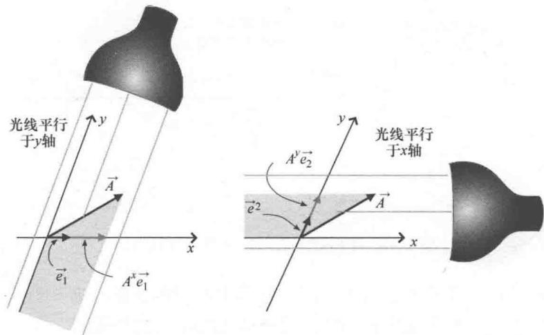
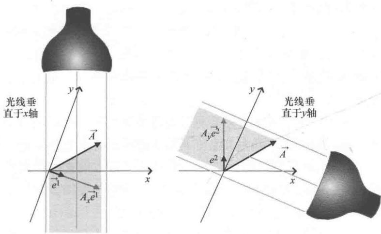

import Guide from '@/components/Guide.astro';
import Knowledge from '@/components/Knowledge.astro';
import Example from '@/components/Example.astro';
import Analysis from '@/components/Analysis.astro';
import Solution from '@/components/Solution.astro';
import Variant from '@/components/Variant.astro';
import Note from '@/components/Note.astro';
import Block from '@/components/Block.astro';
import Method from '@/components/Method.astro';
import Exercise from '@/components/Exercise.astro';

## 4.5 对偶基矢量

从几何图形上可以看出（例如图4.12），矢量在非正交坐标系下由垂直坐标轴投影的方法得到的"分量"与平行投影不同，垂直投影分量按照矢量相加得到的并不是给定的原矢量。但是，在分量作为矢量"相加"时，必须要考虑到基矢量在其中的作用。先考虑平行投影，沿（非正交）坐标轴方向的基矢量为 $\vec{e}_1$ ， $\vec{e}_2$ ，矢量 $\vec{A}$ 在这两个方向上投影，如图4.13所示。该例中，矢量 $\vec{A}$ 可以记作：

$$
\vec {A} = A ^ {x} \vec {e} _ {1} + A ^ {y} \vec {e} _ {2}.\tag{4.20}
$$

其中， $A^{x}$ ， $A^{y}$ 表示 $\vec{A}$ 的平行投影（逆变）分量.

  
图 4.13 平行投影分量与基矢量

从图4.12b中的投影长度就能看出，两个垂直投影"分量" $A_{x}$ ， $A_{y}$ 乘以基矢量 $\vec{e}_1$ ， $\vec{e}_2$ 再相加不等于矢量 $\vec{A}$ ，因此该方法不适用于垂直投影分量。那么，是否存在其他可替代的基矢量，使得垂直投影分量可以运用与式（4.20）类似的方法得到原矢量呢？幸运的是"有"，并且这些替代基矢量称为"互反"或"对偶"基矢量。

对偶基矢量具有两个本质特征．第一个特征：每一个对偶基矢量一定垂直于所有指标不同的原基矢量．为了与原基矢量 $\vec{e}_1$ ， $\vec{e}_2$ 区分开，我们把对偶基矢量记为 $\vec{e}^1$ ， $\vec{e}^2$ ，因此一定有 $\vec{e}^1$ 垂直于 $\vec{e}_2$ （本例中也就是垂直于 $y$ 轴）， $\vec{e}^2$ 垂直于 $\vec{e}_1$ （本例中也就是垂直于 $x$ 轴）．对偶基矢量 $\vec{e}^1$ ， $\vec{e}^2$ 的方向如图4.14所示.

第二个特征：对偶基矢量中的每一个基矢量与指标相同的原基矢量的点积一定等于1（因此 $\vec{e}^1\cdot \vec{e}_1 = 1$ ， $\vec{e}^2\cdot \vec{e}_2 = 1$ ）.根据这个特征，只要已知原基矢量的长度和每个对偶基矢量与相应原基矢量之间的夹角，就能求出对偶基矢量的长度 ① 。因此，只要将原基矢量 $\vec{e}_{1}$ 的长度乘以 $\vec{e}1$ 与 $\vec{e}_{1}$ 的夹角余弦，再求倒数，就可以求出 $\vec{e}1$ 的长度。同理，只要将原基矢量 $\vec{e}_{2}$ 的长度乘以 $\vec{e}2$ 与 $\vec{e}_{2}$ 的夹角余弦，再求倒数，就可以求出 $\vec{e}2$ 的长度。即：

  
图 4.14 垂直投影分量与对偶基矢量

$$
\mid \vec {e} ^ {1} \mid = \frac {1}{\mid \vec {e} _ {1} \mid \cos (\theta_ {1})},\tag{4.21}
$$

且

$$
\mid \vec {e} ^ {2} \mid = \frac {1}{\mid \vec {e} _ {2} \mid \cos (\theta_ {2})}.\tag{4.22}
$$

其中， $\theta_{1}$ 为 $\vec{e}1$ 与 $\vec{e}_{1}$ 的夹角， $\theta_{2}$ 为 $\vec{e}2$ 与 $\vec{e}_{2}$ 的夹角.

有了对偶基矢量的概念，就可以理解为什么把垂直投影（协变）分量 $A_{x}$ ， $A_{y}$ 称为"分量"了。关键是因为这里的投影是向对偶基矢量的方向投影，而不是原基矢量的方向。投影后，协变分量 $A_{x}$ ， $A_{y}$ 乘以对应的基矢量再相加就得到原矢量 $\vec{A}$ ，这与由平行投影（逆变）分量 $A^{x}$ ， $A^{y}$ 得到原矢量的方法是一致的。因此，与式（4.20）类似，

由协变分量得到：

$$
\vec {A} = A _ {x} \vec {e} ^ {1} + A _ {y} \vec {e} ^ {2}.\tag{4.23}
$$

如您所料，使用上标表示对偶基矢量 $\vec{e}1$ ， $\vec{e}2$ 并非偶然，当这些基矢量变换到新的坐标系时，就要用到逆变换矩阵，它也用于矢量逆变分量 $A^{x}$ ， $A^{y}$ .

请注意，二维笛卡儿坐标系的对偶基矢量与指向坐标轴方向的原基矢量是相同的。这是因为二维笛卡儿坐标系具有正交基矢量（例如 $\hat{i},\hat{j}$ ）并且每个对偶基矢量一定与一个原基矢量方向垂直，因此对偶基矢量的方向一定沿 $x$ 轴和 $y$ 轴。又因为对偶基矢量的长度一定等于原基矢量长度乘以 $\cos (\theta)$ 再取倒数（本例中为 $1 / [1\cos (0^{\circ})]$ ，所以对偶基矢量的长度与同方向的 $\hat{i},\hat{j}$ 相同。因此，正交坐标系的原基矢量和对偶基矢量是没有差别的，就像正交坐标系中的协变分量和逆变分量没有区别一样。

对偶基矢量中的概念可以直接推广到三维，并且三维对偶基矢量的长度和方向通过矢量的点积和叉积很容易确定。假如三维原基矢量分别为 $\vec{e}_1, \vec{e}_2, \vec{e}_3$ ，要求三维对偶基矢量 $\vec{e}^1, \vec{e}^2, \vec{e}^3$ ，只要利用下面的关系即可：

$$
\begin{array}{l} \vec {e} ^ {1} = \frac {\vec {e} _ {2} \times \vec {e} _ {3}}{\vec {e} _ {1} \cdot (\vec {e} _ {2} \times \vec {e} _ {3})}, \\ \vec {e} ^ {2} = \frac {\vec {e} _ {3} \times \vec {e} _ {1}}{\vec {e} _ {1} \cdot (\vec {e} _ {2} \times \vec {e} _ {3})}, \\ \vec {e} ^ {3} = \frac {\vec {e} _ {1} \times \vec {e} _ {2}}{\vec {e} _ {1} \cdot (\vec {e} _ {2} \times \vec {e} _ {3})}. \end{array}\tag{4.24}
$$

方程中的分母均为原基矢量的三重标积，而三重标积等于三个矢量构成平行六面体的体积，见第2.3节.

等式分子中的叉积确保了对偶基矢量第一个特征的成立（例如， $\vec{e}^1$ 垂直于 $\vec{e}_2, \vec{e}_3$ ）。分母中的三重标积确保了对偶基矢量第二个特征的成立（例如， $\vec{e}^1 \cdot \vec{e}_1 = 1$ ）。

要想通过计算对偶基矢量实现矢量的另一种表达形式看起来比较麻烦，但是比较式（4.20）和式（4.23）后却有重大的发现—这些方程表示的是同一个矢量。不妨将它们写在一起：

$$
\vec {A} = A ^ {x} \vec {e} _ {1} + A ^ {y} \vec {e} _ {2} = A _ {x} \vec {e} ^ {1} + A _ {y} \vec {e} ^ {2}.\tag{4.25}
$$

为了定义一个坐标变换下的不变量（如矢量 $\vec{A}$ ），可以选择将上标（逆变）分量与下标（协变）基矢量组合，也可以将下标（协变）分量与上标（逆变）基矢量组合。因为协变分量是用直接变换矩阵变换的，而逆变分量是用逆变换矩阵变换的，所以这样表示是合理的。将这些量乘起来就可以保证变换下的结果不受影响。

下一节将举例说明如何确定对偶基矢量以及协变分量和逆变分量.
