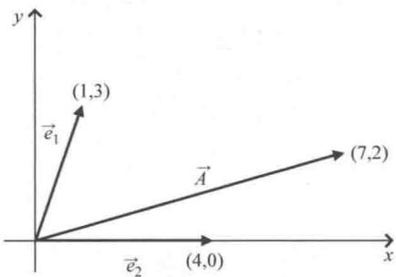
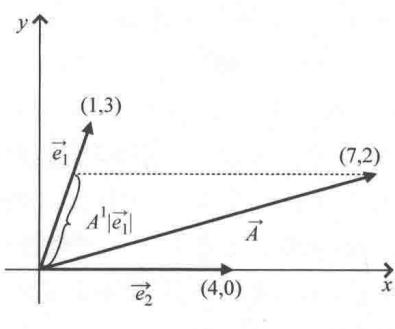
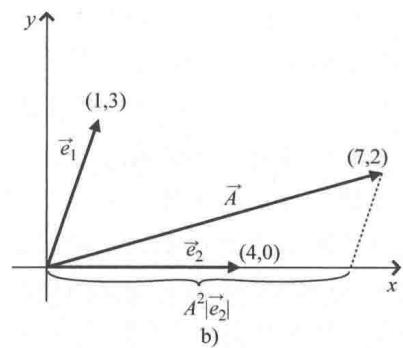
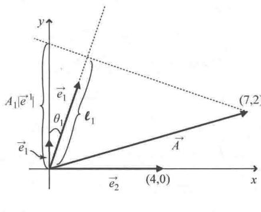
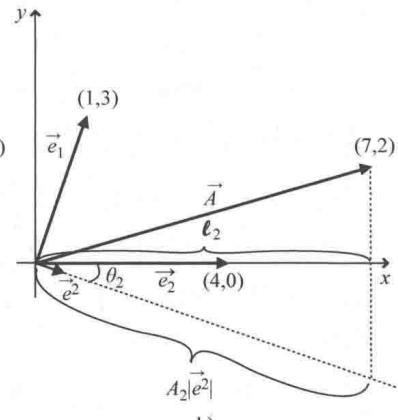

import Guide from '@/components/Guide.astro';
import Knowledge from '@/components/Knowledge.astro';
import Example from '@/components/Example.astro';
import Analysis from '@/components/Analysis.astro';
import Solution from '@/components/Solution.astro';
import Variant from '@/components/Variant.astro';
import Note from '@/components/Note.astro';
import Block from '@/components/Block.astro';
import Method from '@/components/Method.astro';
import Exercise from '@/components/Exercise.astro';

## 4.6 协变分量与逆变分量的求法

如果掌握了非正交坐标系中的对偶基矢量的概念，求协变分量和逆变分量就变得很容易了。举个例子，已知矢量 $\vec{A}$ 以及非正交基矢量 $\vec{e}_1, \vec{e}_2$ ，如图4.15所示。

  
图 4.15 非正交基矢量

要求逆变分量 $A^1, A^2$ ，只要将矢量 $\vec{A}$ 平行投影到原基矢量 $\vec{e}_1, \vec{e}_2$ 的方向即可，如图4.16所示。从图上看，分量 $A^1 | \vec{e}_1|$ 应该是原基矢量 $\vec{e}_1$ 长度的 $2/3$ ，分量 $A^2 | \vec{e}_2|$ 应该是原基矢量 $\vec{e}_2$ 长度的 1.5 倍。由矢量方程：

$$
\vec {A} = A ^ {1} \vec {e} _ {1} + A ^ {2} \vec {e} _ {2}\tag{4.26}
$$

  
a)

  
图 4.16 原基矢量上的平行投影

就可以求出 $A^1$ ， $A^2$ 的值

将式（4.26）写成 $\vec{A}$ 的两个分量方程：

$$
\begin{array}{l} A _ {x} = A ^ {1} e _ {1, x} + A ^ {2} e _ {2, x}, \\ A _ {y} = A ^ {1} e _ {1, y} + A ^ {2} e _ {2, y}. \end{array}
$$

联立这两个方程，利用消元法或者代入法解出 $A^1$ ， $A^2$ （这两种方法的证明为本章末的习题，证明过程见线上答案）．还可以通过矩阵法，运用克拉默法则（见本书网站上矩阵代数的相关内容）求解．将矢量 $\vec{A}$ 以及 $\vec{e}_1$ ， $\vec{e}_2$ 的值代入，得矩阵方程为

$$
\binom {7} {2} = A ^ {1} \binom {1} {3} + A ^ {2} \binom {4} {0},\tag{4.27}
$$

也可以写成：

$$
\binom {7} {2} = \left( \begin{array}{c c} 1 & 4 \\ 3 & 0 \end{array} \right) \binom {A ^ {1}} {A ^ {2}}.\tag{4.28}
$$

接下来运用克拉默法则可以求解出 $A^1, A^2$ ：

$$
A ^ {1} = \frac {\left| \begin{array}{l l} 7 & 4 \\ 2 & 0 \end{array} \right|}{\left| \begin{array}{l l} 1 & 4 \\ 3 & 0 \end{array} \right|} = \frac {- 8}{- 1 2} = 0. 6 6 7, A ^ {2} = \frac {\left| \begin{array}{l l} 1 & 7 \\ 3 & 2 \end{array} \right|}{\left| \begin{array}{l l} 1 & 4 \\ 3 & 0 \end{array} \right|} = \frac {- 1 9}{- 1 2} = 1. 5 8 3.\tag{4.29}
$$

这与我们从图 4.16 估计的结果一致.

要想运用相同的方法求出垂直投影（协变）分量 $A_{1}, A_{2}$ ，首先要确定对偶基矢量的长度和方向。已知 $\vec{e}1$ 的方向一定垂直于 $\vec{e}_{2}$ 的方向， $\vec{e}2$ 的方向一定垂直于 $\vec{e}_{1}$ 的方向，因此要想求出对偶基矢量的长度，首先要求出 $\vec{e}_{1}, \vec{e}_{2}$ 的长度：

$$
\mid \vec {e} _ {1} \mid = \sqrt {(1) ^ {2} + (3) ^ {2}} = 3. 1 6, \mid \vec {e} _ {2} \mid = \sqrt {(4) ^ {2} + (0) ^ {2}} = 4. 0 0.\tag{4.30}
$$

代入式（4.21）和式（4.22）就可以求出 $|\vec{e}^1|, |\vec{e}^2|$ . 在此之前，要先求出 $\vec{e}_1$ 与 $\vec{e}^1$ 的夹角（即 $\theta_1$ ）以及 $\vec{e}_2$ 与 $\vec{e}^2$ 的夹角（即 $\theta_2$ ).

根据图 4.17，有 $\theta_{1}=\theta_{2}=\arctan(1/3)=18.43^{\circ}$ . 因此：

$$
\begin{array}{r l} & {\mid \vec {e} ^ {1} \mid = \frac {1}{\mid \vec {e} _ {1} \mid \cos (\theta_ {1})} = \frac {1}{3 . 1 6 \cos (1 8 . 4 3 ^ {\circ})} = 0. 3 3 3,} \\ & {\mid \vec {e} ^ {2} \mid = \frac {1}{\mid \vec {e} _ {2} \mid \cos (\theta_ {2})} = \frac {1}{4 . 0 0 \cos (1 8 . 4 3 ^ {\circ})} = 0. 2 6 4.} \end{array}\tag{4.31}
$$

对偶基矢量 $\vec{e}1$ ， $\vec{e}2$ （非常短），如图4.17所示。再次强调， $\vec{e}1$ 垂直于 $\vec{e}_{2}$ ， $\vec{e}2$ 垂直于 $\vec{e}_{1}$ ，式（4.31）给出了 $\vec{e}1$ ， $\vec{e}2$ 的长度。

掌握了对偶基矢量，就可以求出垂直投影（协变）分量 $A_{1}, A_{2}$ 。这里运用几何方法，过矢量 $\vec{A}$ 的终点向 $\vec{e}_{1}, \vec{e}_{2}$ 的方向线作垂线并继续延长垂直投影线到 $\vec{e}1, \vec{e}2$ 的方向线上，如图4.17所示。矢量 $\vec{A}$ 的长度为

$$
\vert \vec {A} \vert = \sqrt {(7) ^ {2} + (2) ^ {2}} = 7. 2 8,\tag{4.32}
$$

矢量 $\vec{A}$ 与 $x$ 轴的夹角为 $\arctan\left(\frac{2}{7}\right)=15.94^{\circ}$ 。通过这个角以及上面给出的 $\theta_{1}$ ，就可以确定 $\vec{A}$ 与 $\vec{e}_{1}$ 的夹角为 $55.62^{\circ}$ ， $\vec{A}$ 与 $\vec{e}_{2}$ 的夹角为 $15.94^{\circ}$ 。因此，图4.17a中 $l_{1}$ 的长度为

$$
l _ {1} = | \vec {A} | \cos (5 5. 6 2 ^ {\circ}) = 4. 1 1,\tag{4.33}
$$

且

$$
A _ {1} \mid \vec {e} ^ {1} \mid = \frac {l _ {1}}{\cos (1 8 . 4 3 ^ {\circ})} = 4. 3 3,\tag{4.34}
$$

因此， $A_{1}=4.33/0.333=13.0.$

  
a)

  
b)  
图 4.17 对偶基矢量上的垂直投影

同理，由图4.17b可以求出 $A_{2}$

$$
l _ {2} = | \vec {A} | \cos (1 5. 9 4 ^ {\circ}) = 7. 0 0,\tag{4.35}
$$

且

$$
A _ {2} \mid \vec {e} ^ {2} \mid = \frac {l _ {2}}{\cos (1 8 . 4 3 ^ {\circ})} = 7. 3 8,\tag{4.36}
$$

因此， $A_{2}=7.38/0.264=28.0.$

这些结果提醒我们注意，当使用非规范基矢量（即，大小不等于1的基矢量）时，坐标轴上投影的长度与矢量分量的大小不相等。这是因为投影是分量与基矢量大小的乘积。

也可以用代数方法求 $A_{1}, A_{2}$ ，过程同求 $A1, A2$ 时一样。但是，所用的方程为

$$
\vec {A} = A _ {1} \vec {e} ^ {1} + A _ {2} \vec {e} ^ {2}.\tag{4.37}
$$

对偶基矢量 $\vec{e}^1$ ， $\vec{e}^2$ 的 $x$ ， $y$ 分量为

$$
e _ {x} ^ {1} = \left| \vec {e} ^ {1} \right| \cos (9 0 ^ {\circ}) = 0. 0 0 0, e _ {x} ^ {2} = \left| \vec {e} ^ {2} \right| \cos (3 6 0 ^ {\circ} - 1 8. 4 3 ^ {\circ}) = 0. 2 5 0,
$$

$$
e _ {y} ^ {1} = \left| \vec {e} ^ {1} \right| \sin (9 0 ^ {\circ}) = 0. 3 3 3, e _ {y} ^ {2} = \left| \vec {e} ^ {2} \right| \sin (3 6 0 ^ {\circ} - 1 8. 4 3 ^ {\circ}) = - 0. 0 8 3,
$$

接下来将已知的矢量 $\vec{A}$ 以及 $\vec{e}^1$ ， $\vec{e}^2$ 的 $x$ ， $y$ 分量带入，有：

$$
\binom {7} {2} = A _ {1} \binom {0} {0. 3 3 3} + A _ {2} \binom {0. 2 5} {- 0. 0 8 3},\tag{4.38}
$$

同前面一样，上式也可写成：

$$
\binom {7} {2} = \left( \begin{array}{c c} 0 & 0. 2 5 \\ 0. 3 3 3 & - 0. 0 8 3 \end{array} \right) + \binom {A _ {1}} {A _ {2}},\tag{4.39}
$$

再利用克拉默法则求解，可以得出 $A_{1}, A_{2}$

$$
A _ {1} = \frac {\left| \begin{array}{c c} 7 & 0 . 2 5 \\ 2 & - 0 . 0 8 3 \end{array} \right|}{\left| \begin{array}{c c} 0 & 0 . 2 5 \\ 0 . 3 3 3 & - 0 . 0 8 3 \end{array} \right|} = \frac {- 1 . 0 8 1}{- 0 . 0 8 3} = 1 3. 0,\tag{4.40}
$$

$$
A _ {2} = \frac {\left| \begin{array}{c c} 0 & 7 \\ 0 . 3 3 3 & 2 \end{array} \right|}{\left| \begin{array}{c c} 0 & 0 . 2 5 \\ 0 . 3 3 3 & - 0 . 0 8 3 \end{array} \right|} = \frac {- 2 . 3 3 1}{- 0 . 0 8 3} = 2 8. 0,
$$

这与几何方法求得的结果一致.

如果掌握了原基矢量和对偶基矢量，还有求矢量的逆变分量和协变分量更简单的方法，但是要用到以下关系式：

$$
A _ {1} = \vec {A} \cdot \vec {e} _ {1} = A _ {x} e _ {1, x} + A _ {y} e _ {1, y} \quad A _ {2} = \vec {A} \cdot \vec {e} _ {2} = A _ {x} e _ {2, x} + A _ {y} e _ {2, y},\tag{4.41}
$$

且

$$
A ^ {1} = \vec {A} \cdot \vec {e} ^ {1} = A _ {x} e _ {x} ^ {1} + A _ {y} e _ {y} ^ {1}, \quad A ^ {2} = \vec {A} \cdot \vec {e} ^ {2} = A _ {x} e _ {x} ^ {2} + A _ {y} e _ {y} ^ {2},\tag{4.42}
$$

仍然用当前这个例子，根据以上关系，协变分量为

$$
\begin{array}{l} A _ {1} = (7, 2) \cdot (1, 3) = (7) (1) + (2) (3) = 1 3, \\ A _ {2} = (7, 2) \cdot (4, 0) = (7) (4) + (2) (0) = 2 8, \end{array}
$$

且

$$
A ^ {1} = (7, 2) \cdot (0, 0. 3 3 3) = (7) (0) + (2) (0. 3 3 3) = 0. 6 6 6,
$$

$$
A ^ {2} = (7, 2) \cdot (0. 2 5 0, - 0. 0 8 3) = (7) (0. 2 5 0) + (2) (- 0. 0 8 3) = 1. 5 8,
$$

这与几何方法和矩阵代数方法求得的结果一致.

再次强调，我们刚刚求的是矢量 $\vec{A}$ 关于原基矢量 $\vec{e}_{1}$ ， $\vec{e}_{2}$ 和对偶基矢量 $\vec{e}1$ ， $\vec{e}2$ 的平行投影（逆变）分量和垂直投影（协变）分量。那么，可以说 $\vec{A}$ 是协变矢量或者是逆变矢量吗？

答案就是都不可以．协变或者逆变不是指矢量本身，而是指通过平行或垂直投影形成的一组分量．当我们读到有关张量的文献时，很可能会看到"逆变矢量 $\vec{A}$ "或者"协变矢量 $\vec{B}$ "这样的表达，作者意思通常是指问题中用到了矢量 $\vec{A}$ 的逆变分量和矢量 $\vec{B}$ 的协变分量（也许是因为这样表达更简洁）．但是可以确定， $\vec{A}$ 和 $\vec{B}$ 像所有的矢量一样都有逆变分量和协变分量，只要运用本节所讲的方法就可以求得 ①

为什么要花费这么大精力求这些分量呢？可以非常确定的说，协变分量和逆变分量具有巨大的价值。要认识到它们的价值，首先要认识到矢量不仅是既具有确定的长度又指向特定方向的箭头，更是一种张量，而张量在坐标变换下具有很强的可预测性（和实用性）。通过"指标表示法"以及"爱因斯坦求和约定"的运用更容易理解为什么把矢量看成一阶张量以及这样做的意义。下一节就来介绍指标表示法以及爱因斯坦求和约定。
