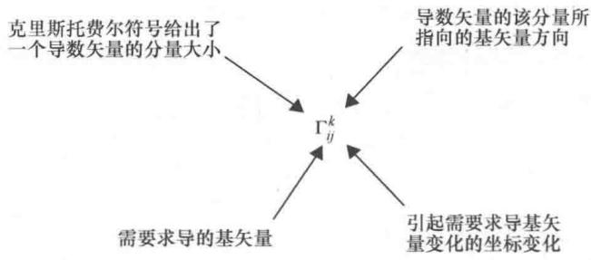
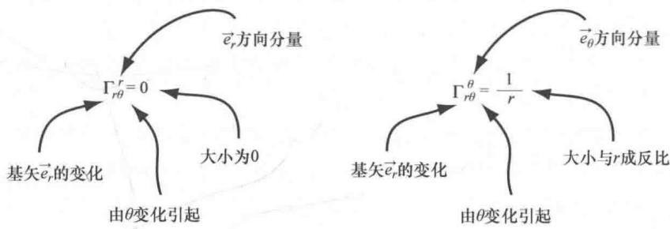

import Guide from '@/components/Guide.astro';
import Knowledge from '@/components/Knowledge.astro';
import Example from '@/components/Example.astro';
import Analysis from '@/components/Analysis.astro';
import Solution from '@/components/Solution.astro';
import Variant from '@/components/Variant.astro';
import Note from '@/components/Note.astro';
import Block from '@/components/Block.astro';
import Method from '@/components/Method.astro';
import Exercise from '@/components/Exercise.astro';

## 5.7 张量的导数和克里斯托费尔符号

在许多情况下，了解矢量从一个位置移动到另一个位置时如何变化是非常重要的。在笛卡儿坐标系中，对矢量求导是非常简单的：只需要对矢量的每一个分量求导即可，之所以可以这样是因为笛卡儿坐标系的基矢量（ $\hat{i}$ 、 $\hat{j}$ 、 $\hat{k}$ ）无论是大小还是方向在任何地方都相同，也就是说你不用考虑对基矢量的求导。但是正如在球极坐标系中看到的，其基矢量（ $\hat{r}$ 、 $\hat{\theta}$ 、 $\hat{\phi}$ ）在空间各点的方向是不断变化的，这就意味着当对这些坐标系中的矢量求空间导数时，必须考虑对基矢量的

求导.

因此，如果矢量 $\vec{A}$ 用广义坐标 $x1$ 、 $x2$ 、 $x3$ 结合其对应的协变基矢量 $\vec{e}_{1}$ 、 $\vec{e}_{2}$ 、 $\vec{e}_{3}$ 表示成：

$$
\vec {A} = A ^ {1} \vec {e} _ {1} + A ^ {2} \vec {e} _ {2} + A ^ {3} \vec {e} _ {3},
$$

则矢量 $\vec{A}$ 对坐标 $x1$ 的导数

$$
\begin{array}{r l} \frac {\partial \vec {A}}{\partial x ^ {1}} & = \frac {\partial (A ^ {1} \vec {e} _ {1} + A ^ {2} \vec {e} _ {2} + A ^ {3} \vec {e} _ {3})}{\partial x ^ {1}} \\ & = \frac {\partial (A ^ {i} \vec {e} _ {i})}{\partial x ^ {1}} \\ & = \frac {\partial A ^ {i} \vec {e} _ {1}}{\partial x ^ {1}} + A ^ {i} \frac {\partial \vec {e} _ {i}}{\partial x ^ {1}}. \end{array}
$$

方程中的第二项使求导过程复杂化了，因为坐标系中基矢量的大小和/或方向随着空间位置的不同在不断变化，当然了，矢量 $\vec{A}$ 对其他坐标求导也会出现类似求导项。因此，如果要评估非正交坐标系中矢量场的变化，则必须考虑基矢量的变化。正确地考虑这些变化意味着求导结果将保留原始对象的张量特征。

幸运的是，有一种方法可以考虑到基矢量的任何变化，并确定一个张量的导数是另外一个张量。这个过程被称为"协变求导"，将在本章下一节具体讨论。但是如果先学习本节中克里斯托费尔符号的含义，将对我们进行协变求导更有帮助。

为了理解克里斯托费尔符号，首先要意识到对基矢量求导将得到另一个矢量，和其他任意矢量一样，该矢量可以用其所依附点的基矢量的加权线性叠加来表示。每一个克里斯托费尔符号只是代表某一个基矢量的加权系数，用大写希腊字母（Γ）表示。因此，克里斯托费尔符号定义的关系 ① 是

$$
\Gamma_ {i j} ^ {k} \vec {e} _ {k} = \frac {\partial \vec {e} _ {i}}{\partial x ^ {j}}.\tag{5.22}
$$

其中，指标 $i$ 是指需要求导的基矢量，指标 $j$ 表示发生变化进而引起第 $i$ 个基矢量变化的坐标，指标 $k$ 确定导数分量所指的方向，如图5.1所示.

  
图 5.1 克里斯托费尔符号的指标说明

因此，如果知道两个克里斯托费尔符号如 $\Gamma_{r\theta}^{r} = 0$ 、 $\Gamma_{r\theta}^{\theta} = \frac{1}{r}$ ，那么

$$
\frac {\partial \vec {e} _ {r}}{\partial \theta} = 0 \vec {e} _ {r} + \frac {1}{r} \vec {e} _ {\theta}
$$

可以帮助我们更深的理解克里斯托费尔符号，如图 5.2 所示.

  
图 5.2 克里斯托费尔符号的指标举例

正如这个例子所示，一旦知道了指标代码，克里斯托费尔符号理解起来非常简单。最重要的是，如果知道所在坐标系度规张量的矩阵元，这些有用的符号就很容易确定。要想得到克里斯托费尔符号和度规张量之间的关系需要一些代数知识，但是这么做是值得的。

一个比较好的方法是用基矢量 $\vec{e}_l$ 点乘方程（5.22）两边：

$$
\Gamma_ {i j} ^ {k} \vec {e} _ {k} \cdot \vec {e} ^ {l} = \vec {e} ^ {l} \cdot \frac {\partial \vec {e} _ {i}}{\partial x ^ {j}}.
$$

因为 $\vec{e}_k\cdot \vec{e}^l = \delta_k^l$ ，所以

$$
\Gamma_ {i j} ^ {k} \delta_ {k} ^ {l} = \vec {e} ^ {l} \cdot \frac {\partial \vec {e} _ {i}}{\partial x ^ {j}},
$$

$$
\Gamma_ {i j} ^ {l} = \vec {e} ^ {l} \cdot \frac {\partial \vec {e} _ {i}}{\partial x ^ {j}}.
$$

因为 $\frac{\partial\vec{e}_i}{\partial x^j}$ 与 $\frac{\partial\vec{e}_j}{\partial x^i}$ 相等，所以可以写成

$$
\Gamma_ {i j} ^ {l} = \frac {1}{2} \vec {e} ^ {l} \cdot \frac {\partial \vec {e} _ {i}}{\partial x ^ {j}} + \frac {1}{2} \vec {e} ^ {l} \cdot \frac {\partial \vec {e} _ {j}}{\partial x ^ {i}}.
$$

在不添加其他项之前，这看起来毫无意义。但是如果可以将它写成下面形式：

$$
\begin{array}{r l} \Gamma_ {i j} ^ {l} & = \frac {1}{2} \vec {e} ^ {l} \cdot \frac {\partial \vec {e} _ {i}}{\partial x ^ {j}} + \left(\frac {1}{2} g ^ {k l} \frac {\partial \vec {e} _ {k}}{\partial x ^ {j}} \cdot \vec {e} _ {i} - \frac {1}{2} g ^ {k l} \frac {\partial \vec {e} _ {j}}{\partial x ^ {k}} \cdot \vec {e} _ {i}\right) \\ & + \frac {1}{2} \vec {e} ^ {l} \cdot \frac {\partial \vec {e} _ {j}}{\partial x ^ {i}} + \left(\frac {1}{2} g ^ {k l} \frac {\partial \vec {e} _ {k}}{\partial x ^ {i}} \cdot \vec {e} _ {j} - \frac {1}{2} g ^ {k l} \frac {\partial \vec {e} _ {i}}{\partial x ^ {k}} \cdot \vec {e} _ {j}\right). \end{array}
$$

注意每一行的括号中的项相加为零，所以添加上这些项并没有改变方程右边的值。这样看起来好像越来越复杂，但是当完成更多的变换后，情况会变得更加清楚。首先意识到 $\vec{e}^l = g^{kl}\vec{e}_k$ ，所以克里斯托费尔符号变为

$$
\begin{array}{r l} \Gamma_ {i j} ^ {l} & = \frac {1}{2} g ^ {k l} \vec {e} _ {k} \cdot \frac {\partial \vec {e} _ {i}}{\partial x ^ {j}} + \left(\frac {1}{2} g ^ {k l} \frac {\partial \vec {e} _ {k}}{\partial x ^ {j}} \cdot \vec {e} _ {i} - \frac {1}{2} g ^ {k l} \frac {\partial \vec {e} _ {j}}{\partial x ^ {k}} \cdot \vec {e} _ {i}\right) \\ & + \frac {1}{2} g ^ {k l} \vec {e} _ {k} \cdot \frac {\partial \vec {e} _ {j}}{\partial x ^ {i}} + \left(\frac {1}{2} g ^ {k l} \frac {\partial \vec {e} _ {k}}{\partial x ^ {i}} \cdot \vec {e} _ {j} - \frac {1}{2} g ^ {k l} \frac {\partial \vec {e} _ {i}}{\partial x ^ {k}} \cdot \vec {e} _ {j}\right). \end{array}
$$

现在只需要提出公因子 $\frac{1}{2} g^{kl}$ 并其根据指标合并分组：

$$
\begin{array}{r l} \Gamma_ {i j} ^ {l} = & \frac {1}{2} g ^ {k l} \left[ \left(\vec {e} _ {k} \cdot \frac {\partial \vec {e} _ {i}}{\partial x ^ {j}} + \frac {\partial \vec {e} _ {k}}{\partial x ^ {j}} \cdot \vec {e} _ {i}\right) + \left(\vec {e} _ {k} \cdot \frac {\partial \vec {e} _ {j}}{\partial x ^ {i}} + \frac {\partial \vec {e} _ {k}}{\partial x ^ {i}} \cdot \vec {e} _ {j}\right) - \left(\frac {\partial \vec {e} _ {j}}{\partial x ^ {k}} \cdot \vec {e} _ {i} + \frac {\partial \vec {e} _ {i}}{\partial x ^ {k}} \cdot \vec {e} _ {j}\right) \right], \end{array}
$$

如果认识到这一点，可以进一步简化

$$
\begin{array}{l} \vec {e} _ {k} \cdot \frac {\partial \vec {e} _ {i}}{\partial x ^ {j}} + \frac {\partial \vec {e} _ {k}}{\partial x ^ {j}} \cdot \vec {e} _ {i} = \frac {\partial (\vec {e} _ {k} \cdot \vec {e} _ {i})}{\partial x ^ {j}}, \\ \vec {e} _ {k} \cdot \frac {\partial \vec {e} _ {j}}{\partial x ^ {i}} + \frac {\partial \vec {e} _ {k}}{\partial x ^ {i}} \cdot \vec {e} _ {j} = \frac {\partial (\vec {e} _ {j} \cdot \vec {e} _ {k})}{\partial x ^ {i}}, \\ \vec {e} _ {i} \cdot \frac {\partial \vec {e} _ {j}}{\partial x ^ {k}} + \frac {\partial \vec {e} _ {i}}{\partial x ^ {k}} \cdot \vec {e} _ {j} = \frac {\partial (\vec {e} _ {i} \cdot \vec {e} _ {j})}{\partial x ^ {k}}. \end{array}
$$

因此

$$
\Gamma_ {i j} ^ {l} = \frac {1}{2} g ^ {k l} \left[ \frac {\partial (\vec {e} _ {k} \cdot \vec {e} _ {i})}{\partial x ^ {j}} + \frac {\partial (\vec {e} _ {j} \cdot \vec {e} _ {k})}{\partial x ^ {i}} - \frac {\partial (\vec {e} _ {i} \cdot \vec {e} _ {j})}{\partial x ^ {k}} \right].
$$

但是由度规张量的矩阵元可知 $\vec{e}_i\cdot \vec{e}_k = g_{ik}$ 、 $\vec{e}_i\cdot \vec{e}_j = g_{ij}$ ，也就是说上式可以写为

$$
\Gamma_ {i j} ^ {l} = \frac {1}{2} g ^ {k l} \left[ \frac {\partial g _ {i k}}{\partial x ^ {j}} + \frac {\partial g _ {j k}}{\partial x ^ {i}} - \frac {\partial g _ {i j}}{\partial x ^ {k}} \right].\tag{5.23}
$$

如果已知度规张量，通过这个表达式求解任何坐标系的克里斯托费尔符号会变得很简单。这么做有什么意义呢？只因为使用克里斯托费尔符号，可以对矢量和张量求导，不管矢量和张量的变化是由基矢量变化引起还是分量变化引起，这保持了张量最重要的性质：坐标变换不变性。这种协变导数是下一节的研究对象，但是在这之前，可以先考虑一个比较熟悉的坐标系克里斯托费尔符号的例子。

以第1.5节中的圆柱坐标系（ $r$ ， $\phi$ 和 $z$ ）为例，在该坐标系中，线元微分的平方与坐标微分之间的关系为 $\mathrm{ds}^2 = \mathrm{dr}^2 +r^2\mathrm{d}\phi^2 +\mathrm{dz}^2$ 因此，协变度规张量可以表示为

$$
g _ {i j} = \left[ \begin{array}{l l l} g _ {1 1} & g _ {1 2} & g _ {1 3} \\ g _ {2 1} & g _ {2 2} & g _ {2 3} \\ g _ {3 1} & g _ {3 2} & g _ {3 3} \end{array} \right] = \left[ \begin{array}{l l l} 1 & 0 & 0 \\ 0 & r ^ {2} & 0 \\ 0 & 0 & 1 \end{array} \right]
$$

这说明在这种情况下大多数克里斯托费尔符号都为零，可以根据方程（5.23）的定义通过求导来验证。设开始时 $l = 1$ 、 $i = 1$ 、 $j = 1$ （别忘了求和约定意味着必须对所有的 $k$ 求和）：

$$
\begin{array}{r l} \Gamma_ {1 1} ^ {1} = & \frac {1}{2} g ^ {1 1} \left[ \frac {\partial g _ {1 1}}{\partial x ^ {1}} + \frac {\partial g _ {1 1}}{\partial x ^ {1}} - \frac {\partial g _ {1 1}}{\partial x ^ {1}} \right] \\ & + \frac {1}{2} g ^ {2 1} \left[ \frac {\partial g _ {1 2}}{\partial x ^ {1}} + \frac {\partial g _ {1 2}}{\partial x ^ {1}} - \frac {\partial g _ {1 1}}{\partial x ^ {2}} \right] \\ & + \frac {1}{2} g ^ {3 1} \left[ \frac {\partial g _ {1 3}}{\partial x ^ {1}} + \frac {\partial g _ {1 3}}{\partial x ^ {1}} - \frac {\partial g _ {1 1}}{\partial x ^ {3}} \right] \end{array}
$$

然后利用关系式 $x1 = r$ 、 $x2 = \phi$ 、 $x3 = z$

$$
\begin{array}{r l} \Gamma_ {1 1} ^ {1} & = \frac {1}{2} (1) \left[ \frac {\partial (1)}{\partial r} + \frac {\partial (1)}{\partial r} - \frac {\partial (1)}{\partial r} \right] \\ & + \frac {1}{2} (0) \left[ \frac {\partial (0)}{\partial r} + \frac {\partial (0)}{\partial r} - \frac {\partial (1)}{\partial \phi} \right] \\ & + \frac {1}{2} (0) \left[ \frac {\partial (0)}{\partial r} + \frac {\partial (0)}{\partial r} - \frac {\partial (1)}{\partial z} \right] = 0. \end{array}
$$

这看起来很无聊，而且大多数其他项也都是这样．但是当 l=1、i=2、j=2：

$$
\begin{array}{r l} \Gamma_ {2 2} ^ {1} & = \frac {1}{2} g ^ {1 1} \left[ \frac {\partial g _ {2 1}}{\partial x ^ {2}} + \frac {\partial g _ {2 1}}{\partial x ^ {2}} - \frac {\partial g _ {2 2}}{\partial x ^ {1}} \right] \\ & + \frac {1}{2} g ^ {2 1} \left[ \frac {\partial g _ {2 2}}{\partial x ^ {2}} + \frac {\partial g _ {2 2}}{\partial x ^ {2}} - \frac {\partial g _ {2 2}}{\partial x ^ {2}} \right] \\ & + \frac {1}{2} g ^ {3 2} \left[ \frac {\partial g _ {2 3}}{\partial x ^ {2}} + \frac {\partial g _ {2 3}}{\partial x ^ {2}} - \frac {\partial g _ {2 2}}{\partial x ^ {3}} \right], \end{array}
$$

即：

$$
\begin{array}{r l} \Gamma_ {2 2} ^ {1} = & \frac {1}{2} g ^ {1 1} \left[ \frac {\partial g _ {2 1}}{\partial x ^ {2}} + \frac {\partial g _ {2 1}}{\partial x ^ {2}} - \frac {\partial g _ {2 2}}{\partial x ^ {1}} \right] \\ & + \frac {1}{2} g ^ {2 1} \left[ \frac {\partial g _ {2 2}}{\partial x ^ {2}} + \frac {\partial g _ {2 2}}{\partial x ^ {2}} - \frac {\partial g _ {2 2}}{\partial x ^ {2}} \right] \\ & + \frac {1}{2} g ^ {3 2} \left[ \frac {\partial g _ {2 3}}{\partial x ^ {2}} + \frac {\partial g _ {2 3}}{\partial x ^ {2}} - \frac {\partial g _ {2 2}}{\partial x ^ {3}} \right], \end{array}
$$

# 大学生理工专题导读——矢量与张量分析

或：

$$
\Gamma_ {2 2} ^ {1} = \frac {1}{2} (1) [ 0 + 0 - 2 r ] + 0 + 0 = - r.
$$

现在我们已经进行到某一步了，具体是哪一步呢？只要记住克里斯托费尔符号的意义，我们就会清楚这个结果意味着当沿着 $\phi$ 方向移动时，协变基矢量 $\vec{\phi}$ 的变化会产生一个沿 $-\vec{r}$ 方向的分量，且随着到原点距离的增加而直接增加。

类似的分析表明对于圆柱坐标系，另外两个非零的克里斯托费尔符号 $^{\ominus}$ 为 $\Gamma_{12}2=\Gamma_{21}2=1/r$ 。如果不明白怎么得到这个结果，可以参照本章末的习题和线上解答。
