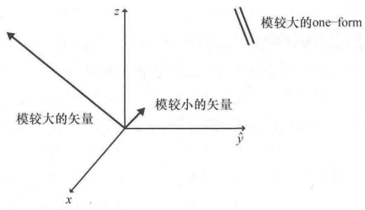

import Guide from '@/components/Guide.astro';
import Knowledge from '@/components/Knowledge.astro';
import Example from '@/components/Example.astro';
import Analysis from '@/components/Analysis.astro';
import Solution from '@/components/Solution.astro';
import Variant from '@/components/Variant.astro';
import Note from '@/components/Note.astro';
import Block from '@/components/Block.astro';
import Method from '@/components/Method.astro';
import Exercise from '@/components/Exercise.astro';

## 5.9 矢量和 one - forms

如果在最近发表的物理文献中查找有关"张量"的主题，特别是涉及广义相对论的文献，您可能会惊讶地发现很少提到逆变和协变分量，而更倾向于使用"余矢量"和one-forms之类的术语。您是否觉得自己已经浪费了时间去努力地理解现在已经过时的复杂概念和术语呢？显然我不这么认为，否则我不会在最后两章的讨论中投入太多篇幅。相反，我相信弄清楚传统表示和现代表示方法是有价值的，因为差异源自研究角度不同，而不是核心概念不同。但是研究角度不同确实导致产生了截然不同的术语，本节的目的是简要介绍一下这些术语。

首先要理解的是传统表示倾向于用逆变分量和协变分量表示同一个研究对象，而在现代表示方法中，研究对象被分为矢量或 one-forms（也称为余矢量）两类。在现代术语中，矢量变换为逆变量变换，one-forms 变换为协变量变换。分子中具有长度量纲的量（例如速度，单位为 "m/"）自然被划分为矢量类；分母中具有长度量纲的量（例如标量场的梯度，单位为 "/m"）自然被划分为 one-forms 类。

在涉及矢量和 one-forms 的插图中，矢量用箭头，one-forms 用相邻曲面的一小部分表示，如图 5.3 所示．如图中所示，对于矢量，用箭头的角度表示方向、箭头的长度表示大小．对于 one-forms，其方向与曲面垂直，其大小与相邻曲面之间的距离成反比，这意味着模更大的矢量由更长的箭头表示，而模更大的 one-forms 由更近的曲面间距表示．

与传统表示方法一样，矢量（逆变分量）用基矢量展开，而one-forms（协变分量）用one-forms基矢量展开，相当于传统表示中的对偶基矢量．这种对应意味着一个矢量和一个one-forms的点积是一个不变量（标量），正如一个逆变量和一个协变量相乘得到一个标量，而不需要度规张量一样．对这些乘积的一个很好的图解是：得到的标量是指一个矢量穿过 one-forms 曲面的数目.

  
图 5.3 矢量用箭头表示，one-form 用相邻曲面表示

使用现代表示方法的作者经常强调矢量和 one-forms 是算子（规则），因此我们可能会看到这样的描述：矢量作用在 one-forms 上并生成一个标量，就像 one-forms 作用在矢量上并生成一个标量是一样的。同样，高阶张量作用在多个矢量和/或 one-forms 上也生成一个标量。从这个角度来看，度规张量是一个作用在两个矢量或 one-forms 上并产生其点积的算子，度规张量的分量可以通过给它提供基矢量和 one-forms 基矢量来找到。
