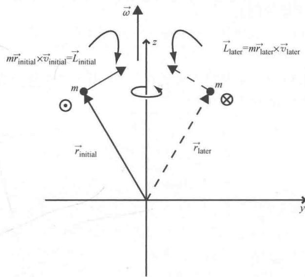
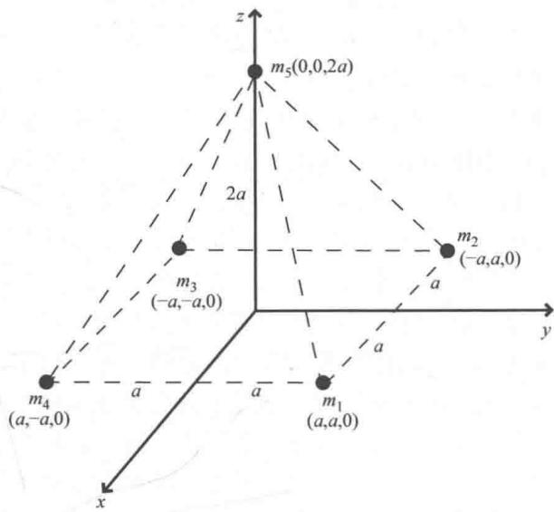
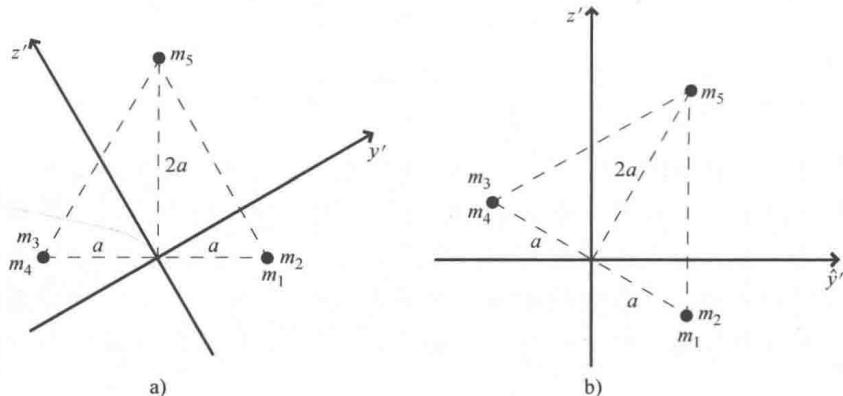
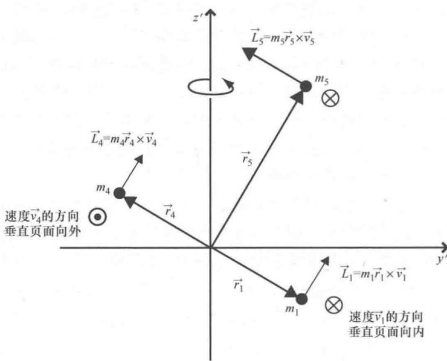

import Guide from '@/components/Guide.astro';
import Knowledge from '@/components/Knowledge.astro';
import Example from '@/components/Example.astro';
import Analysis from '@/components/Analysis.astro';
import Solution from '@/components/Solution.astro';
import Variant from '@/components/Variant.astro';
import Note from '@/components/Note.astro';
import Block from '@/components/Block.astro';
import Method from '@/components/Method.astro';
import Exercise from '@/components/Exercise.astro';

## 6.1 惯性张量

关于质量一个非常有用的思考是：质量具有抵抗加速度的性质，就是说要想改变任何具有质量的物体的速度需要力的作用。您可能会发现，把转动惯量跟质量类比对理解转动惯量是很有帮助的。这就是说转动惯量具有抵抗角加速度的性质，因此，要想改变任何一个物体的角加速度需要力矩的作用。

很多学生发现通过记住平动量和转动量之间的关系更容易理解转动．因此，平动用位置（x）、速度（ $\vec{v}$ ）和加速度（ $\vec{a}$ ）来描述，转动用类似的物理量角位置（ $\theta$ ）、角速度（ $\vec{\omega}$ ）和角加速度（ $\vec{\alpha}$ ）来描述．对于转动来说还有很多其他类似的物理量：转动中的力矩（ $\vec{\tau}$ ）、转动惯量（I）和角动量（ $\vec{L}$ ）对应于平动中的力（ $\vec{F}$ ）、质量（m）和动量（ $\vec{p}$ ）.

回想一下，关于平动的几个方程与转动方程具有相似的形式．因此，转动的牛顿第二定律（ $\vec{F} = m\vec{a}$ ）是 $\vec{\tau} = I\vec{\alpha}^{\ominus}$ ，鉴于平移动量与质量和速度的关系是 $\vec{p} = m\vec{v}$ ，可能我们所知道的角动量与转动惯量和角速度的关系是 $L_{z} = I\omega$

当第一次给出这些关系时，大多数教材为了简化问题，将转动限制为单个质点的平面转动。因此，当我们考虑线量和角量之间的关系时，可能会想到 $v = \omega r$ ，如果 $L_{z} = mvr$ ，那么 $L_{z} = mr2\omega$ 。定义 $mr2$ 为单个质点的转动惯量（ $I$ ），则 $L_{z} = I\omega$ 。但是这些方程中的 $v$ 和 $\omega$ 并不是真正的速度，因为它们都写成了标量形式，而且角动量的下角标 $z$ 似乎在暗示些什么。

是的，它在告诉你所使用的方程是角动量的一个分量方程（这种情况下就是 $z$ 分量），这只适用于 $xOy$ 平面内的单个粒子绕坐标原点的转动。因此，这个并没有错，只不过其使用受限。很明显，它适用于绕 $z$ 轴的平面转动。

表示速度、角速度和位置矢量之间更为普遍的关系是：

$$
\stackrel {\rightarrow} {v} = \stackrel {\rightarrow} {\omega} \times \stackrel {\rightarrow} {r},\tag{6.1}
$$

其中，叉号表示第2章所讲的矢量的叉乘．表示角动量与动量、线速度和质量之间关系的方程是

$$
\begin{array}{r l} \vec {L} & = \vec {r} \times \vec {p} \\ & = \vec {r} \times (\vec {m v}) \\ & = \vec {m r} \times \vec {v}. \end{array}\tag{6.2}
$$

在深究这些方程之前，应该考虑平面转动方程的含义，即单个质点的转动惯量为 $I_{\mathrm{particle}} = mr^2$ 。这个方程中暗含着一个很重要的观点，即单个质点的转动惯量不仅与其质量有关，还与其位置有关，具体是与该粒子到转轴的距离 $r$ 有关。因此，由许多质点组成的一般物体的转动惯量不仅与其质量有关，还与其质量分布有关，不管是一般转动

还是平面转动都是如此.

如果想类比着平动方程 $\vec{p} = m\vec{v}$ 写转动方程，我们可能会写出 $\vec{L} = I\vec{\omega}$ . 但是该方程表明角动量 $\vec{L}$ 的方向必须和角速度 $\vec{\omega}$ 的方向一致，因为矢量乘以一个标量只能改变其大小而不能改变其方向（如果标量是负数，矢量反向）．对于一般运动情况会更复杂，例如我们可以把方程（6.2）应用到图6.1中关于一个质点的绕轴转动．图中质点" $m$ "绕 $z$ 轴转动，所以其角速度沿 $z$ 轴竖直向上．在此俯视图中， $x$ 轴正好位于质点运动平面的下方，垂直纸面向里为其负方向．因为角动量矢量 $\vec{L} = m\vec{r} \times \vec{v}$ ，所以可以根据第2.2节的右手法则，初始角动量的方向可以由此时 $\vec{r}$ 和 $\vec{v}$ 的叉乘方向决定．如果没有错误，可以看到初始位置角动量 $\vec{L}$ 的方向如图所示向右上方．下一时刻，当质点绕着 $z$ 轴转半圈之后，在图中右侧，此时速度矢量的方向垂直纸面向里．那时， $\vec{r}$ 和 $\vec{v}$ 叉乘的方向，即角动量 $\vec{L}$ 的方向如图所示指向左上方．

  
图 6.1 质点绕轴的转动

因此，角动量矢量 $\vec{L}$ 方向不仅不是角速度 $\vec{\omega}$ 的方向，而且当质点绕轴转动时其方向还在不断地变化，但是角速度的方向始终指向 z 轴

不变.

在这些情况下，当通过方程 $\vec{L} = I\vec{\omega}$ 把角动量和角速度联系起来时，很明显转动惯量不能再被当做标量来处理。如果转动惯量是标量，根本不可能将一个方向上的矢量与另一个不同方向上的矢量联系起来。但是如果按照第4章和第5章的思路，应该熟悉有一种量乘以一个矢量（如 $\vec{\omega}$ ）得到另外一个指向不同方向的矢量（如 $\vec{L}$ ），这个量就是张量。因此，虽然最初在关于原点的平面运动中了解的转动惯量是一个标量，但是现在我们应该明白对一般的问题，需要用更高级的方法来处理，即把转动惯量表示为张量而不是标量。

我们可能会想到只要在 $z$ 轴的另一侧等距离处添加一个等质量的质点，产生额外的角动量将叠加到原来质点的角动量上。这种情况下，总的角动量确实会指向 $z$ 轴的方向，与角速度的方向完全相同。所以可以推测角动量和角速度之间的关系（转动惯量的内在秉性）依赖于研究对象的对称性。通过分析转动惯量的分量可以证明这个推测是正确的。

首先，可以通过写出联系角动量和角速度的张量方程来理解转动惯量的分量：

$$
\vec {L} = \vec {I} \omega ,\tag{6.3}
$$

然后根据角动量的定义：

$$
\begin{array}{r l} \vec {L} & = \vec {r} \times \vec {p} \\ & = \vec {r} \times (\vec {m v}) \\ & = m \vec {r} \times \vec {v} \\ & = m \vec {r} \times (\vec {\omega} \times \vec {r}). \end{array}
$$

表达式中的三重积可以通过第 2.4 节中的规则，简单的用 "BAC 减去 CAB 法则"，则：

$$
\vec {L} = m \left[ \vec {\omega} (\vec {r} \cdot \vec {r}) - \vec {r} (\vec {r} \cdot \vec {\omega}) \right].
$$

这个表达式只适用于单个质点的角动量，可以通过对所有质点求和（质量连续分布可以求积分）求质点系的角动量．因此，可能会经常遇到如下表达式：

$$
\vec {L} = \sum_ {i} m _ {i} \left[ \vec {\omega} (\vec {r} _ {i} \cdot \vec {r} _ {i}) - \vec {r} _ {i} (\vec {r} _ {i} \cdot \vec {\omega}) \right],\tag{6.4}
$$

指标 i 表示研究对象中的每一个质元.

为了理解这个表达式中的转动惯量，首先把位置矢量写成 $\vec{r}_i = x_i\hat{i} +y_i\hat{j} +z_i\hat{k}$ 、角速度矢量写成 $\vec{\omega} = \omega_x\hat{i} +\omega_y\hat{j} +\omega_z\hat{k}$ （注意角速度 $\vec{\omega}$ 对每个质点都一样，所以没必要写成 $\vec{\omega}_i$ ）．因此角动量的表达式为

$$
\begin{array}{r l} \vec {L} = & \sum_ {i} m _ {i} \left[ \vec {\omega} (x _ {i} \hat {i} + y _ {i} \hat {j} + z _ {i} \hat {k}) \cdot (x _ {i} \hat {i} + y _ {i} \hat {j} + z _ {i} \hat {k}) \right. \\ & \left. - \vec {r} _ {i} (x _ {i} \hat {i} + y _ {i} \hat {j} + z _ {i} \hat {k}) \cdot (\omega_ {x} \hat {i} + \omega_ {y} \hat {j} + \omega_ {z} \hat {k}) \right], \end{array}
$$

点乘后得到

$$
\vec {L} = \sum_ {i} m _ {i} \left[ \vec {\omega} \left(x _ {i} ^ {2} + y _ {i} ^ {2} + z _ {i} ^ {2}\right) - \vec {r} _ {i} \left(x _ {i} \omega_ {x} + y _ {i} \omega_ {y} + z _ {i} \omega_ {z}\right) \right].
$$

因为 $\vec{\omega}$ 的x分量是 $\omega_{x}$ 而 $\vec{r}_{i}$ 的x分量是 $x_{i}$ ，所以角动量的x分量可以写成

$$
\begin{array}{r l} L _ {x} & = \sum_ {i} m _ {i} \left[ \omega_ {x} (x _ {i} ^ {2} + y _ {i} ^ {2} + z _ {i} ^ {2}) - x _ {i} (x _ {i} \omega_ {x} + y _ {i} \omega_ {y} + z _ {i} \omega_ {z}) \right] \\ & = \sum_ {i} m _ {i} \left[ \omega_ {x} x _ {i} ^ {2} + \omega_ {x} y _ {i} ^ {2} + \omega_ {x} z _ {i} ^ {2} - x _ {i} ^ {2} \omega_ {x} - x _ {i} y _ {i} \omega_ {y} - x _ {i} z _ {i} \omega_ {z} \right] \\ & = \sum_ {i} m _ {i} \left[ \omega_ {x} (y _ {i} ^ {2} + z _ {i} ^ {2}) - x _ {i} y _ {i} \omega_ {y} - x _ {i} z _ {i} \omega_ {z} \right], \end{array}
$$

$y$ 分量和 $z$ 分量为

$$
\begin{array}{l} L _ {y} = \sum_ {i} m _ {i} \left[ \omega_ {y} (x _ {i} ^ {2} + z _ {i} ^ {2}) - y _ {i} x _ {i} \omega_ {x} - y _ {i} z _ {i} \omega_ {z} \right], \\ L _ {z} = \sum_ {i} m _ {i} \left[ \omega_ {z} (x _ {i} ^ {2} + y _ {i} ^ {2}) - z _ {i} x _ {i} \omega_ {x} - z _ {i} y _ {i} \omega_ {y} \right]. \end{array}
$$

角动量 $\vec{L}$ 的三个分量方程可以用一个单独的矩阵方程表示成：

$$
\left( \begin{array}{c} L _ {x} \\ L _ {y} \\ L _ {z} \end{array} \right) = \left( \begin{array}{c c c} \sum_ {i} m _ {i} (y _ {i} ^ {2} + z _ {i} ^ {2}) & - \sum_ {i} m _ {i} x _ {i} y _ {i} & - \sum_ {i} m _ {i} x _ {i} z _ {i} \\ - \sum_ {i} m _ {i} y _ {i} x _ {i} & \sum_ {i} m _ {i} (x _ {i} ^ {2} + z _ {i} ^ {2}) & - \sum_ {i} m _ {i} y _ {i} z _ {i} \\ - \sum_ {i} m _ {i} z _ {i} x _ {i} & - \sum_ {i} m _ {i} z _ {i} y _ {i} & \sum_ {i} m _ {i} (x _ {i} ^ {2} + y _ {i} ^ {2}) \end{array} \right) \left( \begin{array}{c} \omega_ {x} \\ \omega_ {y} \\ \omega_ {z} \end{array} \right)\tag{6.5}
$$

矩阵元表示惯性张量 $\vec{I}$ 的分量．注意每一个分量的大小都是质量乘以距离的平方（国际单位是 $kg\cdot m2$ ），与标量转动惯量是一样的．

在一些教材中，我们会发现惯性张量分量写成如下形式

$$
I _ {a b} = m _ {i} \left(\delta_ {a b} r _ {i} ^ {2} - r _ {a} r _ {b}\right),
$$

这与方程6.5中的张量分量是一样的.

惯性张量的对角元素被称为"转动惯量"，而非对角元素被称为"惯量乘积"。为了理解每一个元素的物理意义，回忆一下，转动惯量具有抵抗物体角加速度的性质，这种抵抗不仅与物体的质量有关，还跟物体相对于转轴的质量分布有关。

每一项都说明物体绕 $b$ 轴的转动对 $a$ 方向角动量的贡献为多少，因此， $I_{11} = I_{xx}$ 说明绕 $x$ 轴的转动对 $x$ 方向角动量的贡献为多少，而 $I_{23} = I_{yz}$ 则说明绕 $z$ 轴的转动对 $y$ 方向角动量的贡献为多少。

下面解释非对角项是如何产生的，但是先来看下对角项．在 $I_{xx}$ 的表达式中，对每一个质元 $(m_{i})$ ，都是其质量乘以到x轴距离的平方 $(y_{i}2+z_{i}2)$ ．这只是我们已学过的质点平面转动的转动惯量 $I=mr2$ 的三维版本，其中，r是质点到转轴的距离．观察惯性张量可以看到由于绕x轴转动产生角动量x方向的分量，由于绕y轴转动产生角动量y方向的分量和由于绕z轴转动产生角动量z方向的分量．最重要的是关于每个轴对称的质量分布对转动惯量矩阵的对角项都有贡献．

惯性张量的非对角元素有所不同．在 $I_{yz}$ 中，对每一个质元 $(m_i)$ ，都是其质量乘以y和z坐标 $(y_i z_i)$ ．跟上面的解释一样，这决定了由于绕z轴的转动而产生角动量沿y方向的分量．什么时候绕z轴转动会产生角动量沿y方向的分量呢？当质量分布关于z轴不对称时会产生，图6.1中所示质点的转动就是一个例子．同样， $I_{xy}$ 项决定了由于绕y轴的转动而对角动量沿x方向的贡献，这种贡献来自于质量分布关于y轴的不对称性．因此，质量分布关于某一个特定轴的不对称性产生了惯性张量矩阵的非对角元素．

为了弄清楚其原理，考虑如图6.2所示的位于金字塔四个角点和顶点的五个质点。要确定此质量系的惯性张量，只需将每个质点的质量和坐标代入公式（6.5）即可。如果五个质点的质量都等于"m"，且金字塔的高度等于每个底边的长度（具有如图6.2中所示的值2a），则 $I_{xx}$ 项很简单

$$
\begin{array}{r l} I _ {x x} & = m _ {1} \left(y _ {1} ^ {2} + z _ {1} ^ {2}\right) + m _ {2} \left(y _ {2} ^ {2} + z _ {2} ^ {2}\right) + m _ {3} \left(y _ {3} ^ {2} + z _ {3} ^ {2}\right) + m _ {4} \left(y _ {4} ^ {2} + z _ {4} ^ {2}\right) \\ & \quad + m _ {5} \left(y _ {5} ^ {2} + z _ {5} ^ {2}\right) \\ & = m _ {1} \left(a ^ {2} + 0 ^ {2}\right) + m _ {2} \left(a ^ {2} + 0 ^ {2}\right) + m _ {3} \left[ (- a) ^ {2} + 0 ^ {2} \right] + m _ {4} \left[ (- a) ^ {2} + 0 ^ {2} \right] \\ & \quad + m _ {5} \left(0 ^ {2} + (2 a) ^ {2}\right) \\ & = 8 m a ^ {2}. \end{array}
$$

对于其他对角矩阵元 $I_{yy}$ 和 $I_{zz}$ 应该可以得到相同的结果．对于非对角元素， $I_{xy}$ 项是

$$
\begin{array}{r l} I _ {x y} & = - m _ {1} x _ {1} y _ {1} - m _ {2} x _ {2} y _ {2} - m _ {3} x _ {3} y _ {3} - m _ {4} x _ {4} y _ {4} - m _ {5} x _ {5} y _ {5} \\ & = - m _ {1} (a) (a) - m _ {2} (- a) (a) - m _ {3} (- a) (- a) - m _ {4} (a) (- a) - m _ {5} (0) \\ & = - m (2 a ^ {2} - 2 a ^ {2}) = 0. \end{array}\tag{0}
$$

  
图 6.2 五个质点排列成金字塔

其他非对角矩阵元的求法完全一样，因此，如图 6.2 所示的质点系的惯性张量矩阵是

$$
\vec {I} = \left( \begin{array}{c c c} 8 m a ^ {2} & 0 & 0 \\ 0 & 8 m a ^ {2} & 0 \\ 0 & 0 & 8 m a ^ {2} \end{array} \right)
$$

这个惯量张量的分量式中包含了大量的信息，所有非对角元素都等于零意味着所选的 $x$ 、 $y$ 、 $z$ 轴是这个系统相对于所选原点的主轴，而转动惯量是系统的主惯量。当系统绕一个主轴转动时，角动量矢量和角速度矢量方向相同，这说明系统具有对称性。系统的三个主惯量都相等意味着这个系统有资格作为"球形顶"（力学中，"顶"是指任何刚性旋转的系统）。对于球形顶部，任何三个相互正交的轴都是其主轴。

如果把 $m_{5}$ 相对于其他四个质点所在平面的高度提高为原来的两倍（因此其 z 坐标是 4a 而不是 2a），距离 x 和 y 轴的距离越大，系统相对于它们的转动惯量就越大，因此转动惯量变为

$$
\vec {I} = \left( \begin{array}{c c c} 2 0 m a ^ {2} & 0 & 0 \\ 0 & 2 0 m a ^ {2} & 0 \\ 0 & 0 & 8 m a ^ {2} \end{array} \right).
$$

当然了，不管高度如何，从 $m_{5}$ 到 $z$ 轴的距离都是零，因此其质量不会对 $I_{zz}$ 的分量产生影响，该分量保持不变。现在只有两个主转动惯量分量相等，该系统不再是球形顶，而是变成一个"对称顶"（如果三个主惯量都不相同，系统被称为"非对称顶"）。最后一点：如果系统有一个主惯量等于零，另外两个彼此相等，那么该系统被称为"转子"。

改变系统惯性张量的另一个方法是改变其中质点的质量．例如，如果使 $m_{5}$ 的质量从m变到2m，而其他四个质点的质量不变，惯性张量变为

$$
\vec {I} = \left( \begin{array}{c c c} 1 2 m a ^ {2} & 0 & 0 \\ 0 & 1 2 m a ^ {2} & 0 \\ 0 & 0 & 8 m a ^ {2} \end{array} \right).
$$

不出所料，分量 $I_{zz}$ 没有变化，因为 $m_{5}$ 对该分量没有贡献.

现在考虑，如果旋转坐标轴，惯性张量会如何变化．记住，惯性张量是由给定原点的位置和给定方向的坐标轴决定的，因此如果旋转坐标轴，预测其分量会发生变化似乎是合理的．

为了验证这一点，设想绕 $x$ 轴逆时针旋转坐标系，如图6.3所

  
图 6.3 坐标轴相对于 x 逆时针旋转 $30^{\circ}$

示. 该图中垂直纸面向里为 $x$ 轴的负方向，因此 $y$ 轴和 $z$ 轴的方向是倾斜的（为了区别于原来的 $y$ 轴和 $z$ 轴，用 $y'$ 和 $z'$ 表示）．在这种情况下，旋转角度约为 $30^{\circ}$ ．图6.3a显示坐标轴旋转质量分布保持不变，而图6.3b则显示如果你歪着头看则有 $z$ 轴沿竖直方向， $y'$ 轴沿水平方线．

这个会对惯性张量产生什么影响呢？要回答该问题，需要知道每个质点在新（旋转）坐标系中的坐标（也就是说，需要知道每一个质点的 $x'$ 、 $y'$ 和 $z'$ ）。幸运地是，第4章已经就如何利用旋转矩阵进行原始坐标系和旋转坐标系之间的转换提供了一些参考。在这种情况下，旋转矩阵为

$$
\left( \begin{array}{l} x ^ {\prime} \\ y ^ {\prime} \\ z ^ {\prime} \end{array} \right) = \left( \begin{array}{c c c} 1 & 0 & 0 \\ 0 & \cos \theta & \sin \theta \\ 0 & - \sin \theta & \cos \theta \end{array} \right) \left( \begin{array}{l} x \\ y \\ z \end{array} \right)\tag{6.6}
$$

如果质量都是最初的质量（五个质点的质量都等于 m）且 $m_{5}$ 保持原始高度（相对于 xOy 平面的高度为 2a），然后再旋转，你应该得到下面表示惯性张量的各分量的值：

$$
\vec {\vec {I}} = \left( \begin{array}{c c c} 8 m a ^ {2} & 0 & 0 \\ 0 & 8 m a ^ {2} & 0 \\ 0 & 0 & 8 m a ^ {2} \end{array} \right).
$$

如果我们惊讶地发现旋转惯性张量相对于原始惯性张量（未旋转）没有变化，那么说明该系统的对称性满足球形顶，这意味着任何一组三个互相正交的轴都将是其主轴．因此倾斜的坐标轴不应该导致惯性张量的变化.

这听起来非常合理，但是如果将图6.3中质点的位置和图6.1中质点情况相比较，预期 $m_{5}$ 将会产生 $y$ 方向上的角动量分量不也就合理了吗（就像图6.1中质点那样）？

是的，的确是这样．而且实际上 $m_{5}$ 确实会产生 y 方向上的角动量分量．为了说明这一点，设其他四个质点的质量等于零，单独算 $m_{5}$ 的惯性张量（别忘了坐标轴是旋转的），你应该得到

$$
\stackrel {\rightarrow} {I} = \left(\begin{array}{c c c}4 m a ^ {2}&0&0\\0&3 m a ^ {2}&- 1. 7 3 m a ^ {2}\\0&- 1. 7 3 m a ^ {2}&m a ^ {2}\end{array}\right).
$$

所以确实是这样： $I_{yz}$ （表示绕z轴旋转产生y方向上的角动量分量）显然不等于零．但是，当首次在倾斜坐标系中计算金字塔分布的质点系的惯性张量时，为什么所有非对角元素都为零？答案是其他四个质点对惯性张量也有影响．为了研究它们对 $I_{yz}$ 的贡献，设 $m_{5}$ 的质量为零而其他四个质点的质量都等于m，那么惯性张量应该是

$$
\vec {I} = \left( \begin{array}{c c c} 4 m a ^ {2} & 0 & 0 \\ 0 & 5 m a ^ {2} & 1. 7 3 m a ^ {2} \\ 0 & 1. 7 3 m a ^ {2} & 7 m a ^ {2} \end{array} \right).
$$

这就给出了答案：其他四个质点对角动量在 $y$ 正方向上的贡献与 $m_5$ 在 $y$ 负方向上的贡献完全相同，如图6.4所示．请记住，从第5章开始，张量加法可以通过其分量相加来实现，所以当把 $m_{5}$ 产生的惯性张量加到其他四个质点的惯性张量时，就可以得到（漂亮的对角矩阵）五质点金字塔的惯性张量.

为了证明 $m_{5}$ 和其他四个质点之间的平衡关系，再一次将 $m_{5}$ 的高度提高为原来的两倍，然后在把坐标轴旋转 $30^{\circ}$ ，我们可能会发现很有趣。在这种情况下，惯性张量是

  
图 6.4 页面内质点的角动量矢量

$$
\stackrel {\rightarrow} {I} = \left(\begin{array}{c c c}2 0 m a ^ {2}&0&0\\0&1 7 m a ^ {2}&- 5. 2 m a ^ {2}\\0&- 5. 2 m a ^ {2}&1 1 m a ^ {2}\end{array}\right)
$$

显然来自 $m_{5}$ 的 $I_{yz}$ 项和其他四个质点的不再相互抵消.

通过对多个坐标轴旋转来确定任意方向坐标轴的惯性张量．例如，如果你希望首先绕 x 轴旋转 $\theta_{1}$ ，然后再绕 y 轴旋转 $\theta_{2}$ ，可以将旋转矩阵组合为

$$
\left( \begin{array}{c} x ^ {\prime} \\ y ^ {\prime} \\ z ^ {\prime} \end{array} \right) = \left( \begin{array}{c c c} \cos \theta_ {2} & 0 & \sin \theta_ {2} \\ 0 & 1 & 0 \\ - \sin \theta_ {2} & 0 & \cos \theta_ {2} \end{array} \right) \left( \begin{array}{c c c} 1 & 0 & 0 \\ 0 & \cos \theta_ {1} & \sin \theta_ {1} \\ 0 & - \sin \theta_ {1} & \cos \theta_ {1} \end{array} \right) \left( \begin{array}{c} x \\ y \\ z \end{array} \right)\tag{6.7}
$$

如果两个转角都是 $30^{\circ}$ （首先是 $x$ 轴，然后是 $y$ 轴），则总的旋转矩阵为

$$
\left( \begin{array}{c} x ^ {\prime} \\ y ^ {\prime} \\ z ^ {\prime} \end{array} \right) = \left( \begin{array}{c c c} 0. 8 6 6 & - 0. 2 5 & 4. 3 3 \\ 0 & 0. 8 6 6 & 0. 5 \\ - 0. 5 & - 0. 4 3 3 & 0. 7 5 \end{array} \right) \left( \begin{array}{c} x \\ y \\ z \end{array} \right).\tag{6.8}
$$

如果令 $m_{5}$ 的高度为 4a 再按上面方式旋转坐标轴，惯性张量变为

$$
\stackrel {\rightarrow} {I} = \left(\begin{array}{c c c}1 7. 8 m a ^ {2}&2. 6 m a ^ {2}&3. 9 m a ^ {2}\\2. 6 m a ^ {2}&1 7 m a ^ {2}&- 4. 5 m a ^ {2}\\3. 9 m a ^ {2}&- 4. 5 m a ^ {2}&1 3. 3 m a ^ {2}\end{array}\right).\tag{6.9}
$$

由于旋转坐标轴既不改变矩阵的秩也不改变矩阵的行列式 ① ，所以可以通过旋转坐标轴验证对计算进行快速检查。

还有一种方法可以直接求出旋转坐标系中的惯性张量，而不用求出每个质点在旋转坐标系中的新坐标．这种方法是对原始惯性张量应用"相似变换"．原理是这样的：角动量与原始（未旋转）坐标系的惯性张量和角速度有关

$$
\vec {L} = \vec {I} \omega .
$$

通过旋转矩阵 R（可能是几个旋转矩阵的乘积）旋转坐标轴，则

$$
\vec {L} ^ {\prime} = \vec {R L} = \vec {R} (\vec {I} \omega).
$$

并且由于任何矩阵和其逆矩阵的乘积是单位矩阵，因此可以在 $\vec{\omega}$ 前插入 $R^{-1}R$ ：

$$
\begin{array}{r l} \vec {L} ^ {\prime} & = \vec {R L} = \vec {R I} (\boldsymbol {R} ^ {- 1} \boldsymbol {R}) \vec {\omega} \\ & = (\vec {R I R} ^ {- 1}) \vec {R \omega}. \end{array}
$$

但是 $\vec{R\omega}$ 等于 $\vec{\omega}^{\prime}$ ，因此

$$
\vec {L} ^ {\prime} = \left(\vec {R I R} ^ {- 1}\right) \vec {\omega} ^ {\prime}.
$$

因此，表达式 $(R\vec{I}R^{-1})$ 将旋转坐标系中的角动量和角速度联系了起来，这意味着该表达式是新坐标系中的惯性张量．所以，不用计算每个质点在旋转坐标系中的新坐标并将它们插入到惯性张量的方程中，而是简单地直接将旋转矩阵和其逆矩阵应用于表示惯性张量的矩阵中即可（但是请记住，在做矩阵乘法时注意顺序）.

利用这种方法，过程如下：

$$
\begin{array}{r l} \vec {\vec {I}} ^ {\prime} & = \left( \begin{array}{c c c} 0. 8 6 6 & - 0. 2 5 & 4. 3 3 \\ 0 & 0. 8 6 6 & 0. 5 \\ - 0. 5 & - 0. 4 3 3 & 0. 7 5 \end{array} \right) \left( \begin{array}{c c c} 2 0 m a ^ {2} & 0 & 0 \\ 0 & 2 0 m a ^ {2} & 0 \\ 0 & 0 & 8 m a ^ {2} \end{array} \right) \\ & \times \left( \begin{array}{c c c} 0. 8 6 6 & - 0. 2 5 & 4. 3 3 \\ 0 & 0. 8 6 6 & 0. 5 \\ - 0. 5 & - 0. 4 3 3 & 0. 7 5 \end{array} \right) ^ {- 1} \\ & = \left( \begin{array}{c c c} 1 7. 8 m a ^ {2} & 2. 6 m a ^ {2} & 3. 9 m a ^ {2} \\ 2. 6 m a ^ {2} & 1 7 m a ^ {2} & - 4. 5 m a ^ {2} \\ 3. 9 m a ^ {2} & - 4. 5 m a ^ {2} & 1 3. 3 m a ^ {2} \end{array} \right) \end{array}
$$

与将旋转系中坐标插入到惯性张量所得到的结果是相同的.

如果学过线性代数，可能会想到，通过把表示惯性张量的矩阵对角化得到主轴和主惯量的可能性．这当然可能了，我们可以在这本书的网站上阅读关于使用本征矢量和本征值来完成求解过程的信息．

如果能够通过目测确定使坐标轴成为研究对象的对称轴需要旋转的角度，那么可以使用相似变换的方法对惯性张量矩阵进行对角化。读者可以通过本章课后习题和在线解答了解如何实现变换。
