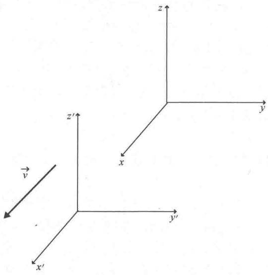

import Guide from '@/components/Guide.astro';
import Knowledge from '@/components/Knowledge.astro';
import Example from '@/components/Example.astro';
import Analysis from '@/components/Analysis.astro';
import Solution from '@/components/Solution.astro';
import Variant from '@/components/Variant.astro';
import Note from '@/components/Note.astro';
import Block from '@/components/Block.astro';
import Method from '@/components/Method.astro';
import Exercise from '@/components/Exercise.astro';

## 6.2 电磁场张量

现在世界的一个显著特征是宽带通信信道的可用性，不需要物理连接就可以实现信息的瞬间远距离传输。这种通讯技术的使用直接源自于1860年斯科茨曼·詹姆斯·克拉克·麦克斯韦建立的方程组，现在被称为"麦克斯韦方程组"。鉴于电磁通讯对我们生活的影响，根据2004年《物理世界》的读者投票将麦克斯韦方程组列为有史以来最伟大的方程组并不奇怪。

被称为麦克斯韦方程组的四个矢量方程分别是电场的高斯定理、磁场的高斯定理、法拉第定律和麦克斯韦－安培定理，每一个方程都有积分形式或微分形式．积分形式描述了表面或路径周围的电磁场行为，而微分形式适用于特定的具体位置．微分形式与本书所讨论的矢量和张量运算联系比较大，涉及第2章讨论的标量积、散度、旋度和偏微分，它与本节主题－电磁场强度张量密切相关.

麦克斯韦方程组的微分形式如下

电场的高斯定理： $\vec{\nabla}\cdot \vec{E} = \frac{\rho}{\varepsilon_0},$

磁场的高斯定理： $\vec{\nabla}\cdot \vec{B} = 0$

法拉第定律： $\vec{\nabla}\times \vec{E} = -\frac{\partial\vec{B}}{\partial t},$

麦克斯韦-安培定理: $\vec{\nabla}\times\vec{B}=\mu_{0}\vec{J}+\mu_{0}\varepsilon_{0}\frac{\partial\vec{E}}{\partial t}.$

为了理解电磁张量，复习每个方程的物理意义是很有帮助的。

$$
\boxed {\vec {\nabla} \cdot \vec {E} = \frac {\rho}{\varepsilon_ {0}}}
$$

电场的高斯定理指出电场（ $\vec{E}$ ）在任何位置的散度（ $\vec{\nabla} \cdot$ ）应该与该位置的电荷密度（ $\rho$ ）成正比。这是因为静电场的电场线起始于正电荷终止于负电荷（因此电场线从正电荷位置发散出去，并向负电荷位置收敛集中）。

$$
\boxed {\vec {\nabla} \cdot \vec {B} = 0}
$$

磁场的高斯定理告诉我们磁场（ $\vec{B}$ ）在任何位置的散度（ $\vec{\nabla} \cdot$ ）为零。这是因为在自然界中不存在单独的"磁荷"，所以磁场既不发散也不收敛。

$$
\boxed {\vec {\nabla} \times \vec {E} = - \frac {\partial \vec {B}}{\partial t}}
$$

法拉第定律指出电场 $(\vec{E})$ 在任何位置的旋度 $(\vec{\nabla} \times)$ 等于该位置磁场 $(\vec{B})$ 随时间变化率的负值．这是因为变化的磁场可以激发涡旋电场．

$$
\boxed {\vec {\nabla} \times \vec {B} = \mu_ {0} \vec {J} + \mu_ {0} \varepsilon_ {0} \frac {\partial \vec {E}}{\partial t}}
$$

麦克斯韦-安培定理说明，磁场（ $\vec{B}$ ）在任何位置的旋度（ $\vec{\nabla} \times$ ）正比于该位置的电流密度（ $\vec{J}$ ）加上电场随时间的变化率，这是因为电流和变化的电场都可以激发涡旋磁场。

注意，麦克斯韦方程组将场的空间行为与激发这些场的场源联系了起来。这些场源是电场的高斯定理中出现的电荷（电荷密度 $\rho$ ）、麦克斯韦-安培定理中出现电流（电流密度 $\vec{J}$ ）、法拉第定律中出现的变化的磁场 $\left(\frac{\partial\vec{B}}{\partial t}\right)$ 和麦克斯韦-安培定理中出现的变化的电场 $\left(\frac{\partial\vec{E}}{\partial t}\right)$

需要另加一个方程来充分描述电磁相互作用，这个方程叫作"连续性方程"，通常写成如下形式：

$$
\frac {\partial \rho}{\partial t} = - \vec {\nabla} \cdot \vec {J},
$$

其中， $\rho$ 是电荷密度， $\vec{J}$ 是电流密度.

连续性方程说明电荷密度随时间的变化率 $\left(\frac{\partial\rho}{\partial t}\right)$ 等于电流密度散度 $(\vec{\nabla}\cdot \vec{J})$ 的负值．这是因为负散度意味着收敛，如果某一点电流密度 $\vec{J}$ 的散度为正，那么流入该点的正电荷必须多于流出该点的正电荷．如果是这样，该点的正电荷密度必须不断增加（这种情况下意味着 $\frac{\partial\rho}{\partial t}$ 大于零）.

与单独的麦克斯韦方程一样有意义，这些方程的真正价值是通过把它们组合起来产生波动方程来实现的。对法拉第定律两边取旋度并把麦克斯韦-安培定理中 $\vec{B}$ 的旋度表达式代入其中得到如下方程

$$
\nabla^ {2} \vec {E} = \mu_ {0} \varepsilon_ {0} \frac {\partial^ {2} \vec {E}}{\partial t ^ {2}},\tag{6.10}
$$

其中， $\nabla2()=\vec{\nabla}\cdot\vec{\nabla}()$ 是拉普拉斯算符的矢量形式 ① . 这个方程适用于电荷密度（ $\rho$ ）和电流密度（ $\vec{J}$ ）都等于零的情况.

对麦克斯韦－安培定理两边取旋度并把法拉第定律中 $\vec{E}$ 的旋度表达式代入可以得到关于磁场的类似波动方程，即

$$
\nabla^ {2} \vec {B} = \mu_ {0} \varepsilon_ {0} \frac {\partial^ {2} \vec {B}}{\partial t ^ {2}}.\tag{6.11}
$$

将方程（6.10）和方程（6.11）与波动的一般方程比较是有启发意义的：

$$
\nabla^ {2} \vec {A} = \frac {1}{v ^ {2}} \frac {\partial^ {2} \vec {A}}{\partial t ^ {2}},\tag{6.12}
$$

其中，v 是波的传播速度．注意 $1/v2$ 项，它表明电磁波在真空中的传播速度仅取决于真空中的电容率 $(\varepsilon_{0})$ 和磁导率 $(\mu_{0})$ （具体来说， $\mu_{0}\varepsilon_{0}=1/v2$ ，或 $v=1/\sqrt{\mu_{0}\varepsilon_{0}}=3\times108m/s$ ）．更重要的是，这个速度与观察者是否运动无关．正是电磁波的这个特性使爱因斯坦走上了创立狭义相对论的道路．

为了创立狭义相对论，爱因斯坦提出两条基本假设，这两条假设是：

1）在所有的惯性参考系（即非加速系）中物理规律必须相同；

2）真空中的光速是一个常数，并不依赖于波源或观察者的运动.

即使面对反直觉的结论，爱因斯坦仍坚定不移的坚持两条基本假设，并意识到空间距离和时间间隔不是绝对的，而是依赖于观察者的相对运动。另外，空间和时间不是分离的，而是联系在一起共同形成了四维时空，并且四维时空间隔在所有惯性参考系中保持不变。

为了理解爱因斯坦的理论，参照图6.5中的两个笛卡儿参考系。如图中箭头所指的方向，表示带撇参考系以速度 $\vec{v}$ 沿 $x$ 轴正方向运动。利用传统的伽利略变换，某点的空间坐标（ $x, y, z$ ）和时间坐标（ $t$ ）在不带撇坐标系和带撇坐标系中的关系为

$$
\begin{array}{l} {t ^ {\prime} = t  ,} \\ {x ^ {\prime} = x - v t  ,} \\ {y ^ {\prime} = y  ,} \\ {z ^ {\prime} = z.} \end{array}
$$

因为带撇参考系只沿 x 轴方向运动 ① .

爱因斯坦意识到狭义相对论的第二条假设（光速是一个常量）与上面的伽利略变换相矛盾，并且只有在不带撇坐标系和带撇坐标系之间使用不同于伽利略的变换时才能解决这对矛盾。该变换必须能保持不同惯性参考系中时空间隔的不变性．但是究竟什么是时空间隔（也就是说，应该如何把空间项和时间项联系起来）？

  
图6.5 带撇参考系以速度 $\vec{v}$ 沿 $x$ 轴正方向运动

通过想象从某点向外发射球形光脉冲，可以帮助我们理解这个问题的答案。因为光的速度为 $c$ ，不带撇参考系中的观察者会发现在时间 $t$ 内，光的波前传播的距离的平方是 $x2 + y2 + z2 = c t2$ 。同样，带撇参考系中的观察者也会发现 $x'2 + y'2 + z'2 = c t'2$ 。但是根据狭义相对论的第二条假设，光速对于所有的观察者都必须相同，所以有

$$
c t ^ {2} - x ^ {2} - y ^ {2} - z ^ {2} = c t ^ {\prime 2} - x ^ {\prime 2} - y ^ {\prime 2} - z ^ {\prime 2},
$$

这说明如果光速对所有观察者都相同，则时间项的符号与空间项的符号必须相反．当然，负号也可以附加在时间项前面（只要空间项为正即可），并且我们会发现使用本约定的一些文献．

将一个时间坐标和三个空间坐标组合成一个"四维矢量"最好用指标记法表示：

$$
\begin{array}{l} x _ {0} = c t, \\ x _ {1} = x, \\ x _ {2} = y, \end{array}
$$

$$
x _ {3} = z.
$$

其中，时间项中的光速（c）确保所有的四个坐标都具有长度量纲.

利用这个概念，时空间隔（ds）可以写成

$$
(\mathrm{d} s) ^ {2} = (\mathrm{d} x ^ {0}) ^ {2} - (\mathrm{d} x ^ {1}) ^ {2} - (\mathrm{d} x ^ {2}) ^ {2} - (\mathrm{d} x ^ {3}) ^ {2}.
$$

这个间隔与三维空间中的距离（ $\mathrm{ds}^2 = \mathrm{dx}^2 +\mathrm{dy}^2 +\mathrm{dz}^2$ ）是等价的.

这种变换保持了惯性参考系中时空间隔的不变性，以荷兰物理学家亨德里克·洛伦兹的名字命名为"洛伦兹变换"。如果沿 $x$ 轴正方向的运动速度为 $v$ ，洛伦兹变换为

$$
\begin{array}{r l} & x _ {0} ^ {\prime} = \gamma (x _ {0} - \beta x _ {1}), \\ & x _ {1} ^ {\prime} = \gamma (x _ {1} - \beta x _ {0}), \\ & \quad x _ {2} ^ {\prime} = x _ {2}, \\ & \quad x _ {3} ^ {\prime} = x _ {3}. \end{array}
$$

其中，

$$
\beta = \frac {| v |}{c},
$$

而

$$
\gamma = \frac {1}{\sqrt {1 - \frac {v ^ {2}}{c ^ {2}}}} = \frac {1}{\sqrt {1 - \beta^ {2}}}.
$$

这种形式的时空间隔可以用度规张量 $g_{\alpha\beta}$ 表示成

$$
\left(\mathrm{d} s\right) ^ {2} = g _ {\alpha \beta} \mathrm{d} x ^ {\alpha} \mathrm{d} x ^ {\beta},
$$

其中，张量 $g_{\alpha\beta}$ 对应于平直时空的闵可夫斯基度规张量．矩阵形式为

$$
\stackrel {\rightarrow} {g} = \left(\begin{array}{c c c c}1&0&0&0\\0&- 1&0&0\\0&0&- 1&0\\0&0&0&- 1\end{array}\right)
$$

如果学过现代物理，可能还记得洛伦兹变换下时空间隔的不变性会使不同惯性参考系中的观察者得到一些有趣的结论，这些结论包括：

1）长度收缩：给定参考系中的观察者测量相对其运动的参考系中的长度时，长度沿运动方向会发生收缩；

2）时间膨胀：给定参考系中的观察者测量相对其运动的参考系中的时间时，时间会变慢；

3）同时的相对性：给定参考系中的观察者和相对其运动的参考系中的观察者观察两个事件是否同时发生时，其结论是不一致的。

以明显符合狭义相对论框架的形式书写物理定律有几点好处：这种"明显协变"定律在所有惯性参考系中具有相同的表达形式，并且涉及的物理量以可预测的方式在参考系之间变换。任何电磁学的协变理论都必须包含一个实验事实，即电量是一个标量（在参考系之间保持不变），且麦克斯韦方程组和洛伦兹变换在所有惯性参考系中都是正确的。这就需要电磁场方程的张量形式和洛伦兹变换的四维矢量形式，这可以通过将电荷密度 $\rho$ 和电流密度 $J$ 表示为被称为"四维电流"的矢量来实现：

$$
\vec {J} = (c \rho , J _ {x}, J _ {y}, J _ {z})
$$

通过 "四维电流" 将电场和磁场分量组合成 "电磁场张量" 来实现麦克斯韦方程组的张量形式．表示该张量逆变形式的矩阵是 ①

$$
\boldsymbol {F} ^ {\alpha \beta} = \left( \begin{array}{c c c c} 0 & - E _ {x} / c & - E _ {y} / c & - E _ {z} / c \\ E _ {x} / c & 0 & - B _ {z} & B _ {y} \\ E _ {y} / c & B _ {z} & 0 & - B _ {x} \\ E _ {z} / c & - B _ {y} & B _ {x} & 0 \end{array} \right),\tag{6.13}
$$

协变形式张量可以通过使用度规张量降低指标来求解．其结果是

$$
\boldsymbol {F} _ {\alpha \beta} = \left( \begin{array}{c c c c} 0 & E _ {x} / c & E _ {y} / c & E _ {z} / c \\ - E _ {x} / c & 0 & - B _ {z} & B _ {y} \\ - E _ {y} / c & B _ {z} & 0 & - B _ {x} \\ - E _ {z} / c & - B _ {y} & B _ {x} & 0 \end{array} \right)\tag{6.14}
$$

另一种有用的张量是双逆变电磁场张量

$$
\mathfrak {F} ^ {\alpha \beta} = \left( \begin{array}{c c c c} 0 & - B _ {x} & - B _ {y} & - B _ {z} \\ B _ {x} & 0 & E _ {z} / c & - E _ {y} / c \\ B _ {y} & - E _ {z} / c & 0 & E _ {x} / c \\ B _ {z} & E _ {y} / c & - E _ {x} / c & 0 \end{array} \right)\tag{6.15}
$$

这些张量表达式有一个好处，麦克斯韦的所有方程式现在仅用两个张量方程就可以表示，这两个方程是：

$$
\frac {\partial F ^ {\alpha \beta}}{\partial x ^ {\alpha}} = \mu_ {0} ^ {J ^ {\beta}},\tag{6.16}
$$

和

$$
\frac {\partial \mathfrak {F} ^ {\alpha \beta}}{\partial x ^ {\alpha}} = 0.\tag{6.17}
$$

这些表达式中麦克斯韦方程在哪里？方程（6.16）中取 $\beta = 0$ 就可以得到电场的高斯定理：

$$
\frac {\partial F ^ {\alpha 0}}{\partial x ^ {\alpha}} = \mu_ {0} J ^ {0}.
$$

将方程（6.13）中电磁场强度的张量值代入上式并对所有亚指标 $\alpha$ 求和得

$$
\frac {\partial (0)}{\partial (c t)} + \frac {\partial (E _ {x} / c)}{\partial x} + \frac {\partial (E _ {y} / c)}{\partial y} + \frac {\partial (E _ {z} / c)}{\partial z} = \mu_ {0} (c \rho).
$$

因此

$$
\frac {\partial (E _ {x})}{\partial x} + \frac {\partial (E _ {y})}{\partial y} + \frac {\partial (E _ {z})}{\partial z} = \mu_ {0} (c ^ {2} \rho),
$$

又因为 $c2=1/(\varepsilon_{0}\mu_{0})$ ,

$$
\frac {\partial (E _ {x})}{\partial x} + \frac {\partial (E _ {y})}{\partial y} + \frac {\partial (E _ {z})}{\partial z} = \frac {\mu_ {0}}{\varepsilon_ {0} \mu_ {0}} \rho ,
$$

或者

$$
\vec {\nabla} \cdot \vec {E} = \frac {\rho}{\varepsilon_ {0}},
$$

这就是电场的高斯定理.

要想得到麦克斯韦-安培定理，设方程（6.16）中 $\beta = 1$ ，2和3

就可以得到：

$$
\frac {\partial F ^ {\alpha 1}}{\partial x ^ {\alpha}} = \mu_ {0} J ^ {1},
$$

$$
\frac {\partial F ^ {\alpha 2}}{\partial x ^ {\alpha}} = \mu_ {0} J ^ {2},
$$

$$
\frac {\partial F ^ {\alpha 3}}{\partial x ^ {\alpha}} = \mu_ {0} J ^ {3}.
$$

同上面一样，只需将方程（6.13）中电磁场强度的张量值代入并对所有亚指标 $\alpha$ 求和得：

$$
\frac {\partial (- E _ {x} / c)}{\partial (c t)} + \frac {\partial (0)}{\partial x} + \frac {\partial (B _ {z})}{\partial y} + \frac {\partial (- B _ {y})}{\partial z} = \mu_ {0} (J _ {x}),
$$

$$
\frac {\partial (- E _ {y} / c)}{\partial (c t)} + \frac {\partial (- B _ {z})}{\partial x} + \frac {\partial (0)}{\partial y} + \frac {\partial (B _ {x})}{\partial z} = \mu_ {0} (J _ {y}),
$$

$$
\frac {\partial (- E _ {z} / c)}{\partial (c t)} + \frac {\partial (B _ {y})}{\partial x} + \frac {\partial (- B _ {x})}{\partial y} + \frac {\partial (0)}{\partial z} = \mu_ {0} (J _ {z}).
$$

因此

$$
\frac {\partial (B _ {z})}{\partial y} - \frac {\partial (B _ {y})}{\partial z} = \mu_ {0} (J _ {x}) + \frac {1}{c ^ {2}} \frac {\partial (E _ {x})}{\partial t},
$$

$$
\frac {\partial (B _ {x})}{\partial z} - \frac {\partial (B _ {z})}{\partial x} = \mu_ {0} (J _ {y}) + \frac {1}{c ^ {2}} \frac {\partial (E _ {y})}{\partial t},
$$

$$
\frac {\partial (B _ {y})}{\partial x} - \frac {\partial (B _ {x})}{\partial y} = \mu_ {0} (J _ {z}) + \frac {1}{c ^ {2}} \frac {\partial (E _ {z})}{\partial t}.
$$

认识到磁场的偏导数是 $\vec{B}$ 的旋度的分量，这就是

$$
\vec {\nabla} \times \vec {B} = \mu_ {0} \vec {J} + \mu_ {0} \varepsilon_ {0} \frac {\partial \vec {E}}{\partial t},
$$

麦克斯韦-安培定理.

另外两个麦克斯韦方程（磁场的高斯定理和法拉第定律）可以通过双电磁场强度张量（方程6.15）获得相似的形式．例如，取方程(6.17）中 $\beta = 0$ 就可以得到磁场的高斯定理：

$$
\frac {\partial \mathfrak {F} ^ {\alpha 0}}{\partial x ^ {\alpha}} = 0.
$$

将方程（6.15）中电磁场强度的张量值代入并对所有亚指标 $\alpha$ 求和得：

$$
\frac {\partial (0)}{\partial (c t)} + \frac {\partial (B _ {x})}{\partial x} + \frac {\partial (B _ {y})}{\partial y} + \frac {\partial (B _ {z})}{\partial z} = 0,
$$

即

$$
\vec {\nabla} \cdot \vec {B} = 0,
$$

磁场的高斯定理.

要想得到法拉第定律，设方程（6.17）中 $\beta = 1$ ，2和3就可以得到：

$$
\begin{array}{l} \frac {\partial \mathfrak {F} ^ {\alpha 1}}{\partial x ^ {\alpha}} = 0, \\ \frac {\partial \mathfrak {F} ^ {\alpha 2}}{\partial x ^ {\alpha}} = 0, \\ \frac {\partial \mathfrak {F} ^ {\alpha 3}}{\partial x ^ {\alpha}} = 0. \end{array}
$$

同前边一样，只需将方程（6.15）中电磁场强度张量的值代入并对所有亚指标 $\alpha$ 求和得：

$$
\begin{array}{l} \frac {\partial (- B _ {x})}{\partial (c t)} + \frac {\partial (0)}{\partial x} + \frac {\partial (- E _ {z} / c)}{\partial y} + \frac {\partial (E _ {y} / c)}{\partial z} = 0, \\ \frac {\partial (- B _ {y})}{\partial (c t)} + \frac {\partial (E _ {z} / c)}{\partial x} + \frac {\partial (0)}{\partial y} + \frac {\partial (- E _ {x} / c)}{\partial z} = 0, \\ \frac {\partial (- B _ {z})}{\partial (c t)} + \frac {\partial (- E _ {y} / c)}{\partial x} + \frac {\partial (E _ {x} / c)}{\partial y} + \frac {\partial (0)}{\partial z} = 0. \end{array}
$$

因此

$$
\begin{array}{l} \frac {\partial (E _ {y})}{\partial z} - \frac {\partial (E _ {z})}{\partial y} = \frac {\partial (B _ {x})}{\partial t}, \\ \frac {\partial (E _ {z})}{\partial x} - \frac {\partial (E _ {x})}{\partial z} = \frac {\partial (B _ {y})}{\partial t}, \\ \frac {\partial (E _ {x})}{\partial y} - \frac {\partial (E _ {y})}{\partial x} = \frac {\partial (B _ {z})}{\partial t}. \end{array}
$$

认识到电场的偏导数是 $\vec{E}$ 的旋度的分量，这就是法拉第定律：

$$
\vec {\nabla} \times \vec {E} = - \frac {\partial \vec {B}}{\partial t}.
$$

因此，使用张量可以简写麦克斯韦方程组．但是张量表示的真正作用是当从不同的参考系观察时，帮助我们理解电场和磁场的行为．具体来说，就是当变换到运动参考系时，电场和磁场对观察者运动状态的依赖变得更加清晰．

为了了解它是如何产生的，设观察者在参考系中以恒定速度 $v$ 沿 $x$ 轴正方向运动。你可以通过把电磁场张量变换到观察者参考系中来研究电场和磁场的行为。

当沿 x 轴正方向以恒定速度 v 运动时，洛伦兹变换矩阵为

$$
\boldsymbol {A} = \left( \begin{array}{c c c c} \gamma & - \gamma \beta & 0 & 0 \\ - \gamma \beta & \gamma & 0 & 0 \\ 0 & 0 & 1 & 0 \\ 0 & 0 & 0 & 1 \end{array} \right).\tag{6.18}
$$

因此变换到带撇坐标系，利用

$$
\vec {\overrightarrow {F}} ^ {\prime} = \boldsymbol {A} \vec {\overrightarrow {F}} \boldsymbol {A} ^ {\mathrm{T}},
$$

即

$$
\vec {F} ^ {\prime} = \left( \begin{array}{c c c c} \gamma & - \gamma \beta & 0 & 0 \\ - \gamma \beta & \gamma & 0 & 0 \\ 0 & 0 & 1 & 0 \\ 0 & 0 & 0 & 1 \end{array} \right) \left( \begin{array}{c c c c} 0 & - E _ {x} / c & - E _ {y} / c & - E _ {z} / c \\ E _ {x} / c & 0 & - B _ {z} & B _ {y} \\ E _ {y} / c & B _ {z} & 0 & - B _ {x} \\ E _ {z} / c & - B _ {y} & B _ {x} & 0 \end{array} \right) \times \left( \begin{array}{c c c c} \gamma & - \gamma \beta & 0 & 0 \\ - \gamma \beta & \gamma & 0 & 0 \\ 0 & 0 & 1 & 0 \\ 0 & 0 & 0 & 1 \end{array} \right),
$$

将中心矩阵乘以右矩阵得到

$$
\left( \begin{array}{c c c c} (- E _ {x} / c) (- \gamma \beta) & (- E _ {x} / c) (\gamma) & - E _ {y} / c - E _ {z} / c \\ (E _ {x} / c) (\gamma) & (E _ {x} / c) (- \gamma \beta) & - B _ {z} & B _ {y} \\ (E _ {y} / c) (\gamma) + (B _ {z}) (- \gamma \beta) & (E _ {y} / c) (- \gamma \beta) + (B _ {z}) (\gamma) & 0 & - B _ {x} \\ (E _ {z} / c) (\gamma) + (- B _ {y}) (- \gamma \beta) & (E _ {z} / c) (- \gamma \beta) + (B _ {y}) (- \gamma) & B _ {x} & 0 \end{array} \right),
$$

中心矩阵乘以左矩阵得到

$$
\left( \begin{array}{c c c c} (E _ {x} / c) \gamma^ {2} \beta - (E _ {x} / c) \gamma^ {2} \beta & - (E _ {x} / c) \gamma^ {2} + (E _ {x} / c) \gamma^ {2} \beta^ {2} & - (E _ {y} / c) \gamma + (B _ {z}) \gamma \beta & - (E _ {z} / c) \gamma - (B _ {y}) \gamma \beta \\ (E _ {x} / c) \gamma^ {2} - (E _ {x} / c) \gamma^ {2} \beta^ {2} & 0 & (E _ {y} / c) \gamma \beta - (B _ {z}) \gamma & (E _ {z} / c) \gamma \beta + (B _ {y}) \gamma \\ (E _ {y} / c) \gamma - (B _ {z}) \gamma \beta & - (E _ {y} / c) \gamma \beta + (B _ {z}) \gamma & 0 & - B _ {x} \\ (E _ {z} / c) \gamma + (B _ {y}) \gamma \beta & - (E _ {z} / c) \gamma \beta - (B _ {y}) \gamma & B _ {x} & 0 \end{array} \right).
$$

因此

$$
\vec {F} ^ {\prime} = \left( \begin{array}{c c c c} 0 & - E _ {x} / c & \gamma (E _ {y} / c - \beta B _ {z}) & - \gamma (E _ {z} / c + \beta B _ {y}) \\ E _ {x} / c & 0 & - \gamma (B _ {z} - \beta E _ {y} / c) & \gamma (B _ {y} + \beta E _ {z} / c) \\ \gamma (E _ {y} / c - \beta B _ {z}) & \gamma (B _ {z} - \beta E _ {y} / c) & 0 & - B _ {x} \\ \gamma (E _ {z} / c + \beta B _ {y}) & - \gamma (B _ {y} + \beta E _ {z} / c) & B _ {x} & 0 \end{array} \right).
$$

与方程（6.13）相比较，新（带撇）坐标系中电场分量与原始（不带撇）坐标系中电场分量的关系为

$$
\begin{array}{c} E _ {x} ^ {\prime} = E _ {x}, \\ E _ {y} ^ {\prime} = c \gamma (E _ {y} / c - \beta B _ {z}), \\ E _ {z} ^ {\prime} = c \gamma (E _ {z} / c + \beta B _ {y}). \end{array}\tag{6.19}
$$

新（带撇）坐标系中磁场分量与原始（不带撇）坐标系中磁场分量的关系为

$$
\begin{array}{c} B _ {x} ^ {\prime} = B _ {x}, \\ B _ {y} ^ {\prime} = \gamma (B _ {y} + \beta E _ {z} / c), \\ B _ {z} ^ {\prime} = \gamma (B _ {z} - \beta E _ {y} / c). \end{array}\tag{6.20}
$$

这个结果意义深远，因为它表明电场和磁场的存在依赖于观察者的运动.

为了理解这个结果的含义，考虑 $E_{x} = E_{y} = E_{z} = 0$ ，但一个或一个以上 $\vec{B}$ 的分量不为零（例如当长直导线载有稳恒电流时）的情况。这意味着不带撇参考系中的观察者能观察到磁场，但没有电场。然而，换到带撇参考系中看，方程（6.19）和方程（6.20）说明，在该参考系中观察者既可以看到电场也可以看到磁场（因为此时 $E^{\prime}_{y} = -c\gamma \beta B_{z}, E^{\prime}_{z} = -c\gamma \beta B_{y}$ ）。那么磁场是否存在呢？其答案取决于观察者的运动。

现在，考虑 $B_{x} = B_{y} = B_{z} = 0$ ，但一个或一个以上 $\vec{E}$ 的分量不为零（例如不带撇参考系中的电荷静止时）的情况．这种情况下，带撇参考系中观察者看到分量为 $B'_{y}=-\gamma\beta E_{z}/c$ 和 $B'_{z}=-\gamma\beta E_{y}/c$ 的磁场（这是合理的，因为带撇参考系中的观察者看到电荷是运动的，运动电荷是电流，电流会激发磁场）．这些实例解释了电场和磁场"不会单独存在"的本质原因．

本章课后习题将使您了解到静止观察者和以可与光速相比拟的速度运动的观察者观察到的场强的相对性.
