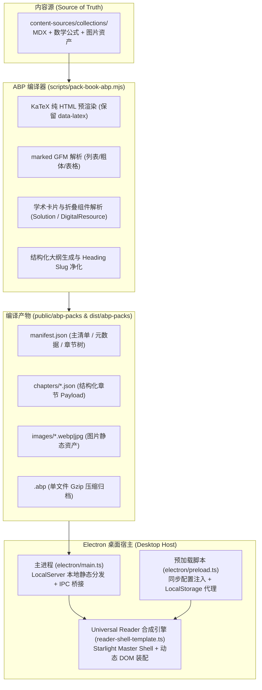

# Electron 桌面端与 ABP 离线分发系统交接文档

本文档全面阐述 AstroLib 桌面端（Electron）的核心架构、框架与内容解耦设计、AstroBook Package（ABP）预编译标准、Universal Reader 动态页面合成引擎、状态持久化机制以及全套构建打包流水线，为后续维护与功能迭代的 AI Agent 提供权威指引。

---

## 1. 架构总览与核心设计哲学

### 1.1 "框架与内容彻底解耦"（Zero-Builtin Books Architecture）
在早期版本中，AstroLib 的所有教材章节均以静态 MDX 形式硬编码在 `src/content/docs/collections/` 下，由 Astro 在构建期全量预渲染。随着收录图书与章节规模扩大（12+ 本教材、数千章节、海量高精度 KaTeX 公式），全量静态构建时间显著膨胀，且桌面端与 Web 端无法独立热更新教材内容。

为此，系统重构并落地了**框架与内容彻底解耦架构**：
- **宿主壳工程（Shell Engine）**：基于 Astro 7 + Starlight + Electron 45 打造，仅维护底座框架、Material You UI 样式库、Sideload Dock 状态机、多书树状目录以及 Universal Reader 基础模板（`dist/reader-shell/index.html`）。工程中零硬编码图书内容。
- **内容源（Content Sources）**：书籍源码与切片独立托管于 `content-sources/collections/`。
- **离线标准化内容包（AstroBook Package / ABP）**：通过离线编译器将书籍预编译为符合 ABP Schema 1.0.0 的结构化资产包，支持单文件归档（`.abp`）与流式离散目录（`abp-packs/{colSlug}-{bookSlug}/`）。
- **动态分发与本地直供（LocalServer）**：桌面端主进程内置极轻量本地 HTTP 静态服务器（`LocalServer`），为渲染进程提供流式 JSON/WebP 分发，规避 `file://` 协议跨域限制与安全沙箱限制。



---

## 2. AstroBook Package (ABP) 规范与数据结构

### 2.1 契约定义 (`src/types/content-package.ts`)
内容包严格遵守 `ABP_SCHEMA_VERSION = '1.0.0'` 规范：

```typescript
// 书籍主清单 (manifest.json)
export interface AstroBookManifest {
  schemaVersion: '1.0.0';
  id: string;               // 唯一包标识，例如 'math-linear_algebra_geometry'
  slug: string;             // 图书 slug，例如 'linear_algebra_geometry'
  colSlug: string;          // 合集 slug，例如 'math', 'physics', 'cs'
  title: string;            // 书籍全名
  author?: string;          // 著者信息
  publisher?: string;       // 出版社
  entryPoint: string;       // 默认入口章节 slug
  modules?: Record<string, ModuleItemConfig>; // 卡片类型缩写映射 ('定理' -> '理')
  sections: AstroBookSection[];               // 目录层级树
  totalChapters: number;    // 章节总数
  contentHash: string;      // 内容散列校验值
  assets?: string[];        // 包含的相对资产路径列表
}

// 章节详细负荷 (chapters/{chapterSlug}.json)
export interface AstroBookChapterPayload {
  schemaVersion: '1.0.0';
  bookId: string;
  bookSlug: string;
  colSlug: string;
  chapterSlug: string;
  title: string;
  html: string;             // 预编译完成的纯净语义 HTML (KaTeX + Card DOM)
  headings: ChapterHeadingItem[]; // 本节大纲
  crossRefs?: Record<string, any>;
  notices?: NoticeConfig[];
  updatedAt: string;
}
```

### 2.2 离线编译流水线 (`scripts/pack-book-abp.mjs`)
编译器对输入 MDX 执行严格的转换：
1. **数学公式保护与渲染**：
   - 块级公式 `$$...$$` 与行内公式 `$...$` 由 KaTeX 预渲染为纯 HTML（`output: 'html'`），并将原始 LaTeX 源码回填至 `data-latex` 属性，供读者双击复制源码；
   - 提取标题内公式时，净化公式占位符，生成纯净无乱码的 `id`（例如 `id="2-7-1-k-阶矩"`），杜绝带有特殊引号和转义符的异常。
2. **正文 Markdown 完整编译**：
   - 使用 `marked.parse(..., { gfm: true, breaks: true })`，保证无序列表、有序列表、加粗、斜体等语法被 100% 编译为合法 HTML，严禁裸露 `- **...**` 语法文本。
3. **填空题与占位符单趟归一化**：
   - 将连续下划线（`\_\_\_\_` 或 `____`）经单趟正则转换为标准 `<span class="fill-in-blank">&nbsp;&nbsp;&nbsp;&nbsp;&nbsp;&nbsp;</span>`，消除双反斜杠与嵌套下划线缺陷。
4. **学术卡片与折叠组件转换**：
   - `<Solution title="...">` $\rightarrow$ 标准 HTML5 `<details class="solution-details toc-chunk" data-title="...">`，并在内容末尾输出学术墓碑符 `∎`；
   - `<DigitalResource>` / `<QRCodeVideo>` $\rightarrow$ 标准 `.academic-digital-resource` 流式卡片，支持微课视频、教学课件与动态演示分类标识及一键复制链接。

---

## 3. Universal Reader 动态页面合成引擎

动态合成引擎位于 [`src/services/content-provider/reader-shell-template.ts`](file:///d:/Antigravity/project/AstroLib/src/services/content-provider/reader-shell-template.ts)。它将轻量 ABP 章节有效负载（Payload）与经过 Vite 编译打包的 Starlight Master Shell（`dist/reader-shell/index.html`）无缝合成。

### 3.1 核心合成环节
1. **左侧导航树装配**：
   - 扫描书库目录清单（`catalog.json`），渲染支持多合集（`cs`, `math`, `science`, `telecom`）、全书目展开/折叠、章节高亮选中的树状导航抽屉。
2. **右侧 Sideload 大纲与模块重构 (`buildStructuredTocHtml`)**：
   - 解析正文中的 `h2/h3` 标题与学术卡片（`.toc-chunk`）；
   - 根据图书配置 `manifest.modules` 自动提取卡片类别 Chip（如 `[引] Lemma`, `[习] 习题 4.2.1`, `[理]`, `[定]`, `[例]`）；
   - 生成带折叠按钮（`.toc-collapse-btn`）的手风琴大纲组（`.toc-group`），并实现平滑锚点滚动（`scrollIntoView({ behavior: 'smooth' })`）。
3. **顶部元数据 Chips 与快捷入口**：
   - 注入包含著者、出版社、书名、学科分类的 Google Material 3 辅助芯片（`<md-assist-chip>`）；
   - 注入双语助读入口（`Alt+Y`）与关注点透镜入口（`Alt+I`）。
4. **去噪与纯净度保证**：
   - 强行剔除历史残留的 `[网站地图](.../sitemap/)` 底部标签；
   - 仅当章节清单显式声明含有 MinerU/OCR 来源时才挂载提示条，避免无害章节误报。

---

## 4. 桌面宿主交互与状态持久化架构

### 4.1 预加载与配置防闪烁同步 (`electron/preload.ts`)
桌面端通过 Preload 脚本在 DOM 构造第一帧之前向主进程发起同步查询：
```typescript
// 1. 同步获取持久化配置，在 DOM 解析前写入全局变量与 localStorage
const initialSettings = ipcRenderer.sendSync('astrolib:get-settings-sync');
```
在 `document.documentElement` 首部注入自执行脚本，直接初始化 `localStorage` 并重写 `localStorage.setItem` 与 `removeItem`，将任何前端设置项（主题色、字体预设、空两格排版等）自动双向同步至用户数据目录的 `settings.json`。

### 4.2 排版与字体默认准则
- **默认中文字体**：统一初始化为**思源黑体**（`--font-cjk: var(--font-cjk-han-sans)`）。
- **默认学术段落缩进**：正文段落默认开启**首行缩进两字**（`text-indent: 2em`）。
- **排版负空间保护**：对卡片标题（`.card-header`）、折叠题解摘要（`.solution-details summary`）、独立块级公式（`:has(> .katex-display:only-child)`）与单图段落强制施加 `text-indent: 0 !important`，确保数学美感。

### 4.3 窗口三键安全避让
由于桌面端采用原生无边框窗口（Frameless Window）以融合 Material You 顶部通栏，Windows 系统自带的最小化、最大化、关闭按钮会悬浮于顶栏右上方。
- **强制样式规则**：在 `src/styles/custom.css` 中为 `.vp-nav-actions` 与 `.vp-right-group` 赋予 `padding-right: 140px !important;`。
- **严禁擅自缩减该间距**，否则会导致暗黑切换、设置齿轮等操作图标被系统窗口按钮遮挡而无法点击。

### 4.4 关注点透镜（Info Lens / Alt+I）侧载集成
- 透镜侧载面板由 `.astrolib-sideload-dock` 统一托管（`data-panel-id="focus"`）。
- 全局单例 `sideloadManager` 同时挂载至 `window.__sideloadManager` 与 `window.sideloadManager`，确保外部脚本无缝调用 `sideloadManager.toggle('focus')`。

---

## 5. 常用自动化命令与构建流水线

### 5.1 编译全部图书内容包（ABP）
当教材 MDX 源码或图片发生修改时，必须重新生成 ABP 数据包：
```bash
# 编译全站 12 本教材为标准 ABP 包 (写入 public/abp-packs 与 dist/abp-packs)
node scripts/pack-book-abp.mjs --all

# 编译指定单本书籍
node scripts/pack-book-abp.mjs content-sources/collections/math/linear_algebra_geometry
```

### 5.2 启动桌面端调试模式
```bash
npm run electron:dev
```
该命令会自动编译 Electron 主进程与预加载脚本（`dist-electron/`），并启动 Electron 加载本地本地服务。

### 5.3 编译可直接运行的绿色免安装版（win-unpacked）
```bash
# 1. 严格全量类型检查
npm run check:types

# 2. 运行 Astro 生产构建 (生成 dist/reader-shell/index.html 与 CSS 资产)
npm run build

# 3. 编译 Electron 主进程与预加载脚本
npm run electron:build:scripts

# 4. 生成 release/win-unpacked/ 绿色免安装目录
npx electron-builder --dir
```
构建成功后，直接运行可执行程序：
```text
release/win-unpacked/AstroLib.exe
```

### 5.4 打包完整 NSIS 安装包与便携版单文件
```bash
npm run electron:build
```
产物将输出至 `release/AstroLib Setup 0.0.1.exe` 与 `release/AstroLib 0.0.1.exe` (Portable)。

---

## 6. 后续 Agent 工作规约与禁忌（Invariants）

后续参与桌面端维护或功能扩展的 Agent 必须严格遵守以下准则：

1. **严禁破坏“框架与内容解耦”原则**：
   - 严禁将大批量教材 MDX 直接丢回 `src/content/docs/collections/` 让 Astro 在静态构建阶段预编译全站。
   - 新教材或修改后的教材必须放置于 `content-sources/collections/`，并通过 `node scripts/pack-book-abp.mjs` 编译为 ABP 包。
2. **严禁在 reader-shell-template.ts 中手写破坏性 HTML 结构**：
   - 必须保持 Starlight Master Shell 的 DOM 完整性（保持 `@material/web` 组件与相关 Web Components 的注册）；
   - 大纲提取必须保证 `id` 属性净化，严禁将未转义的双引号注入 HTML 属性中。
3. **本地缓存与更新同步防坑**：
   - 用户实际运行的应用会从操作系统数据目录（`%APPDATA%/AstroLib/abp-packs/`）读取已解压的书籍；
   - 若修改了编译器逻辑并重新打包了图书，若本地未见生效，应检查并清理 `%APPDATA%/AstroLib/.cache/` 与对应图书目录，或在 `electron/main.ts` 中依托 `manifest.contentHash` 触发自动同步覆盖。
4. **质量门禁必跑**：
   - 任何提交前必须确保 `npm run check:types` 保持 **0 TS Errors**；
   - 必须确保 `tests/unit/content-provider.test.ts` 与 `tests/acceptance/abp-dynamic-serving.test.ts` 全部通过。
